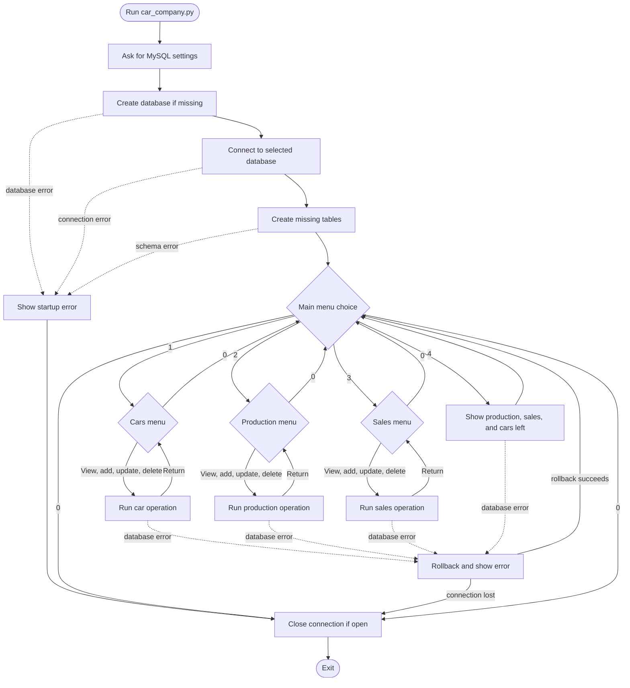

# Programming Guide

This guide explains the ideas and functions used by the Car Company Database program. It is written for a beginner and follows the program's actual design. The program stores records in MySQL; it does not save car data in a local project file.

**Project documents:** [README](README.md) · [CBSE project report](project_report.md)

## Contents

1. [Python](#python)
2. [SQL and MySQL](#sql-and-mysql)
3. [System Requirements](#system-requirements)
4. [Python and MySQL Connector](#python-and-mysql-connector)
5. [Database Tables](#database-tables)
6. [Program Functions](#program-functions)
7. [Imported Modules and Functions](#imported-modules-and-functions)
8. [Useful Built-in Functions and Methods](#useful-built-in-functions-and-methods)
9. [Test Helpers](#test-helpers)
10. [Reading the Code](#reading-the-code)
11. [Program Flow](#program-flow)
12. [Further Reading](#further-reading)

## Python

Python is a high-level, general-purpose programming language. It is designed to make program instructions readable. Python is interpreted: a Python interpreter reads and runs the program, so the programmer does not normally compile this project into a separate executable first.

### Salient features

- **Readable syntax:** indentation marks code blocks, and many operations use short, descriptive words.
- **Dynamically typed:** variables do not need a declared type, although values still have types such as string, integer, or decimal.
- **High-level:** the language handles many low-level details such as memory management.
- **Large standard library:** common tasks such as dates, terminal I/O, text handling, and tests are available without extra packages.
- **Cross-platform:** the same Python source can run on Windows, macOS, and Linux when compatible Python and packages are installed.
- **Extensible:** third-party packages can add capabilities, as MySQL Connector/Python does here.

### Applications

Python is used for automation and scripting, websites and web services, data analysis, scientific computing, education, testing, and database applications. This project uses it for a terminal interface, input checking, SQL execution, and error handling.

## SQL and MySQL

**SQL** means Structured Query Language. It is a language for defining and working with data in relational databases. The project uses SQL statements to create tables, insert and read records, update and delete records, join related rows, and calculate totals.

**MySQL** is a relational database management system (RDBMS). It runs as a database server, stores data in tables, and accepts SQL statements from client programs. In this project, Python is the client and MySQL Server stores the persistent car, production, and sales records.

### Salient features of MySQL

- Stores structured data in tables made of columns and rows.
- Uses primary keys to identify rows and foreign keys to maintain relationships.
- Supports multiple clients connecting to a server.
- Provides transactions, so successful changes can be committed and failed work can be rolled back.
- Supports SQL queries, indexes, constraints, and grouped calculations.
- Keeps data after the Python program exits; records are not held only in the program's memory.

### Applications

MySQL is commonly used for websites, business information systems, inventory, customer records, reporting, and other applications that need shared, persistent relational data. This school project uses it to demonstrate tables, keys, CRUD operations, joins, and aggregate totals.

### SQL ideas used here

- `CREATE DATABASE` creates the selected database.
- `CREATE TABLE` defines a table and its columns.
- `PRIMARY KEY` uniquely identifies each row.
- `AUTO_INCREMENT` asks MySQL to generate the next integer ID.
- `NOT NULL` requires a value.
- `UNIQUE` prevents duplicate model names.
- `FOREIGN KEY` requires a related car to exist.
- `INSERT`, `SELECT`, `UPDATE`, and `DELETE` add, read, change, and remove rows.
- `WHERE` limits which row an update or delete affects.
- `JOIN` combines related rows from two tables.
- `SUM` adds quantities, and `GROUP BY` calculates one sum per car.

A MySQL-specific part of this project is `AUTO_INCREMENT`. The connector's `%s` placeholders are also driver syntax for safely supplying values; they are not Python string interpolation.

## System Requirements

### Required software

- **Python:** The source uses Python 3.8 or newer syntax. Choose a MySQL Connector/Python release that supports your installed Python version; connector releases can have different minimum versions.
- **MySQL Server:** MySQL 8.0 or a compatible MySQL server, installed locally or reachable over a network.
- **Python package:** `mysql-connector-python`, installed from `requirements.txt`.
- **Terminal:** Windows Terminal/PowerShell, Command Prompt, macOS Terminal, or a Linux terminal.

The program uses only the Python standard library in addition to `mysql-connector-python`. `unittest` is part of Python and is not installed from `requirements.txt`.

### Required access and resources

- A MySQL account that can create the selected database and create tables in it. The program creates the database and tables when missing.
- A keyboard and terminal to use the menu.
- Internet access is needed to download the project or install the connector, but not for normal use when the project and MySQL server are available locally.
- Enough disk space for Python, MySQL Server if installed locally, and the database records. The project itself is small.

No specific processor, memory size, display resolution, or terminal-window dimensions are required for this small text-based program.

### Install and run

From the project directory, install the one external dependency and start the application:

```sh
python -m pip install -r requirements.txt
python car_company.py
```

On systems where the Python 3 command is named `python3`, use `python3` in both commands. The database server must be running and reachable before starting the app. The download instructions are in [README.md](README.md#download-to-desktop).

## Python and MySQL Connector

MySQL Connector/Python is the driver that lets a Python program communicate with a MySQL Server. Install it with:

```sh
python -m pip install mysql-connector-python
```

This project keeps that dependency in `requirements.txt` so the full project setup is repeatable:

```sh
python -m pip install -r requirements.txt
```

### Connection sequence in this program

1. `connect_to_database()` asks for the server host, username, password, and database name.
2. It validates the database name because it must be inserted into a SQL statement as an identifier.
3. `mysql.connector.connect(**settings)` opens a connection to the server without selecting a database.
4. A cursor runs `CREATE DATABASE IF NOT EXISTS` for the chosen name.
5. The first cursor and server connection are closed.
6. A second connection is opened with the selected database.
7. `create_tables()` creates missing tables, then calls `commit()`.
8. Operations create cursors, execute SQL, fetch results where needed, and close cursors. Changes are committed on success or rolled back after a connector error.
9. `main()` closes the database connection when the program exits.

The password is read with `getpass`, so normal terminal input does not echo it. The program does not save credentials to a local configuration file. Do not put a real password into source code or commit it to the repository.

### Parameterized values

For inserted, changed, and deleted values, the program uses `%s` placeholders and passes the values separately:

```python
cursor.execute(
    "INSERT INTO cars (model, price) VALUES (%s, %s)",
    (model, price),
)
```

This is safer and more reliable than building a SQL command by joining user text into it. SQL table and column names cannot be supplied as ordinary value placeholders; the program uses fixed table/column names from its `RECORDS` dictionary for those queries.

## Database Tables

The program creates three tables. The `cars` table is the parent. Each production or sales row belongs to one car through `car_id`.

```text
cars (one) ------ (many) production
cars (one) ------ (many) sales
```

The following is the standard tabular layout returned by MySQL's `DESCRIBE` command for the definitions in `create_tables()`. `Default` cells with no displayed value are blank. MySQL versions can format output differently, so run the commands below to see the exact output from your own server.

### `cars`

Command: `DESCRIBE cars;`

```text
+--------+---------------+------+-----+---------+----------------+
| Field  | Type          | Null | Key | Default | Extra          |
+--------+---------------+------+-----+---------+----------------+
| car_id | int           | NO   | PRI | NULL    | auto_increment |
| model  | varchar(50)   | NO   | UNI | NULL    |                |
| price  | decimal(10,2) | NO   |     | NULL    |                |
+--------+---------------+------+-----+---------+----------------+
```

- `car_id` is the primary key and is generated by MySQL.
- `model` is required and unique, so two cars cannot have the same model name.
- `price` is required and stores up to eight digits before and two digits after the decimal point.

### `production`

Command: `DESCRIBE production;`

```text
+-----------------+------+------+-----+---------+----------------+
| Field           | Type | Null | Key | Default | Extra          |
+-----------------+------+------+-----+---------+----------------+
| production_id   | int  | NO   | PRI | NULL    | auto_increment |
| car_id          | int  | NO   | MUL | NULL    |                |
| production_date | date | NO   |     | NULL    |                |
| quantity        | int  | NO   |     | NULL    |                |
+-----------------+------+------+-----+---------+----------------+
```

- `production_id` is the generated primary key for a production entry.
- `car_id` is a foreign key to `cars.car_id`. MySQL commonly displays its index as `MUL` because multiple production rows can refer to the same car.
- `production_date` stores the date of the entry.
- `quantity` stores the number made in this entry.

### `sales`

Command: `DESCRIBE sales;`

```text
+-----------+------+------+-----+---------+----------------+
| Field     | Type | Null | Key | Default | Extra          |
+-----------+------+------+-----+---------+----------------+
| sale_id   | int  | NO   | PRI | NULL    | auto_increment |
| car_id    | int  | NO   | MUL | NULL    |                |
| sale_date | date | NO   |     | NULL    |                |
| quantity  | int  | NO   |     | NULL    |                |
+-----------+------+------+-----+---------+----------------+
```

- `sale_id` is the generated primary key for a sales entry.
- `car_id` is a foreign key to `cars.car_id`.
- `sale_date` stores the date of the entry.
- `quantity` stores the number sold in this entry.

### Check the live table descriptions

After connecting to MySQL and selecting the project database, run:

```sql
USE car_company;
DESCRIBE cars;
DESCRIBE production;
DESCRIBE sales;
```

The foreign keys prevent inserting production or sales for a car that does not exist. They also prevent deleting a car while related rows remain. Delete the related rows first if removing that car is intended.

## Program Functions

These are the functions defined in `car_company.py`, grouped by what the program does.

### How the Python file is organized

- [Module description](car_company.py#L1) states the program's purpose, dependencies, and startup behavior.
- [Imports](car_company.py#L21) bring in date and decimal handling, password input, operating-system and terminal helpers, text formatting, and the MySQL connector. Only `mysql-connector-python` is an external package.
- [`DATABASE_DEFAULT` and `RECORDS`](car_company.py#L33) hold shared configuration. `RECORDS` maps the two supported record types to their ID column, date column, and display name. SQL table and column names are selected from this fixed mapping rather than typed by the user.
- The remainder of the file is arranged into terminal helpers, database setup, input validation, car operations, production/sales operations, summary reporting, and menu flow.

### Important Python constructs

- **Tuples and unpacking:** [`RECORDS`](car_company.py#L35) stores each record type as a tuple. Functions unpack a tuple into named fields, for example `id_column, date_column, title = RECORDS[table]`. This keeps the production and sales workflows shared without duplicating whole functions.
- **Dictionaries:** `settings` in [`connect_to_database()`](car_company.py#L59) holds connection options by name. `produced` and `sold` in [`show_summary()`](car_company.py#L426) map car IDs to totals, allowing `.get(car_id, 0)` to provide a missing total as zero.
- **Generator expressions:** expressions such as `(car[0] for car in cars)` pass car IDs to [`read_existing_id()`](car_company.py#L165) without creating another list.
- **F-strings:** prompts, headings, and SQL statements use f-strings to insert values into text. In SQL, user data still goes through connector placeholders; only fixed identifiers selected from `RECORDS` are put into the SQL text.
- **`try`, `except`, and `finally`:** `try` contains an operation that may fail, `except` handles a known error, and `finally` runs cleanup such as closing a cursor regardless of success or failure.
- **The `__main__` guard:** the final [`if __name__ == "__main__"` block](car_company.py#L580) starts `main()` only when this file is run directly. Importing the module from tests defines its functions without opening the menu.

### Source-code map

These are sections of one Python file, not separate modules. Use the linked definition for the exact location of each function.

| Source section | Purpose |
| --- | --- |
| [Imports and shared settings](car_company.py#L21) | Dependencies, default database name, and production/sales configuration. |
| [Terminal helpers](car_company.py#L41) | Screen clearing, headings, and the pause prompt. |
| [Database setup](car_company.py#L59) | Connection prompts, database creation, and table definitions. |
| [Input validation](car_company.py#L124) | Integer, price, model, ID, and date checks. |
| [Car operations](car_company.py#L199) | Select, display, add, update, and delete cars. |
| [Production and sales operations](car_company.py#L299) | Joined record display and shared record CRUD. |
| [Summary report](car_company.py#L414) | Group totals and the cars-left calculation. |
| [Menu and startup flow](car_company.py#L462) | Section menus, main menu, cleanup, and direct execution. |

### Data passed between functions

The MySQL connector returns rows as tuples. A car row has the shape `(car_id, model, price)`, and a production or sales row has the shape `(record_id, car_id, model, date, quantity)`. Functions unpack these tuples into names so each printed field is clear. The menu functions pass the database `connection` to the operation functions; the connection is shared for the whole run, while each query creates and closes its own cursor.

### Terminal and connection

- **[`clear_screen()`](car_company.py#L41)** checks `stdin` and `stdout` with `isatty()`. It runs `cls` on Windows or `clear` elsewhere only for an interactive terminal; redirected output is left untouched.
- **[`print_heading(title)`](car_company.py#L47)** calculates a divider from the title length and prints the title between divider lines.
- **[`pause_for_menu()`](car_company.py#L53)** waits for Enter after an action so its output is not immediately replaced by the next menu.
- **[`connect_to_database()`](car_company.py#L59)** asks for host, user, password, and database. It accepts the documented defaults, validates the database identifier against letters, digits, and underscores, opens a server connection to create the database if needed, closes that temporary connection, then returns a connection scoped to the chosen database. The MySQL account therefore needs database/table creation permission.
- **[`create_tables(connection)`](car_company.py#L87)** issues three `CREATE TABLE IF NOT EXISTS` statements, adds the primary-key, uniqueness, and foreign-key rules, calls `commit()` after the statements, and closes its cursor even if an error occurs. MySQL implicitly commits DDL such as `CREATE TABLE`; this is not the same rollback behavior as ordinary row changes.

The schema is described field-by-field in [Database Tables](#database-tables). The `cars` table is created first because `production.car_id` and `sales.car_id` refer to its primary key.

### Input checking and errors

- **[`read_positive_integer(message)`](car_company.py#L124)** loops until the input converts to an integer greater than zero and no larger than the signed MySQL `INT` maximum. Invalid text and out-of-range values receive the same prompt again.
- **[`read_price(message)`](car_company.py#L136)** parses input with `Decimal`, rejects non-finite and non-positive values, checks the maximum `DECIMAL(10,2)` value, and rejects more than two fractional digits.
- **[`read_model(message)`](car_company.py#L156)** trims surrounding whitespace and accepts only names from 1 to 50 characters, matching `VARCHAR(50)`.
- **[`read_existing_id(message, valid_ids)`](car_company.py#L165)** converts the displayed IDs to strings and accepts only an exact listed value. This prevents selecting an ID that was not offered in the current list.
- **[`read_date(message, default_today=False)`](car_company.py#L175)** parses an ISO `YYYY-MM-DD` date, checks that formatting is exact, and rejects dates earlier than MySQL's `1000-01-01` minimum. For new entries, `default_today=True` makes an empty response use today's date.
- **[`show_error_details(error)`](car_company.py#L191)** converts an exception to text, detects the terminal width with an 80-column fallback, and wraps the message for display.
- **[`confirm_delete()`](car_company.py#L266)** normalizes the response to lowercase, repeats until the user enters `y` or `n`, and returns a Boolean confirmation.

### Car operations

- **[`fetch_cars(connection)`](car_company.py#L199)** runs the ordered `SELECT` for `car_id`, `model`, and `price`, returns all fetched rows, and closes the cursor in `finally`.
- **[`show_cars(connection)`](car_company.py#L209)** prints a heading and either an empty-state message or each returned car. It also returns the rows so callers can restrict ID input to visible cars.
- **[`add_car(connection)`](car_company.py#L221)** collects validated model and price values, inserts them with `%s` placeholders, and commits. A connector error triggers rollback and an explanatory message; the cursor is always closed.
- **[`update_car(connection)`](car_company.py#L241)** displays cars, validates the selected car ID, gathers replacement values, and updates the row selected by its primary key. It checks `rowcount` to distinguish a changed row from no match.
- **[`delete_car(connection)`](car_company.py#L275)** displays cars, validates the ID, asks for confirmation, then deletes by primary key. A foreign-key error prevents removal if production or sales rows still refer to the car.

The car operations do not manually generate IDs. MySQL's `AUTO_INCREMENT` supplies them. A model duplicate is rejected by the database's `UNIQUE` rule, and the operation catches the connector error, rolls back, and displays its details.

### Production and sales operations

- **[`show_records(connection, table)`](car_company.py#L299)** uses the selected fixed `RECORDS` entry to choose table/column names, joins records to `cars` for readable model names, orders by record ID, prints the rows, and returns them for later ID validation.
- **[`add_record(connection, table)`](car_company.py#L326)** requires at least one car, accepts only a displayed car ID, reads a valid date and quantity, and inserts the row into production or sales. User values are bound separately from the SQL text.
- **[`update_record(connection, table)`](car_company.py#L354)** requires an existing record, validates both the record ID and replacement car ID, gathers date and quantity, then updates the selected record. All editable fields are replaced together.
- **[`delete_record(connection, table)`](car_company.py#L387)** requires an existing record and explicit confirmation before deleting by its record ID.
- **[`get_totals(connection, table)`](car_company.py#L414)** runs `SUM(quantity)` with `GROUP BY car_id` and converts the returned `(car_id, total)` pairs into a dictionary for quick lookups.

The `table` argument to these shared operations must be one of the fixed `RECORDS` keys; it is not free-form user input. This is important because table and column names are interpolated into the SQL statement, while actual user values use placeholders.

This is the program's CRUD pattern: create with `INSERT`, read with `SELECT`, edit with `UPDATE`, and remove with `DELETE`. Updates and deletes include a `WHERE` condition on the chosen record's primary-key ID so they affect only the selected row.

### Summary and application flow

- **[`show_summary(connection)`](car_company.py#L426)** loads cars and production/sales totals independently, substitutes zero for a missing total, calculates `produced - sold`, and aligns the output columns. Long labels are shortened for display only; negative totals remain visible.
- **[`manage_cars(connection)`](car_company.py#L462)** redraws the car menu, maps choices 1-4 to view/add/update/delete, pauses after an action, and returns to the main menu on 0.
- **[`manage_records(connection, table)`](car_company.py#L486)** uses the selected record type's display name, handles the same CRUD choices for production or sales, and returns on 0.
- **[`main()`](car_company.py#L508)** connects and initializes tables, displays the main menu, routes choices to the correct manager or summary, handles connector and keyboard/EOF errors, rolls back a failed menu operation, and closes the connection in `finally`.

`main()` has two error-handling phases. During startup it catches connection, schema, and user-interruption errors before entering the menu. During normal menu use it catches connector errors, attempts a rollback, and returns to the menu if the connection is still usable. The outer `finally` closes an open connection on normal exit or interruption.

### Tests for the code paths

The test module is [tests/test_car_company.py](tests/test_car_company.py). Its [`InputValidationTests`](tests/test_car_company.py#L57) check integer limits, decimal precision, date format/range, and listed IDs. [`DeleteConfirmationTests`](tests/test_car_company.py#L79) confirm invalid answers are rejected and both `n` and `y` work. [`SummaryTests`](tests/test_car_company.py#L89) cover normal, missing, and negative totals, long labels, large totals, and Windows/Unix/redirected screen clearing. [`StartupCleanupTests`](tests/test_car_company.py#L198) confirm the connection is closed if startup is interrupted. These tests use fake cursors and do not replace a live MySQL smoke test.

## Imported Modules and Functions

This section explains every imported module and imported API used by `car_company.py`.

| Import | Use in this program |
| --- | --- |
| [`datetime.date`](car_company.py#L21) | Creates and validates calendar dates; `today()`, `fromisoformat()`, and `isoformat()` are used. |
| [`decimal.Decimal`](car_company.py#L22) | Parses and compares prices without binary floating-point rounding. |
| [`decimal.InvalidOperation`](car_company.py#L22) | Exception caught when price text is not a valid decimal. |
| [`getpass.getpass`](car_company.py#L23) | Reads the MySQL password without echoing the typed characters. |
| [`os.name`](car_company.py#L24) | Identifies the operating system (`nt` for Windows). |
| [`os.system(command)`](car_company.py#L24) | Runs the terminal clear command (`cls` or `clear`). |
| [`re.fullmatch(pattern, text)`](car_company.py#L25) | Checks that the complete database name contains only allowed letters, digits, or underscores. |
| [`shutil.get_terminal_size(fallback)`](car_company.py#L26) | Gets terminal width for formatting database error messages; uses the fallback if size detection fails. |
| [`sys.stdin` and `sys.stdout`](car_company.py#L27) | Refer to standard input and output; their `isatty()` methods identify interactive terminals. |
| [`textwrap.fill(text, width)`](car_company.py#L28) | Wraps long error text to a selected width. |
| [`mysql.connector.connect(**settings)`](car_company.py#L30) | Opens a MySQL connection using the supplied host, user, password, and optional database. |
| [`mysql.connector.Error`](car_company.py#L31) | Base exception used to catch connector and database errors. |

`Decimal.is_finite()` and `Decimal.as_tuple()` are methods of the decimal value, not separately imported functions. They are used to reject non-finite prices and excess decimal places.

## Useful Built-in Functions and Methods

These functions are part of Python itself, so they do not appear in `requirements.txt`.

| Function or method | Purpose here |
| --- | --- |
| `input(prompt)` | Displays a prompt and reads a line from the terminal. |
| `print(value)` | Displays menu text, results, and error messages. |
| `int(text)` | Converts validated integer input to an integer value. |
| `str(value)` | Converts IDs to text for comparison with terminal input. |
| `len(value)` | Checks model-name length and sizes heading dividers. |
| `max(a, b)` | Keeps error wrapping at a minimum width. |
| `dict(rows)` | Builds the car-ID-to-total mapping returned by `get_totals()`. |
| `text.strip()` | Removes whitespace around typed values. |
| `text.lower()` | Normalizes a yes/no answer to lowercase. |
| `try` / `except` / `finally` | Handles invalid input and database errors while ensuring cursors are closed. |

MySQL Connector/Python also supplies the following objects and methods used in the code: `connection.cursor()` creates a cursor; `cursor.execute()` sends SQL to the server; `cursor.fetchall()` returns query rows; `cursor.rowcount` reports affected rows for updates and deletes; `connection.commit()` saves a transaction; `connection.rollback()` cancels the current transaction; `cursor.close()` and `connection.close()` release resources; and `connection.is_connected()` checks whether the connection is still open.

### Test helpers

The automated tests use only Python's standard library in addition to the application:

| Import or API | Use in `tests/test_car_company.py` |
| --- | --- |
| `contextlib.redirect_stdout(stream)` | Captures printed output so tests can check the summary and messages. |
| `decimal.Decimal` | Supplies a precise example price to the fake database cursor. |
| `io.StringIO()` | Acts as an in-memory stream for captured output and fake terminal input/output. |
| `unittest.TestCase` | Provides test methods and assertion functions. |
| `unittest.main()` | Runs the tests when the test file is launched directly. |
| `unittest.mock.patch()` | Temporarily replaces input, terminal streams, and database functions during a test. |
| `car_company` | Imports the functions under test; the import does not start the menu because application startup is protected by the `__main__` check. |

The test fixtures' `execute()`, `fetchall()`, and `close()` methods imitate the small part of a MySQL cursor used by summary tests. They do not connect to a real database.

- [`FakeCursor`](tests/test_car_company.py#L12) returns configured sample rows for the cars and aggregate queries.
- [`FakeConnection`](tests/test_car_company.py#L35) creates those fake cursors and passes through production and sales totals.
- [`FakeStartupConnection`](tests/test_car_company.py#L44) records whether startup cleanup closed a connection.
- [`FakeTerminal`](tests/test_car_company.py#L52) behaves like an interactive terminal for screen-clear tests.

The test cases are grouped by behavior: [`InputValidationTests`](tests/test_car_company.py#L57), [`DeleteConfirmationTests`](tests/test_car_company.py#L79), [`SummaryTests`](tests/test_car_company.py#L89), and [`StartupCleanupTests`](tests/test_car_company.py#L198). Run them with `python -m unittest discover -s tests` from the project directory.

## Program Flow

This diagram follows the path through [`main()`](car_company.py#L508). A
section-menu action returns to that section's menu; choosing `0` returns to the
main menu. Database operation errors are rolled back before the program
continues or exits.



1. `main()` opens a MySQL connection and creates any missing tables.
2. The main menu routes to car management, production management, sales management, the summary, or exit.
3. Input helper functions validate values before database operations.
4. SQL statements run through connector cursors; values use `%s` placeholders.
5. Successful data changes are committed. Connector errors trigger rollback and a readable error message.
6. The summary adds production totals and sales totals separately, then computes `Cars left = Produced - Sold` for each car.
7. On exit, `main()` closes the database connection.

## Reading the Code

### One database operation, step by step

[`add_car()`](car_company.py#L221) is a compact example of the program's usual database pattern:

1. Call [`read_model()`](car_company.py#L156) and [`read_price()`](car_company.py#L136) so values match the table's column rules.
2. Create a cursor with `connection.cursor()`. A cursor sends SQL and reads query results for one connection.
3. Call `cursor.execute(sql, values)`. The SQL contains `%s` markers and the values are passed as a tuple, keeping data separate from SQL syntax.
4. Call `connection.commit()` after success so MySQL saves the row change.
5. If the connector raises `Error`, call `connection.rollback()` and show an explanation so the failed data operation is not left pending.
6. Close the cursor in `finally`, which runs whether the operation succeeds or fails.

Read operations such as [`fetch_cars()`](car_company.py#L199) follow the same cursor/cleanup pattern but call `fetchall()` and do not commit because they do not change data. [`create_tables()`](car_company.py#L87) is different only in that it executes several schema statements before one commit.

MySQL treats many DDL statements, including `CREATE DATABASE` and `CREATE TABLE`, as implicit-commit operations. The program still calls `commit()` after creating tables, but a later rollback cannot undo a table that MySQL has already created. For normal `INSERT`, `UPDATE`, and `DELETE` operations, the explicit commit/rollback handling controls whether the row change is saved.

### How menu choices reach operations

[`main()`](car_company.py#L508) reads a choice and routes to the car manager, production manager, sales manager, summary, or exit. [`manage_cars()`](car_company.py#L462) uses a dictionary from menu numbers to functions, while [`manage_records()`](car_company.py#L486) uses a short `if`/`elif` chain for the shared production and sales actions. Both section menus clear the screen before drawing the next menu and pause after actions so the result remains visible. Option `0` returns to the previous menu; it does not delete data.

### Why the summary runs separate queries

[`get_totals()`](car_company.py#L414) runs a grouped total for one fixed table. [`show_summary()`](car_company.py#L426) calls it once for production and once for sales, then joins those results in Python by `car_id`. Keeping the two aggregates separate avoids multiplying rows if one car has several production entries and several sales entries. For each car, the displayed result is:

```text
Cars left = total produced - total sold
```

This is a simple arithmetic summary, not an inventory rule: sales are not blocked when they exceed production.

## Further Reading

- [Python documentation](https://docs.python.org/3/)
- [Python standard library](https://docs.python.org/3/library/)
- [MySQL Reference Manual](https://dev.mysql.com/doc/refman/8.0/en/)
- [MySQL Connector/Python Developer Guide](https://dev.mysql.com/doc/connector-python/en/)
- [Project README](README.md)
- [School project report](project_report.md)
