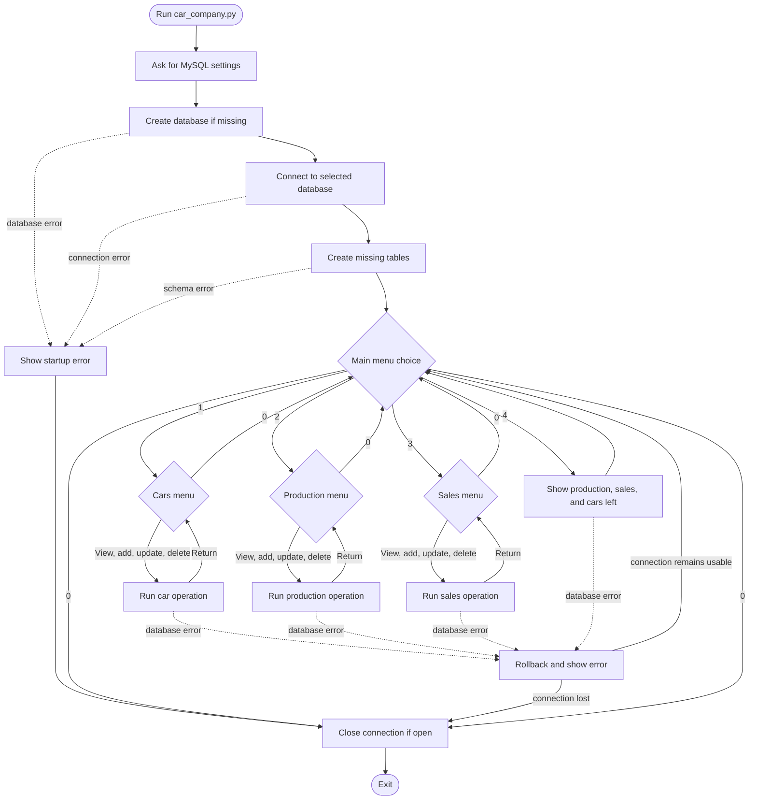

# Programming Guide

This guide explains how the Car Company Database works, from its MySQL tables
to the Python functions that read and change them. The program stores records
in MySQL rather than in a local project data file.

**Project documents:** [README](README.md) · [CBSE project report](project_report.md)

**Recommended reading path:** For a first read, follow **System Requirements →
Python and MySQL Connector → Database Tables → Application Architecture →
Program Flow → Three Design Choices → Detailed Script Walkthrough → Variable
Reference → Data Contracts → Relational Design Decisions → SQL Statement
Reference → SQL Concepts in Context → Validation → End-to-End Operations →
Reliability → Database State Scenarios → Testing Workflow → Debugging Playbook
→ Guided Extension Lab → Read-Only SQL Inspection Lab**. This path introduces
the stored data, follows the program's control flow, then explains the names,
constraints, queries, and checks used by the implementation. The function
catalog and glossary remain lookup chapters for specific behaviors and terms.

## Contents


### Background and setup

- [Python](#python)
- [SQL and MySQL](#sql-and-mysql)
- [System requirements](#system-requirements)
- [Python and MySQL Connector](#python-and-mysql-connector)

- [Database tables](#database-tables)

### Follow the application

- [Application architecture](#application-architecture)

- [Program flow](#program-flow)

- [Three design choices](#three-design-choices)

- [Detailed script walkthrough](#detailed-script-walkthrough)

### Look up details

- [Source-code map](#source-code-map)
- [Imported modules and functions](#imported-modules-and-functions)
- [Useful built-in functions and methods](#useful-built-in-functions-and-methods)
- [Python constructs in context](#python-constructs-in-context)
- [Test helpers](#test-helpers)

- [How to use source references](#how-to-use-the-source-references)
- [Function-by-function reference](#function-by-function-reference)
- [Complete function contracts](#complete-function-contracts)
- [Variable reference](#variable-reference)
- [Data contracts and query shapes](#data-contracts-and-query-shapes)
- [Relational design decisions](#relational-design-decisions)

- [SQL statement reference](#sql-statement-reference)
- [SQL concepts in context](#sql-concepts-in-context)
- [Validation and boundary reference](#validation-and-boundary-reference)
- [End-to-end operations](#end-to-end-operations)
- [Reliability, errors, and edge cases](#reliability-errors-and-edge-cases)

- [Database state scenarios](#database-state-scenarios)

- [Testing workflow](#testing-workflow)
- [Debugging playbook](#debugging-playbook)
- [Study exercises](#study-exercises)
- [How to extend the program](#how-to-extend-the-program)

- [Guided extension lab](#guided-extension-lab)
- [Read-only SQL inspection lab](#read-only-sql-inspection-lab)

- [Project glossary](#project-glossary)
- [Further reading](#further-reading)

## Python

Python is a high-level, general-purpose programming language. It is designed to make program instructions readable. Python is interpreted: a Python interpreter reads and runs the program, so the programmer does not normally compile this project into a separate executable first.

### Salient features


- **Readable syntax:** indentation marks code blocks, and many operations use short, descriptive words.
- **Dynamically typed:** variables do not need a declared type, although values still have types such as string, integer, or decimal.

- **High-level:** the language handles many low-level details such as memory management.

- **Large standard library:** common tasks such as dates, terminal I/O, text handling, and tests are available without extra packages.
- **Cross-platform:** the same Python source can run on Windows, macOS, and Linux when compatible Python and packages are installed.
- **Extensible:** third-party packages can add capabilities, as MySQL Connector/Python does here.

### Python in this project


The script uses Python to collect and validate terminal input, format results,
coordinate the menus, and call MySQL Connector/Python. Keeping those tasks in
separate functions makes the database behavior easier to read and test.

## SQL and MySQL


**SQL** means Structured Query Language. It is a language for defining and working with data in relational databases. The project uses SQL statements to create tables, insert and read records, update and delete records, join related rows, and calculate totals.

**MySQL** is a relational database management system (RDBMS). It runs as a database server, stores data in tables, and accepts SQL statements from client programs. In this project, Python is the client and MySQL Server stores the persistent car, production, and sales records.

### Salient features of MySQL

- Stores structured data in tables made of columns and rows.
- Uses primary keys to identify rows and foreign keys to maintain relationships.
- Supports multiple clients connecting to a server.
- Supports transactions; this application enables autocommit, so each successful data-changing statement is committed immediately.
- Supports SQL queries, indexes, constraints, and grouped calculations.
- Keeps data after the Python program exits; records are not held only in the program's memory.

### SQL ideas used here

- `CREATE DATABASE` creates the selected database.
- `CREATE TABLE` defines a table and its columns.
- `PRIMARY KEY` uniquely identifies each row.
- `AUTO_INCREMENT` asks MySQL to generate the next integer ID.
- `NOT NULL` requires a value.
- `UNIQUE` prevents duplicate model names.
- `FOREIGN KEY` requires a related car to exist.
- `INSERT`, `SELECT`, `UPDATE`, and `DELETE` add, read, change, and remove rows.
- `WHERE` limits which row an update or delete affects.
- `JOIN` combines related rows from two tables.
- `SUM` adds quantities, and `GROUP BY` calculates one sum per car.

A MySQL-specific part of this project is `AUTO_INCREMENT`. The connector's `%s` placeholders are also driver syntax for safely supplying values; they are not Python string interpolation.

## System Requirements

### Required software

- **Python:** The source uses Python 3.8 or newer syntax. Choose a MySQL Connector/Python release that supports your installed Python version; connector releases can have different minimum versions.
- **MySQL Server:** MySQL 8.0 or a compatible MySQL server, installed locally or reachable over a network.
- **Python package:** `mysql-connector-python`, installed from `requirements.txt`.
- **Terminal:** Windows Terminal/PowerShell, Command Prompt, macOS Terminal, or a Linux terminal.

The program uses only the Python standard library in addition to `mysql-connector-python`. `unittest` is part of Python and is not installed from `requirements.txt`.

### Required access and resources

- A MySQL account that can create the selected database and create tables in it. The program creates the database and tables when missing.
- A keyboard and terminal to use the menu.
- Internet access is needed to download the project or install the connector, but not for normal use when the project and MySQL server are available locally.
- Enough disk space for Python, MySQL Server if installed locally, and the database records. The project itself is small.

No specific processor, memory size, display resolution, or terminal-window dimensions are required for this small text-based program.

### Install and run

From the project directory, install the one external dependency and start the application:

```sh
python -m pip install -r requirements.txt
python car_company.py
```

On systems where the Python 3 command is named `python3`, use `python3` in both commands. The database server must be running and reachable before starting the app. The download instructions are in [README.md](README.md#download-to-desktop).

## Python and MySQL Connector

MySQL Connector/Python is the driver that lets a Python program communicate
with MySQL Server. It is the only external runtime dependency listed in
[`requirements.txt`](requirements.txt); use the [Install and run](#install-and-run)
instructions above rather than installing it a second time.

### Connection sequence in this program

1. `connect_to_database()` asks for the server host, username, password, and database name.
2. It validates the database name because it must be inserted into a SQL statement as an identifier.
3. `mysql.connector.connect(**settings)` opens a connection to the server without selecting a database.
4. A cursor runs `CREATE DATABASE IF NOT EXISTS` for the chosen name.
5. The first cursor and server connection are closed.
6. A second connection is opened with the selected database.
7. `create_tables()` creates missing tables and adds missing columns to older tables without deleting rows, then calls `commit()`.
8. Operations create cursors, execute SQL, fetch results where needed, and close cursors. The connection uses autocommit, so successful data-changing statements are committed immediately. The code still calls `commit()` after changes and attempts `rollback()` on errors, but rollback cannot undo a statement that has already been committed.
9. `main()` closes the database connection when the program exits.

The password is read with `getpass`, so normal terminal input does not echo it. The program does not save credentials to a local configuration file. Do not put a real password into source code or commit it to the repository.

### Parameterized values

For inserted, changed, and deleted values, the program uses `%s` placeholders and passes the values separately:

```python
cursor.execute(
    "INSERT INTO cars "
    "(model, price, manufacturer, model_year, color, is_electric) "
    "VALUES (%s, %s, %s, %s, %s, %s)",
    (model, price, manufacturer, model_year, color, is_electric),
)
```

This is safer and more reliable than building a SQL command by joining user text into it. SQL table and column names cannot be supplied as ordinary value placeholders; the program uses fixed table/column names from its `RECORDS` dictionary for those queries.

## Database Tables

The program creates three tables. The `cars` table is the parent. Each production or sales row belongs to one car through `car_id`. At startup, missing columns are added to older tables with defaults, so existing records are preserved.

```text
cars (one) ------ (many) production
cars (one) ------ (many) sales
```

The following is the standard tabular layout returned by MySQL's `DESCRIBE` command for the definitions in `create_tables()`. `Default` cells with no displayed value are blank. MySQL versions can format output differently, so run the commands below to see the exact output from your own server.

### `cars`

Command: `DESCRIBE cars;`

```text
+--------------+-----------------------+------+-----+---------+----------------+
| Field        | Type                  | Null | Key | Default | Extra          |
+--------------+-----------------------+------+-----+---------+----------------+
| car_id       | int                   | NO   | PRI | NULL    | auto_increment |
| model        | varchar(50)           | NO   | UNI | NULL    |                |
| price        | decimal(10,2)         | NO   |     | NULL    |                |
| manufacturer | varchar(50)           | NO   |     | Unknown |                |
| model_year   | smallint unsigned     | NO   |     | 2000    |                |
| color        | varchar(30)           | NO   |     | Unknown |                |
| is_electric  | tinyint(1)             | NO   |     | 0       |                |
+--------------+-----------------------+------+-----+---------+----------------+
```

- `car_id` is the primary key and is generated by MySQL.
- `model` is required and unique, so two cars cannot have the same model name.
- `price` is required and stores up to eight digits before and two digits after the decimal point.
- `manufacturer` and `color` are required text fields.
- `model_year` is stored as an unsigned small integer, and `is_electric` is stored as a Boolean.

### `production`

Command: `DESCRIBE production;`

```text
+-----------------+-------------------+------+-----+---------+----------------+
| Field           | Type              | Null | Key | Default | Extra          |
+-----------------+-------------------+------+-----+---------+----------------+
| production_id   | int               | NO   | PRI | NULL    | auto_increment |
| car_id          | int               | NO   | MUL | NULL    |                |
| production_date | date              | NO   |     | NULL    |                |
| quantity        | int               | NO   |     | NULL    |                |
| shift           | varchar(20)       | NO   |     | Day     |                |
| quality_checked | tinyint(1)        | NO   |     | 0       |                |
+-----------------+-------------------+------+-----+---------+----------------+
```

- `production_id` is the generated primary key for a production entry.
- `car_id` is a foreign key to `cars.car_id`. MySQL commonly displays its index as `MUL` because multiple production rows can refer to the same car.
- `production_date` stores the date of the entry.
- `quantity` stores the number made in this entry.
- `shift` records the production shift, and `quality_checked` records whether quality checks passed.

### `sales`

Command: `DESCRIBE sales;`

```text
+-----------------+------------------------+------+-----+---------+----------------+
| Field           | Type                   | Null | Key | Default | Extra          |
+-----------------+------------------------+------+-----+---------+----------------+
| sale_id         | int                    | NO   | PRI | NULL    | auto_increment |
| car_id          | int                    | NO   | MUL | NULL    |                |
| sale_date       | date                   | NO   |     | NULL    |                |
| quantity        | int                    | NO   |     | NULL    |                |
| sales_channel   | varchar(30)            | NO   |     | Other   |                |
| payment_method  | varchar(20)            | NO   |     | Other   |                |
| warranty_months | smallint unsigned      | NO   |     | 0       |                |
+-----------------+------------------------+------+-----+---------+----------------+
```

- `sale_id` is the generated primary key for a sales entry.
- `car_id` is a foreign key to `cars.car_id`.
- `sale_date` stores the date of the entry.
- `quantity` stores the number sold in this entry.
- `sales_channel` and `payment_method` store sale details; `warranty_months` stores the warranty length.

### Check the live table descriptions

After connecting to MySQL and selecting the project database, run:

```sql
USE car_company;
DESCRIBE cars;
DESCRIBE production;
DESCRIBE sales;
```

The foreign keys prevent inserting production or sales for a car that does not exist. They also prevent deleting a car while related rows remain. Delete the related rows first if removing that car is intended.

## Relational Design Decisions

The tables are organized around three kinds of facts: what car model is
managed, how many units were produced, and how many units were sold. The
`cars` table stores attributes that describe a model. `production` and
`sales` store dated events that can occur more than once for the same model.
Separating these facts keeps one car row from needing repeated columns such
as `production_date_1`, `production_date_2`, and so on.

### Why event rows are separate

A car model may be produced on many dates and sold through many transactions.
Each occurrence becomes a separate row in its event table. The relationship
is therefore one-to-many from `cars` to each event table:

| Parent row | Child rows | Example |
| --- | --- | --- |
| One row in `cars` | Zero or more rows in `production` | A car may be listed before production is recorded. |
| One row in `cars` | Zero or more rows in `sales` | A car may not yet have been sold. |
| One event row | Exactly one `car_id` reference | Each production or sale belongs to one car model. |

The child's `car_id` acts as a foreign key. The car name is not copied into
each event row: `show_records()` joins to `cars` when a readable model name is
needed. Avoiding duplicated names means a model rename is made once, not
repeated across historical events.

### Keys and constraints

Each table has a surrogate integer primary key. `AUTO_INCREMENT` assigns the
next key when a row is inserted, so the application does not ask users to
invent identifiers. Primary keys give updates and deletes a stable target
even if descriptive fields such as a model name change.

The unique constraint on `cars.model` states a project rule: within this
database, one model name identifies one car record. If two trims should be
kept separately but share a marketing name, the current schema has no
separate trim identifier; the user must choose distinct model labels. A
future schema could model manufacturer, model, and trim as separate entities
or use a composite business key, but that is beyond the current project.

The foreign keys encode a different rule: activity cannot refer to a car
that is absent, and a parent car cannot be removed while activity still
refers to it. No `ON DELETE CASCADE` is declared. This makes deletion
conservative and requires an explicit user decision about historical child
rows.

`NOT NULL` and SQL types provide a final structural boundary. They do not
replace friendly application prompts. The app can explain a permitted range
before it submits a value; the database ensures that a second client cannot
store a row that violates the schema.

### What the current model means

The schema stores `model` as unique car-level information but does not
normalize manufacturer into a separate table. That is a deliberate simplification:
this is a small educational database with a limited set of forms, not a
catalog service with manufacturer aliases, locations, suppliers, or product
variants.

Production and sales quantities are stored as event facts. The schema does
not store a current inventory count as an independently updated number. The
summary derives a simple balance from the event totals. This avoids having
one mutable `stock` field that could drift out of sync with production and
sales rows, but it does not represent every real-world stock movement.

The database has no concepts for returns, losses, transfers, holds, or
reservations. Therefore, “Cars left” should be interpreted only as
`recorded production - recorded sales` through a given local date. It is not
a guaranteed count of physically available vehicles.

### Type choices and precision

`DECIMAL(10,2)` is used for the car price because monetary amounts need fixed
decimal precision. The application returns a Python `Decimal`, not a binary
`float`. The maximum value follows the type's eight integer digits and two
fractional digits. The program does not calculate sales revenue, however;
price is displayed as a car attribute and is not multiplied by sales quantity.

`INT` is used for generated IDs and quantities. A quantity is positive in
the application, but the schema itself only requires `NOT NULL`; a different
client can submit zero or negative quantities unless stricter database
constraints are added. This difference is another example of why the UI
validation contract and database constraint contract should be documented
separately.

Dates use MySQL `DATE` because the records describe calendar days, not exact
instants. There is no time-of-day or time-zone conversion in the data model.
The report's cutoff uses the machine's local `date.today()`. A multi-region
deployment would need an explicit business timezone policy before those
semantics could be assumed consistent for every user.

### Index and query implications

The primary keys and unique model constraint create indexes needed for
identity and duplicate checking. A foreign key normally requires an index on
the child reference; MySQL creates or uses one for `car_id`. The summary
filters by event date and groups by `car_id`. For a very large database,
indexes involving date and car ID might help, but adding indexes without
measuring representative queries increases storage and write cost. This
school project has no performance benchmark or index-tuning layer.

The joined list query orders by its event primary key. The summary query
groups by car ID and then returns an aggregate. These choices make result
ordering predictable for menus and the result shape predictable for Python;
they do not guarantee a particular execution plan on every server.

### When the model should change

Revisit the design if requirements introduce any of these needs:

- Multiple variants with shared model names require a separate product or
   trim entity.
- Revenue reporting requires a price captured at the time of sale; the
   current car price can change and is not historically versioned.
- Returns, inventory transfers, or damaged units need explicit event types.
- Different users need permissions or records of who made a change.
- A deletion must preserve audit history instead of removing an event row.
- Multiple facilities need their own production quantities or stock balances.

Such changes affect more than `CREATE TABLE`: they may require new foreign
keys, migration defaults, data contracts, menu flows, report rules, tests,
and documentation. Use the field/type mapping and extension checklist before
changing a table in place.

## Application Architecture

This is a map of the program's components, not another step-by-step
description. Use it to understand how responsibilities are divided; the next
chapters trace the runtime flow and then follow the source in order.

### How the Python file is organized

- [Module description](car_company.py#L1) states the program's purpose, dependencies, and startup behavior.
- [Imports](car_company.py#L23) bring in date and decimal handling, password input, operating-system and terminal helpers, text formatting, and the MySQL connector. Only `mysql-connector-python` is an external package.
- [`DATABASE_DEFAULT`, `RECORDS`, `CAR_COLUMNS`, and `RECORD_COLUMNS`](car_company.py#L36) hold shared configuration. `RECORDS` maps supported record types to ID/date columns and display names; the column maps define extra fields and their migration defaults. SQL identifiers come only from these fixed mappings.
- The remainder of the file is arranged into terminal helpers, database setup, input validation, car operations, production/sales operations, summary reporting, and menu flow.

### Important Python constructs

- **Tuples and unpacking:** [`RECORDS`](car_company.py#L40) stores each record type as a tuple. Functions unpack a tuple into named fields, for example `id_column, date_column, title = RECORDS[table]`. This keeps the production and sales workflows shared without duplicating whole functions.
- **Dictionaries:** `settings` in [`connect_to_database()`](car_company.py#L203) holds connection options by name. `produced` and `sold` in [`show_summary()`](car_company.py#L821) map car IDs to totals, allowing `.get(car_id, 0)` to provide a missing total as zero.
- **Generator expressions:** expressions such as `(car[0] for car in cars)` pass car IDs to [`read_existing_id()`](car_company.py#L432) without creating another list.
- **F-strings:** prompts, headings, and SQL statements use f-strings to insert values into text. In SQL, user data still goes through connector placeholders; only fixed identifiers selected from `RECORDS` are put into the SQL text.
- **`try`, `except`, and `finally`:** `try` contains an operation that may fail, `except` handles a known error, and `finally` runs cleanup such as closing a cursor regardless of success or failure.
- **The `__main__` guard:** the final [`if __name__ == "__main__"` block](car_company.py#L1003) starts `main()` only when this file is run directly. Importing the module from tests defines its functions without opening the menu.

### Source-code map

These are sections of one Python file, not separate modules. Use the linked definition for the exact location of each function.

| Source section | Purpose |
| --- | --- |
| [Imports and shared settings](car_company.py#L36) | Dependencies, default database name, and production/sales configuration. |
| [Terminal helpers](car_company.py#L67) | Screen clearing, headings, and the pause prompt. |
| [Database setup](car_company.py#L203) | Connection prompts, database creation, and table definitions. |
| [Input validation](car_company.py#L310) | Integer ranges, text lengths, yes/no values, price, model, ID, and date checks. |
| [Car operations](car_company.py#L492) | Select, display, add, update, and delete cars. |
| [Production and sales operations](car_company.py#L630) | Joined record display and shared record CRUD. |
| [Summary report](car_company.py#L805) | Group totals and the cars-left calculation. |
| [Menu and startup flow](car_company.py#L853) | Section menus, main menu, cleanup, and direct execution. |

### Data passed between functions

The MySQL connector returns rows as tuples. A car row has the shape `(car_id, model, price, manufacturer, model_year, color, is_electric)`. A production row also includes `shift` and `quality_checked`; a sales row also includes `sales_channel`, `payment_method`, and `warranty_months`. Functions unpack these tuples into names so each printed field is clear. The menu functions pass the database `connection` to operation functions; the connection is shared for the whole run, while each query creates and closes its own cursor.

### Terminal and connection

- **[`clear_screen()`](car_company.py#L67)** checks `stdin` and `stdout` with `isatty()`. It runs `cls` on Windows or `clear` elsewhere only for an interactive terminal; redirected output is left untouched.
- **[`print_heading(title)`](car_company.py#L73)** prints a centered title inside a compact terminal-width-aware frame.
- **[`read_input(message, separator=False)`](car_company.py#L83)** gives prompts a consistent `>` marker and optionally adds an underscore divider before menu choices.
- **[`print_table(headers, rows, max_widths=None, alignments=None)`](car_company.py#L126)** aligns and truncates columns to keep lists readable in narrower terminals.
- **[`pause_for_menu()`](car_company.py#L188)** waits for Enter after an action so its output is not immediately replaced by the next menu.
- **[`connect_to_database()`](car_company.py#L203)** asks for host, user, password, and database. It accepts the documented defaults, validates the database identifier against letters, digits, and underscores, opens a server connection to create the database if needed, closes that temporary connection, then returns a connection scoped to the chosen database. The MySQL account therefore needs database/table creation permission.
- **[`create_tables(connection)`](car_company.py#L247)** issues three `CREATE TABLE IF NOT EXISTS` statements, adds missing columns to pre-existing tables using defaults, applies key constraints, commits, and closes its cursor even if an error occurs. This migration preserves existing rows. MySQL implicitly commits DDL such as `CREATE TABLE` and `ALTER TABLE`; a later rollback cannot undo a schema change already applied.

The schema is described field-by-field in [Database Tables](#database-tables). The `cars` table is created first because `production.car_id` and `sales.car_id` refer to its primary key.

### Input checking and errors

- **[`read_positive_integer(message)`](car_company.py#L310)** loops until the input is a positive integer no larger than the signed MySQL `INT` maximum. Its digit-count check rejects excessively long input before integer conversion.
- **[`read_integer_range(message, minimum, maximum)`](car_company.py#L323)** validates unsigned small-integer fields such as model year and warranty months.
- **[`read_text(message, field_name, max_length)`](car_company.py#L334)** trims values and enforces the length of the corresponding `VARCHAR` field.
- **[`read_yes_no(message)`](car_company.py#L345)** accepts an explicit yes/no response for Boolean values.
- **[`read_price(message)`](car_company.py#L356)** parses input with `Decimal`, rejects non-finite and non-positive values, checks the maximum `DECIMAL(10,2)` value, and rejects more than two fractional digits.
- **[`read_model(message)`](car_company.py#L382)** trims surrounding whitespace and accepts only names from 1 to 50 characters, matching `VARCHAR(50)`.
- **[`read_existing_id(message, valid_ids)`](car_company.py#L432)** converts the displayed IDs to strings and accepts only an exact listed value. This prevents selecting an ID that was not offered in the current list.
- **[`read_date(message, default_today=False)`](car_company.py#L442)** accepts exact ISO `YYYY-MM-DD` calendar dates from MySQL's `1000-01-01` through `9999-12-31`. Future dates are valid for planning; new-entry prompts identify whether the value is a production or sale date, and an empty value defaults to today.
- Car model years accept 1886 through two years ahead of the current year, avoiding nonsensical year values while allowing near-future models.
- **[`show_error_details(error)`](car_company.py#L463)** converts an exception to text, detects the terminal width with an 80-column fallback, and wraps the message for display.
- **[`confirm_delete()`](car_company.py#L593)** normalizes the response to lowercase, repeats until the user enters `y` or `n`, and returns a Boolean confirmation.

### Car operations

- **[`fetch_cars(connection)`](car_company.py#L492)** runs the ordered `SELECT` for all car fields, returns all fetched rows, and closes the cursor in `finally`.
- **[`show_cars(connection)`](car_company.py#L505)** prints a heading and either an empty-state message or each returned car. It also returns the rows so callers can restrict ID input to visible cars.
- **[`add_car(connection)`](car_company.py#L535)** collects validated model, price, manufacturer, year, color, and electric status, inserts them with `%s` placeholders, and commits. A connector error is displayed and triggers rollback; the cursor is always closed.
- **[`update_car(connection)`](car_company.py#L556)** displays cars, validates the selected car ID, gathers replacement values for every car field, and updates the row selected by its primary key. A zero `rowcount` triggers a `SELECT` check so an unchanged car is not reported as missing.
- **[`delete_car(connection)`](car_company.py#L604)** displays cars, validates the ID, asks for confirmation, then deletes by primary key. A foreign-key error prevents removal if production or sales rows still refer to the car.

The car operations do not manually generate IDs. MySQL's `AUTO_INCREMENT` supplies them. A model duplicate is rejected by the database's `UNIQUE` rule, and the operation catches the connector error, rolls back, and displays its details.

### Production and sales operations

- **[`show_records(connection, table)`](car_company.py#L630)** uses the selected fixed `RECORDS` entry to choose table/column names, joins records to `cars` for readable model names, orders by record ID, prints the rows, and returns them for later ID validation.
- **[`add_record(connection, table)`](car_company.py#L692)** requires at least one car, accepts only a displayed car ID, reads a valid date, quantity, and table-specific extra values, then inserts the row. User values are bound separately from the SQL text.
- **[`update_record(connection, table)`](car_company.py#L728)** requires an existing record, validates both the record ID and replacement car ID, gathers date, quantity, and all extra values, then updates the selected record. A zero `rowcount` is checked for an unchanged existing row before reporting it missing.
- **[`delete_record(connection, table)`](car_company.py#L780)** requires an existing record and explicit confirmation before deleting by its record ID.
- **[`get_totals(connection, table, as_of=None)`](car_company.py#L805)** runs `SUM(quantity)` with `GROUP BY car_id`, filters out records after the supplied date, and converts the returned `(car_id, total)` pairs into a dictionary for quick lookups. The summary captures the date once so production and sales use the same cutoff.

The `table` argument to these shared operations must be one of the fixed `RECORDS` keys; it is not free-form user input. This is important because table and column names are interpolated into the SQL statement, while actual user values use placeholders.

This is the program's CRUD pattern: create with `INSERT`, read with `SELECT`,
edit with `UPDATE`, and remove with `DELETE`. Updates and deletes include a
`WHERE` condition on the selected primary-key ID. Connector `rowcount` reports
changed rows in the default configuration, not necessarily every matched row;
the update-result helper checks whether the row still exists when no values
changed. SQL identifiers come from fixed internal configuration, while user
values are passed as parameters.

### Summary and application flow

- **[`show_summary(connection)`](car_company.py#L821)** loads cars and production/sales totals independently, substitutes zero for a missing total, calculates `produced - sold`, and aligns the output columns. Future-dated records are excluded from the current totals; long labels are shortened for display only and negative totals remain visible.
- **[`manage_cars(connection)`](car_company.py#L853)** redraws the car menu, maps choices 1-4 to view/add/update/delete, pauses after an action, and returns to the main menu on 0.
- **[`manage_records(connection, table)`](car_company.py#L879)** uses the selected record type's display name, handles the same CRUD choices for production or sales, and returns on 0.
- **[`main()`](car_company.py#L928)** connects and initializes tables, displays the main menu, routes choices to the correct manager or summary, handles connector and keyboard/EOF errors, rolls back a failed menu operation, and closes the connection in `finally`.

`main()` has two error-handling phases. During startup it catches connection, schema, and user-interruption errors before entering the menu. During normal menu use it catches connector errors, attempts a rollback, and returns to the menu if the connection is still usable. The outer `finally` closes an open connection on normal exit or interruption.

### Tests for the code paths

The test module is [tests/test_car_company.py](tests/test_car_company.py). It
covers input validation, typed-field add/update/display operations, schema
migration, commit and rollback failures, summary date filtering and layout,
terminal output sanitization, and startup cleanup. Tests use fake database
objects and do not replace a live MySQL smoke test.

## Imported Modules and Functions

This section explains every imported module and imported API used by `car_company.py`.

| Import | Use in this program |
| --- | --- |
| [`datetime.date`](car_company.py) | Creates and validates calendar dates; `today()`, `fromisoformat()`, and `isoformat()` are used. |
| [`decimal.Decimal`](car_company.py) | Parses and compares prices without binary floating-point rounding. |
| [`decimal.InvalidOperation`](car_company.py) | Exception caught when price text is not a valid decimal. |
| [`getpass.getpass`](car_company.py) | Reads the MySQL password without echoing the typed characters. |
| [`os.name`](car_company.py) | Identifies the operating system (`nt` for Windows). |
| [`os.system(command)`](car_company.py) | Runs the terminal clear command (`cls` or `clear`). |
| [`re.fullmatch(pattern, text)`](car_company.py) | Checks that the complete database name contains only allowed letters, digits, or underscores. |
| [`shutil.get_terminal_size(fallback)`](car_company.py) | Gets terminal width for formatting database error messages; uses the fallback if size detection fails. |
| [`sys.stdin` and `sys.stdout`](car_company.py) | Refer to standard input and output; their `isatty()` methods identify interactive terminals. |
| [`textwrap.fill(text, width)`](car_company.py) | Wraps long error text to a selected width. |
| `unicodedata.east_asian_width(character)` and `unicodedata.combining(character)` | Help estimate terminal-cell widths for Unicode text when formatting tables. |
| [`mysql.connector.connect(**settings)`](car_company.py) | Opens a MySQL connection using the supplied host, user, password, and optional database. |
| [`mysql.connector.Error`](car_company.py#L34) | Base exception used to catch connector and database errors. |

`Decimal.is_finite()` and `Decimal.as_tuple()` are methods of the decimal value, not separately imported functions. They are used to reject non-finite prices and excess decimal places.

## Useful Built-in Functions and Methods

These functions are part of Python itself, so they do not appear in `requirements.txt`.

| Function or method | Purpose here |
| --- | --- |
| `input(prompt)` | Displays a prompt and reads a line from the terminal. |
| `print(value)` | Displays menu text, results, and error messages. |
| `int(text)` | Converts validated integer input to an integer value. |
| `str(value)` | Converts IDs to text for comparison with terminal input. |
| `len(value)` | Checks model-name length and sizes heading dividers. |
| `max(a, b)` | Keeps error wrapping at a minimum width. |
| `dict(rows)` | Builds the car-ID-to-total mapping returned by `get_totals()`. |
| `text.strip()` | Removes whitespace around typed values. |
| `text.lower()` | Normalizes a yes/no answer to lowercase. |
| `try` / `except` / `finally` | Handles invalid input and database errors while ensuring cursors are closed. |

MySQL Connector/Python also supplies the following objects and methods used in the code: `connection.cursor()` creates a cursor; `cursor.execute()` sends SQL to the server; `cursor.fetchall()` returns query rows; `cursor.rowcount` reports affected rows for updates and deletes; `connection.commit()` finalizes a transaction when one is active; `connection.rollback()` attempts to cancel the current transaction; `cursor.close()` and `connection.close()` release resources; and `connection.is_connected()` checks whether the connection is still open.

The application sets `connection.autocommit = True`. That means each successful
data-changing SQL statement is committed by MySQL without waiting for a later
`commit()` call. The calls to `commit()` remain as explicit markers in the
operation code and are useful if the connection's transaction settings are
changed later. Since each add, update, or delete uses one data-changing
statement, a failed statement does not leave a partial row update to undo.
`rollback()` is still attempted when a connector error occurs; it cannot undo
a statement that MySQL already committed.

### Test helpers

The automated tests use only Python's standard library in addition to the application:

| Import or API | Use in `tests/test_car_company.py` |
| --- | --- |
| `contextlib.redirect_stdout(stream)` | Captures printed output so tests can check the summary and messages. |
| `decimal.Decimal` | Supplies a precise example price to the fake database cursor. |
| `io.StringIO()` | Acts as an in-memory stream for captured output and fake terminal input/output. |
| `unittest.TestCase` | Provides test methods and assertion functions. |
| `unittest.main()` | Runs the tests when the test file is launched directly. |
| `unittest.mock.patch()` | Temporarily replaces input, terminal streams, and database functions during a test. |
| `car_company` | Imports the functions under test; the import does not start the menu because application startup is protected by the `__main__` check. |

The test fixtures' `execute()`, `fetchall()`, and `close()` methods imitate the cursor behavior used by the operations under test. They record SQL and parameters or return configured rows; they do not connect to a real database.

- [`FakeCursor`](tests/test_car_company.py#L12) returns configured sample rows for the cars and aggregate queries.
- [`FakeConnection`](tests/test_car_company.py#L45) creates those fake cursors and passes through production and sales totals.
- [`FakeStartupConnection`](tests/test_car_company.py#L54) records whether startup cleanup closed a connection.
- [`FakeTerminal`](tests/test_car_company.py#L62) behaves like an interactive terminal for screen-clear tests.

The test cases are grouped by behavior: [`InputValidationTests`](tests/test_car_company.py#L218), [`DeleteConfirmationTests`](tests/test_car_company.py#L541), [`SummaryTests`](tests/test_car_company.py#L585), and [`StartupCleanupTests`](tests/test_car_company.py#L782). Run them with `python -m unittest discover -s tests` from the project directory.

## Python Constructs in Context

This chapter connects language syntax to the application's actual data flow.
It complements [Important Python constructs](#important-python-constructs)
and the [Variable Reference](#variable-reference): use it to understand why
the code has a particular shape, not as a general Python language reference.

### Assignment and unpacking

An assignment gives a name to a value. In `read_car_details()`, each
validator result is placed into a tuple. In `add_car()`, unpacking gives each
position a descriptive name:

```python
model, price, manufacturer, model_year, color, is_electric = read_car_details()
```

The number and order of names must match the returned tuple. This syntax is
compact, but it creates a positional contract. If a new value is inserted in
the tuple, every consumer must update its unpacking and the SQL mapping.

An underscore target such as `id_column, date_column, _ =
get_record_config(table)` means “this position exists, but this function does
not use it.” It is a conventional disposable name, not a special Python
operator. Starred unpacking in `show_records()` collects the variable-length
record-specific tail into `extra_values`:

```python
record_id, car_id, model, record_date, quantity, *extra_values = row
```

The first five positions have shared meaning. The remainder depends on the
record type and follows `RECORD_COLUMNS` order.

### Tuples and parameter sequences

Tuples are used for fixed-shape values: car details, extra record details,
database rows, and connector parameters. A tuple signals that the caller
should treat the ordered group as one result. It does not name its positions,
so the nearby contract table and unpacking code are important documentation.

The parameter tuple and SQL marker sequence must have the same length and
order. In `add_record()`, `columns` determines SQL field order,
`placeholders` contains one marker for each field, and `values` contains the
matching values. Treat these three objects as one unit when editing the
operation.

### Dictionaries as lookup tables

The project uses dictionaries for two purposes:

- Configuration dictionaries (`RECORDS`, `RECORD_DATE_LABELS`, and column
   maps) centralize stable metadata.
- Runtime dictionaries (`produced`, `sold`, and the `actions` map) support
   lookups while a report or menu is running.

`produced.get(car_id, 0)` returns a known total or a default zero when there
is no aggregate row. `actions.get(choice)` returns a function for options
1-4 or `None` for an unsupported choice. `dict(cursor.fetchall())` converts
two-value aggregate rows into the ID-to-total shape needed by the report.

Dictionary iteration order is preserved in modern Python. The program uses
the ordered `RECORD_COLUMNS` mapping so extra fields remain aligned between
SQL selection and display. If a mapping becomes an external data source,
document and validate its field-order contract explicitly.

### Comprehensions and generators

A list comprehension builds a new collection in one expression. The width
calculation in `print_table()` measures every row's cell in one column. A
generator expression yields values lazily; `(car[0] for car in cars)` passes
IDs to `read_existing_id()` without creating another list.

Both forms have loop targets, but Python gives comprehension targets their
own scope. This is why the variable glossary distinguishes a normal loop's
`column` from each comprehension's `column`. A generator is consumed as it is
iterated and cannot be rewound. `read_existing_id()` turns `valid_ids` into a
set, so a one-use generator is safe to pass.

### Conditional expressions and short-circuit evaluation

`"Yes" if is_electric else "No"` selects a display string without changing
the original Boolean. The analogous expression in the summary shortens a
model only when it exceeds the chosen display width. These conditional
expressions choose one of two values.

`connection is not None` prevents method access on a failed or not-yet-
established connection. `if not rows` handles an empty result before asking
for an impossible ID. These guards allow a clear early return instead of
letting a later SQL or unpacking operation fail confusingly.

### Exceptions and `finally`

An exception interrupts normal sequential execution and transfers control
to a matching `except` block. The program catches expected categories where
it can respond: connector errors around SQL, `ValueError` around invalid
application arguments, and input interruption around the menu lifecycle.
An exception not caught at a given layer propagates to its caller.

`finally` is used for cleanup that should run regardless of whether a
statement succeeds. Cursors close in `finally`; startup connections close
after database creation; the main application connection closes at program
exit. Cleanup should not conceal the original failure, so helpers report
connector cleanup errors explicitly.

### Nested functions and closures

`cell()` and `format_row()` are defined inside `print_table()` because they
are formatting details used only by that renderer. They can read outer
values such as `widths` and `alignments`, a behavior called a closure. Keeping
them local avoids making their assumptions part of the module-level API.

If the renderer changes, update the local helpers and formatting tests
together. If a second module needs the same algorithm, extraction to a
shared function may become worthwhile; until then, local ownership is clear.

### Return values and side effects

Some functions return data (`fetch_cars()`, validators, and `get_totals()`);
others print a result or make a database change and return `None`. A
function can do both: `show_cars()` prints a table and returns raw rows for
the next operation. The return value is not a copy of the printed text.

When reading a function, separate three kinds of result:

1. **Returned value:** what the caller receives after the function finishes.
2. **Visible output:** what the terminal user sees.
3. **Persistent effect:** what SQL changed in MySQL.

Confusing these can lead to incorrect tests. A test of `add_car()` should
inspect SQL/parameters and commit behavior; a test of `show_cars()` can
inspect both its row return and captured terminal output.

## Program Flow

This diagram follows the path through [`main()`](car_company.py#L928). A
section-menu action returns to that section's menu; choosing `0` returns to the
main menu. Database operation errors are reported and trigger a rollback
attempt; because autocommit is enabled, rollback cannot undo an already
committed statement.



1. `main()` opens a MySQL connection, creates missing tables, and adds missing columns to older tables using defaults.
2. The main menu routes to car management, production management, sales management, the summary, or exit.
3. Input helper functions validate values before database operations.
4. SQL statements run through connector cursors; values use `%s` placeholders.
5. Autocommit saves each successful data-changing statement immediately. Connector errors trigger a rollback attempt and a readable error message.
6. The summary adds production and sales dated through the current local date, then computes `Cars left = Produced - Sold` for each car. Future-dated plans are excluded.
7. On exit, `main()` closes the database connection.

## Three Design Choices

The flowchart above shows what happens. These short examples explain why
three parts are implemented the way they are before the longer source tour.

### One database operation, step by step

[`add_car()`](car_company.py#L535) is a compact example of the program's usual database pattern:

1. Call [`read_model()`](car_company.py#L382) and [`read_price()`](car_company.py#L356) so values match the table's column rules.
2. Create a cursor with `connection.cursor()`. A cursor sends SQL and reads query results for one connection.
3. Call `cursor.execute(sql, values)`. The SQL contains `%s` markers and the values are passed as a tuple, keeping data separate from SQL syntax.
4. The connection uses autocommit, so MySQL saves the successful insert immediately; the code also calls `connection.commit()` explicitly.
5. If the connector raises `Error`, call `connection.rollback()` and show an explanation. With autocommit enabled, rollback cannot undo a statement that MySQL has already committed.
6. Close the cursor in `finally`, which runs whether the operation succeeds or fails.

Read operations such as [`fetch_cars()`](car_company.py#L492) follow the same cursor/cleanup pattern but call `fetchall()` and do not commit because they do not change data. [`create_tables()`](car_company.py#L247) is different only in that it executes several schema statements before one commit.

MySQL treats many DDL statements, including `CREATE DATABASE` and `CREATE TABLE`, as implicit-commit operations. The program still calls `commit()` after creating tables, but a later rollback cannot undo a table that MySQL has already created. For normal `INSERT`, `UPDATE`, and `DELETE` operations, autocommit saves each successful statement immediately; the explicit `commit()` calls do not create a larger transaction around multiple statements.

### How menu choices reach operations

[`main()`](car_company.py#L928) reads a choice and routes to the car manager, production manager, sales manager, summary, or exit. [`manage_cars()`](car_company.py#L853) uses a dictionary from menu numbers to functions, while [`manage_records()`](car_company.py#L879) uses a short `if`/`elif` chain for the shared production and sales actions. Both section menus clear the screen before drawing the next menu and pause after actions so the result remains visible. Option `0` returns to the previous menu; it does not delete data.

### Why the summary runs separate queries

[`get_totals()`](car_company.py#L805) runs a grouped total for one fixed table. [`show_summary()`](car_company.py#L821) calls it once for production and once for sales, then joins those results in Python by `car_id`. Keeping the two aggregates separate avoids multiplying rows if one car has several production entries and several sales entries. For each car, the displayed result is:

```text
Cars left = total produced - total sold
```

This is a simple arithmetic summary, not an inventory rule: sales are not
blocked when they exceed production. Future-dated production and sales entries
are treated as plans and do not affect today's totals.

## Detailed Script Walkthrough

This chapter follows the actual order and responsibilities in
[`car_company.py`](car_company.py). Sections 1–11 form the main source tour:
they explain how values move from the terminal to the database and back.
The [Application Architecture](#application-architecture) section is a
component map; the later function and data-contract chapters are references,
not additional steps in program execution.

### 1. File header, imports, and shared configuration

The module docstring at the top describes what the application stores, what
package it needs, and how to run it. A docstring is a string placed at the
start of a module, class, or function to describe its purpose. Python does not
execute the docstring as a menu command.

The imports near the top group the external dependency and standard-library
tools used throughout the file:

| Import | Why this script needs it |
| --- | --- |
| `date` | Validates user-entered calendar dates and captures today's local date for defaults and summaries. |
| `Decimal`, `InvalidOperation` | Handles prices exactly and recognizes invalid decimal input. |
| `getpass` | Reads the database password without echoing its characters. |
| `os`, `sys` | Chooses the screen-clear command and detects whether input/output are interactive terminals. |
| `re` | Applies whole-string patterns to database names, dates, prices, and integer input. |
| `shutil` | Reads terminal dimensions for headings, prompts, tables, and error messages. |
| `textwrap` | Wraps long database error text. |
| `unicodedata` | Estimates the terminal-cell width of combining and East Asian characters. |
| `mysql.connector`, `Error` | Opens MySQL connections and identifies connector/database errors. |

The configuration values are deliberately near the top:

- `DATABASE_DEFAULT` is the database name suggested at startup. The user can
  accept it or enter a different safe identifier.
- `EARLIEST_MODEL_YEAR` is 1886, the lower bound used by the car-model-year
  prompt.
- `MODEL_YEAR_FUTURE_LIMIT` is two. The upper year bound is recalculated from
  the current year each time car details are collected.
- `RECORDS` is the allow-list for the production and sales tables. For each
  supported type it stores the primary-key column, date column, and readable
  title.
- `RECORD_DATE_LABELS` supplies a clear prompt label for each date column.
- `RECORD_COLUMNS` lists the extra operational columns and SQL definitions
  for production and sales.
- `CAR_COLUMNS` lists additional car columns used by the existing-database
  migration.

Keeping table and column names in fixed configuration is important. SQL
placeholders can bind values such as names, quantities, and dates, but they
cannot bind identifiers such as a table name. The program therefore accepts
only `production` and `sales` for shared record operations instead of putting
typed text into SQL identifiers.

### 2. Terminal helpers and screen-width calculations

The terminal-helper functions isolate display concerns from database logic.
That makes it easier to change the interface without rewriting every query.

#### Clearing and headings

[`clear_screen()`](car_company.py#L67) checks both `sys.stdin.isatty()` and
`sys.stdout.isatty()`. It only clears when the program is connected to an
interactive terminal. When output is redirected to a file or a test captures
it, the function does nothing so it does not erase useful output or invoke a
terminal command unexpectedly.

[`print_heading(title)`](car_company.py#L73) calculates a frame from the
available terminal width, shortens an overly long title, and centers the
remaining title. `shutil.get_terminal_size((80, 24))` supplies a fallback for
environments that cannot report their terminal dimensions. The result is a
small framed heading that is consistent across the connection screen, menus,
and record views.

[`read_input(message, separator=False)`](car_company.py#L83) puts `>` in front
of each visible prompt. When `separator=True`, it prints a short underscore
line before the prompt. Menu handlers use that option to visually separate
the list of choices from the input location. Other field prompts remain
compact, so a form does not fill the screen with dividers.

#### Safe, readable table cells

[`visible_text(value)`](car_company.py#L91) converts a value to text and
escapes non-printable characters. This matters even if input validation is in
place: old database rows may have been entered by an earlier program version
or another client. Escaping a terminal control character prevents stored text
from clearing the screen, moving the cursor, or changing terminal colors.

[`display_width(value)`](car_company.py#L99) estimates how many terminal cells
a string occupies. Most characters count as one cell; full-width East Asian
characters count as two, and combining marks add no additional cell. This is
more useful for table layout than `len()` alone, because string length counts
Unicode code points rather than visual terminal cells.

[`fit_cell(value, width)`](car_company.py#L109) leaves short text untouched and
shortens long text to the assigned cell width. It reserves room for an
ellipsis when the column is wide enough and does not split a wide character
across the boundary.

[`print_table(headers, rows, max_widths=None, alignments=None)`](car_company.py#L126)
is the shared list renderer:

1. It converts headers and row values to terminal-safe text.
2. It checks that every row has one cell per header.
3. If maximum widths or alignments are provided, it checks that their lengths
   match the number of columns and that their values are valid.
4. It measures the natural width of every column.
5. It applies optional per-column limits.
6. If the total is wider than the terminal, it repeatedly shrinks the
   currently widest column, while keeping at least one display cell.
7. It truncates each cell, adds alignment padding, prints the header,
   separator, and data rows.

The car list right-aligns numeric values such as IDs and prices, while the
summary right-aligns counts. The table helper is intentionally not a full
spreadsheet renderer: it does not wrap values to multiple lines; it keeps one
record on one terminal line and uses an ellipsis where necessary.

[`pause_for_menu()`](car_company.py#L188) waits for Enter after an operation.
It goes through `read_input()` too, so the pause prompt uses the same visual
marker. [`close_connection()`](car_company.py#L193) centralizes connection
cleanup and prints details if the connector reports an error while closing.

### 3. Opening the MySQL connection

[`connect_to_database()`](car_company.py#L203) is responsible for gathering
connection settings and returning a connection that selects the application
database.

#### Collecting and checking the database name

The host and username prompts have defaults. An empty response selects the
default; a non-empty response is passed to the connector. `getpass()` handles
the password separately so it is not shown as the user types. The password
is used only to connect and is not written to a file or displayed.

The database name is interpolated into a `CREATE DATABASE` statement because
MySQL does not permit a normal value placeholder in place of an identifier.
Before doing that, the program requires one to 64 ASCII letters, numbers, or
underscores. The name is enclosed in backticks in SQL. Both steps constrain
the identifier to a simple, predictable format.

#### Why there are two connections

The program first connects to the server without a database selected. It
creates the requested database with `CREATE DATABASE IF NOT EXISTS`, then
closes that temporary server connection. It next opens a second connection
with the database selected. This sequence allows first-time setup to create
the database before trying to use it.

The first cursor and first connection are cleaned up in `finally` blocks. A
`finally` block runs whether its `try` body succeeds or raises an exception.
The second connection has `autocommit` enabled; if enabling it fails, that
connection is closed and the original connector error is re-raised for
startup handling.

#### Connection errors

The connection helper does not pretend a failed connection succeeded. Errors
from MySQL Connector/Python bubble to `main()`, which shows the failure and
offers the user a concise reminder to check the settings, connector, and
permissions. The database password is not part of that displayed error
message.

### 4. Creating and upgrading the database schema

[`create_tables(connection)`](car_company.py#L247) creates the parent `cars`
table first, then the child tables that refer to cars:

1. **`cars`** has an auto-generated integer key, unique model name, decimal
   price, manufacturer, model year, color, and electric flag.
2. **`production`** has an auto-generated production ID, a car foreign key,
   date, quantity, shift, and quality-check flag.
3. **`sales`** has an auto-generated sale ID, a car foreign key, date,
   quantity, channel, payment method, and warranty duration.

`CREATE TABLE IF NOT EXISTS` makes a missing table but does not change a table
that already exists. The startup migration handles that case. For each known
table it runs `SHOW COLUMNS`, stores the existing field names in a set, and
adds only fields from the trusted internal column map that are not already
present. The defaults fill the new `NOT NULL` columns for old rows:

| Table | Added field | Existing-row default |
| --- | --- | --- |
| `cars` | `manufacturer` | `Unknown` |
| `cars` | `model_year` | `2000` |
| `cars` | `color` | `Unknown` |
| `cars` | `is_electric` | `FALSE` |
| `production` | `shift` | `Day` |
| `production` | `quality_checked` | `FALSE` |
| `sales` | `sales_channel` | `Other` |
| `sales` | `payment_method` | `Other` |
| `sales` | `warranty_months` | `0` |

The migration does not drop a table or delete an old row. The schema setup
ends with `connection.commit()` and closes its cursor even when a query
fails. MySQL may implicitly commit statements such as `CREATE TABLE` and
`ALTER TABLE`; if a later migration statement fails, a rollback cannot
guarantee that already-applied DDL is undone. On the next startup, the code
checks the actual columns again and can continue adding missing columns.

#### Schema upgrade case study

Consider a database created by an earlier release, where `cars` contains
only `car_id`, `model`, and `price`. The database may already contain years
of car and event rows. The migration proceeds as follows:

1. `CREATE TABLE IF NOT EXISTS cars (...)` sees that `cars` exists and leaves
   its existing definition and rows alone.
2. The same kind of statement ensures `production` and `sales` exist if they
   were not present. Their foreign keys refer to the parent table.
3. `SHOW COLUMNS FROM cars` returns the three old field names. The set named
   `existing_columns` makes membership checks straightforward.
4. `CAR_COLUMNS` is examined in insertion order. Each absent field is added
   with its declared type, `NOT NULL` property, and migration default.
5. Production and sales are checked the same way using their own
   `RECORD_COLUMNS` entries.
6. The current process commits and closes its cursor. Existing data remains;
   new required fields receive defaults for earlier rows.

If the process stops after adding two car fields but before adding the other
two, the database is partially upgraded. This is not equivalent to losing
the car table: the earlier DDL may already be committed. On the next launch,
the metadata query sees those two fields and skips them, then attempts the
remaining fields. This is why the migration checks the actual schema on
every start instead of relying on an in-memory progress flag.

Two simultaneous starts add one timing variation. Both can read the old
column set before either changes it. One `ALTER` wins; the second receives
error 1060. Treating only that result as success makes the migration
idempotent under this race. It would be unsafe to ignore all errors: an
unknown table, insufficient privileges, or malformed DDL does not imply that
the requested field now exists.

An additive default is also a data interpretation decision. Setting an old
car's unknown manufacturer to `Unknown` makes the migration possible, but it
does not recover historical knowledge. Similarly, a default warranty of
zero means “no duration recorded as a positive value,” not proof that the
original purchase had no warranty. Defaults should be documented as
migration placeholders when their values may be mistaken for historical
facts.

### 5. Validating values before they reach SQL

The input functions loop until the user supplies a valid value. They return
typed data (integer, `Decimal`, Boolean, or ISO date string) to the operation
function; they do not talk to MySQL themselves.

#### Whole-number inputs

[`read_positive_integer(message)`](car_company.py#L310) handles quantities
that map to signed MySQL `INT` fields. It first matches digits only, and limits
input to ten digits before calling `int()`. That avoids expensive or
version-limited integer conversion for an extremely long string. It then
checks the range from 1 to 2,147,483,647. Zero, negative signs, decimal
fractions, extra characters, and values beyond the database range are
rejected.

[`read_integer_range(message, minimum, maximum)`](car_company.py#L323) does
the same for non-negative numeric fields with a caller-provided range. The
model year starts at 1886 and ends at the current year plus two. Warranty
months may be zero, so that prompt uses 0 to 65,535 for an unsigned
`SMALLINT`.

#### Text and Boolean inputs

[`read_text(message, field_name, max_length)`](car_company.py#L334) strips
leading and trailing whitespace and accepts only non-empty printable text
that fits the target `VARCHAR`. The field name is included in the error
message to make the correction clear.

[`read_yes_no(message)`](car_company.py#L345) trims and lowercases the answer.
It accepts `y`, `yes`, `n`, and `no` and returns the actual Boolean `True` or
`False`. It does not store a string such as `"yes"` in the Boolean column.

#### Prices

[`read_price(message)`](car_company.py#L356) validates a price for
`DECIMAL(10, 2)`. It accepts ordinary decimal notation, rejects scientific
notation, checks for a positive value, limits the numeric value to
99,999,999.99, and rejects more than two fractional digits. The `Decimal`
type avoids binary floating-point rounding; for example, a decimal amount
remains an exact decimal instead of being approximated as a float.

The regular expression also limits the raw whole-number digit count before
constructing the `Decimal`. Leading zeros may make the text longer without
changing the numeric value, but the numeric maximum is still enforced. Invalid
input receives the same concise prompt again rather than causing the menu to
crash.

#### Dates

[`read_date(message, default_today=False)`](car_company.py#L442) first
requires the exact shape `YYYY-MM-DD`, then asks `date.fromisoformat()` to
check that it is a real calendar date. It rejects dates before MySQL's
`1000-01-01` limit. Python dates cannot exceed `9999-12-31`, which is also the
upper limit supported by the MySQL `DATE` field.

Future dates are intentionally accepted. This permits planned production or
sales records. Adding a record may use today's local date by pressing Enter;
updating a record requires an explicit date. The prompt says whether the
entered date is a production date or a sale date so the user knows which event
is being recorded.

### 6. Shared lookup and validation configuration

[`get_record_config(table)`](car_company.py#L409) is a boundary check for
functions that share behavior between production and sales. It returns the
trusted tuple from `RECORDS`, or raises `ValueError` if an unsupported table
name is passed. The supported identifier is thus chosen by code, not built
from arbitrary terminal input.

[`read_record_details(table)`](car_company.py#L416) gathers fields that differ
by record type:

- For production it asks for a shift and whether the record passed quality
  checks.
- For sales it asks for a sales channel, payment method, and warranty duration.

`read_car_details(is_update=False)` similarly groups all car fields into one
validated return tuple. On an update it prefixes prompts with “New” but uses
the same validators and ranges as the add operation. This reduces the chance
that adding and updating a car behave differently.

### 7. Error display, rollback, and resource cleanup

[`show_error_details(error)`](car_company.py#L463) converts exception text to
a printable form, then wraps it to the terminal width. It uses a fallback
width when the terminal size is unavailable.

[`report_database_error(connection, error, message)`](car_company.py#L470)
prints a user-facing explanation, shows the database error details, and tries
to roll back. If rollback itself fails, it reports that second error and
re-raises it. Re-raising prevents a failed rollback from looking like a
success to the caller.

[`close_cursor(cursor)`](car_company.py#L482) catches connector errors during
cursor cleanup and reports them. All database functions use it from
`finally`, so cursor cleanup is attempted after both successful and failed
queries. `close_connection()` applies a similar cleanup pattern to a database
connection.

There are two layers of database error handling:

1. A CRUD function handles a known connector error close to the failed
   operation. It shows a context-specific message, reports the connector
   details, attempts rollback, and closes its cursor.
2. `main()` is the outer safety net for connector errors from operations that
   only read data, including displaying a list or calculating the summary.
   If rollback fails at the menu level, the connection is considered unusable
   and the application leaves the loop.

Input validation errors are handled separately from connector errors. A
`ValueError` from an unexpected application argument is reported without
claiming MySQL caused it.

### 8. Car table operations

#### Reading and displaying cars

[`fetch_cars(connection)`](car_company.py#L492) executes a fixed `SELECT` for
all seven car fields, orders by `car_id`, fetches the complete result, and
returns the row tuples. It closes the cursor in `finally`. It does not print,
which lets callers reuse the rows for both display and ID choices.

[`show_cars(connection)`](car_company.py#L505) formats these rows into the
shared terminal table. It returns the original database rows after printing.
That return value is important: update, delete, and record-entry operations
use the IDs from the list just displayed. If there are no cars, it prints an
empty-state message and returns an empty list.

#### Adding a car

[`add_car(connection)`](car_company.py#L535) runs this sequence:

1. Collect a model, price, manufacturer, year, color, and electric flag.
2. Create a cursor.
3. Execute one `INSERT` with six `%s` placeholders.
4. Commit after success and print a confirmation.
5. On a connector error, report the duplicate-model possibility and database
   details, then attempt rollback.
6. Close the cursor regardless of the result.

MySQL generates `car_id`; the user does not choose it. The unique constraint
in the schema is the final authority for preventing duplicate model names.
This protects data even if another database client inserts a duplicate at
the same time.

#### Updating a car

[`update_car(connection)`](car_company.py#L556) first displays all cars. If no
car exists, it returns instead of asking the user for an impossible ID. It
then accepts only an ID from the displayed list, collects replacement values
for every editable car field, and updates the row selected by `car_id`.

The update helper is called after the update statement. A connector may
report `rowcount == 0` when the selected row exists but the submitted values
are identical to the stored values. [`report_update_result()`](car_company.py#L906)
therefore runs a parameterized existence query. It reports either “No changes
needed” or “No car found” rather than confusing the two cases.

#### Deleting a car

[`confirm_delete()`](car_company.py#L593) repeats until the user explicitly
answers yes or no. [`delete_car(connection)`](car_company.py#L604) will not
execute its `DELETE` until the user selects an ID and confirms. The foreign
keys prevent deletion if production or sales rows still point to the car.
That constraint protects referential integrity; the application reports the
failure instead of silently deleting related data.

### 9. Production and sales record operations

The production and sales functions share code because the workflows are
similar. The fixed record metadata supplies their differences:

| Detail | Production | Sales |
| --- | --- | --- |
| ID field | `production_id` | `sale_id` |
| Date field | `production_date` | `sale_date` |
| Extra values | `shift`, `quality_checked` | `sales_channel`, `payment_method`, `warranty_months` |

#### Viewing joined records

[`show_records(connection, table)`](car_company.py#L630) verifies the table
choice, then builds a `SELECT` from trusted table/column configuration. It
joins the selected record table to `cars`, allowing the terminal list to
show the car model next to the stored `car_id`. It orders results by the
record's own ID.

The query returns a tuple shaped like:

```text
(record_id, car_id, model, date, quantity, extra_field_1, ...)
```

The function converts Boolean extra fields to “Yes” or “No”, chooses short
table headers for the extra columns, prints the rows, and returns the raw
rows. It closes its cursor before doing terminal formatting.

#### Adding a record

[`add_record(connection, table)`](car_company.py#L692) first shows cars and
requires one to exist. It asks for a car ID from that list, the correctly
named record date, a positive quantity, and the extra values for the chosen
table. It then creates the column list, a matching count of placeholders, and
the value tuple.

For production, the insert shape is conceptually:

```sql
INSERT INTO production
    (car_id, production_date, quantity, shift, quality_checked)
VALUES (%s, %s, %s, %s, %s);
```

For sales, the configured table and field names differ, but each user value
is still passed separately from the SQL text. After successful execution it
commits and confirms the record; on connector errors it displays details,
attempts rollback, and closes the cursor.

#### Updating a record

[`update_record(connection, table)`](car_company.py#L728) lists the current
records first and returns if there are none. It then:

1. Validates the selected record ID against the displayed records.
2. Shows cars and validates the replacement car ID.
3. Reads a new date, positive quantity, and every table-specific extra field.
4. Builds assignments from the known date and extra-column names.
5. Executes one `UPDATE` whose `WHERE` uses the selected primary key.
6. Commits and distinguishes changed, unchanged, and missing records.

All replacement values are updated together. The record's primary key is not
changed. This avoids partial update paths where, for example, the date is
updated but the quantity is forgotten.

#### Deleting a record

[`delete_record(connection, table)`](car_company.py#L780) requires an existing
record, validates its ID, asks for confirmation, and deletes only the row
identified by the selected record ID. It commits and checks `rowcount` to
report whether the row was removed. It does not cascade-delete a car or rows
from the other record table.

### 10. Summary calculations and date cutoffs

[`get_totals(connection, table, as_of=None)`](car_company.py#L805) validates
the record table and uses its configured date column. If no cutoff date is
provided, it captures today's local date. It then runs a grouped query:

```sql
SELECT car_id, SUM(quantity)
FROM production
WHERE production_date <= %s
GROUP BY car_id;
```

The actual date is passed as a connector parameter, not inserted into the SQL
string. The result is converted to a dictionary like `{car_id: total}`. A car
without a matching row is absent from that dictionary.

[`show_summary(connection)`](car_company.py#L821) captures the local date once
and passes the same date to both production and sales queries. This avoids a
midnight boundary where the production query and sales query might otherwise
use different days. Future-dated entries are plans, so they do not count in
the current total. The report names its “through” date so the cutoff is
visible to the user.

For each car, missing totals are treated as zero:

```text
produced_count = production_total.get(car_id, 0)
sold_count = sales_total.get(car_id, 0)
cars_left = produced_count - sold_count
```

This calculation is not inventory enforcement. A sale can exceed production,
and the displayed remaining number can be negative. The program keeps that
value visible rather than silently clamping it to zero.

### 11. Menus, application startup, and shutdown

[`manage_cars(connection)`](car_company.py#L853) presents numbered options and
maps choices 1 through 4 to the view, add, update, and delete functions. A
dictionary holds those callable functions, so the choice lookup is short.
Choice 0 returns to the main menu. An invalid choice prints the allowed range
and leaves the stored data untouched.

[`manage_records(connection, table)`](car_company.py#L879) presents the same
actions for production or sales. It uses the configured title, but dispatches
the choice through a short conditional chain because each function needs the
selected table argument.

[`main()`](car_company.py#L928) owns the application lifetime:

1. Start with `connection = None`, so cleanup can test whether a connection
   was successfully created.
2. Connect and initialize the schema.
3. If startup fails, display the error, close any connection already opened,
   and return before the menu begins.
4. Repeatedly display the main menu and route the choice to the relevant
   manager, summary, or exit.
5. Handle database errors that escape a lower-level read operation. Attempt a
   rollback; if rollback fails, stop using the connection.
6. Treat `KeyboardInterrupt` and `EOFError` as a user exit, so Ctrl+C or
   closed input does not leave the menu loop stuck.
7. In `finally`, check whether the connection is still open and close it.

The `if __name__ == "__main__":` guard calls `main()` only when this file is
executed as a script. Importing `car_company` from `tests/test_car_company.py`
defines functions without prompting for a password or opening the menu.

### Worked example: adding a sale

Suppose the user adds a sale:

1. `main()` receives menu choice `3` and calls
   `manage_records(connection, "sales")`.
2. The sales menu receives choice `2` and calls `add_record(connection, "sales")`.
3. `add_record()` checks for existing cars by calling `show_cars()`.
4. The user enters a car ID. `read_existing_id()` accepts only an ID that
   appeared in the just-displayed list.
5. `read_date()` validates the sale date. Entering nothing on this add form
   selects today's date.
6. `read_positive_integer()` validates quantity; `read_record_details()`
   validates channel, payment method, and warranty months.
7. The function assembles trusted SQL identifiers and creates a tuple of
   values. For example, an input date is a value, not part of the SQL text.
8. `cursor.execute()` sends the parameterized insert to MySQL.
9. The operation reports success or handles a connector error. The cursor is
   closed either way.
10. The sales menu pauses so the result remains visible, then redraws itself.

This separation of responsibilities helps debugging: if a date is rejected,
inspect `read_date()`; if the insert fails after values pass validation,
inspect the SQL columns and schema; if the row is saved but not shown,
inspect `show_records()` and its join.

### Tests as executable documentation

The tests in `tests/test_car_company.py` do not require a live database. Fake
cursor and connection objects record SQL and parameters or return configured
rows. `unittest.mock.patch()` replaces terminal input or a function for one
test, and `redirect_stdout()` captures what the program prints.

The test groups cover different contracts:

| Test group | What it checks |
| --- | --- |
| `InputValidationTests` | Boundary values, malformed dates and prices, text validation, prompt formatting, and allowed record names. |
| `SchemaMigrationTests` | New fields are added to older table layouts without `DROP` statements. |
| `CarOperationTests` | Car output, inserts, production inserts, sales updates, record output, and database failure behavior. |
| `DeleteConfirmationTests` | Invalid responses repeat; yes and no are interpreted correctly. |
| `UpdateResultTests` | A changed row, unchanged existing row, and missing row produce different messages. |
| `SummaryTests` | Date cutoffs, totals, alignment, narrow terminals, text safety, and display edge cases. |
| `StartupCleanupTests` | A connection opened during startup is closed if initialization is interrupted. |

These are unit tests: they check the application's logic with controlled
objects. They cannot prove that a particular MySQL account has permissions,
that a remote server is reachable, or that a deployed MySQL version accepts
every DDL statement. A complete deployment check also needs a MySQL server and
should test creating a fresh database and migrating an older one.

### Troubleshooting by layer

| Symptom | First place to check | Reason |
| --- | --- | --- |
| Connection refused or times out | Host, port configuration, server status, and network reachability | The connector cannot establish the initial server connection. |
| Access denied while creating the database | Account name/password and `CREATE DATABASE` permission | Startup creates the chosen database when it is missing. |
| Access denied during table setup | Permissions for `CREATE TABLE`, `ALTER TABLE`, and reading column metadata | Startup also upgrades old tables with added fields. |
| Input keeps asking again | Read the range or format printed under the field prompt | The validator is rejecting a value before SQL is executed. |
| Duplicate-model error | Check whether the model already exists | MySQL enforces the unique index even if input validation succeeds. |
| Cannot delete a car | View and delete its production and sales records first | The foreign keys prevent orphaned records. |
| Summary number seems too low | Check whether some activity dates are in the future | Future-dated plans are intentionally excluded until their date. |
| Summary value is negative | Compare total recorded sales with production through the displayed date | The tool reports the arithmetic result and does not enforce stock limits. |
| List text contains visible escape sequences | Inspect legacy data for control characters | Terminal output escapes them so stored text cannot control the display. |
| Commit or rollback error appears | Check whether the server connection is still active | The program reports cleanup failures and avoids presenting rollback failure as success. |

When diagnosing a problem, note the exact prompt, menu selection, error
message, date entered, and whether the failure occurs on a fresh or previously
used database. Never include a real password in a bug report.

## How to Use the Source References

This reference complements the earlier conceptual walkthrough. It is
organized around the actual definition order in [car_company.py](car_company.py),
so a reader can move from a section of this guide to the corresponding code
without guessing. Each function link points to its definition line. In a
local editor, use the link to open the file near that definition; on GitHub,
the `#L<number>` fragment highlights the source line.

The source line numbers are a navigation aid, not part of the Python API.
When the program changes, a new function may shift later line numbers. The
function name remains the reliable identifier: use the link, then search for
the definition if a source link no longer lands exactly on it.

### A quick route through the file

| If you want to understand... | Start here | Then follow |
| --- | --- | --- |
| How a value is displayed | [`print_table()`](car_company.py#L126) | [`visible_text()`](car_company.py#L91), [`display_width()`](car_company.py#L99), [`fit_cell()`](car_company.py#L109) |
| Why input is accepted or rejected | The matching `read_*()` validator | [`read_car_details()`](car_company.py#L391) or [`read_record_details()`](car_company.py#L416) |
| How the database is prepared | [`connect_to_database()`](car_company.py#L203) | [`create_tables()`](car_company.py#L247) |
| How a car is saved | [`add_car()`](car_company.py#L535) | [`read_car_details()`](car_company.py#L391), then `cars` in [Database Tables](#database-tables) |
| How a production or sales row is saved | [`add_record()`](car_company.py#L692) | [`get_record_config()`](car_company.py#L409), [`read_record_details()`](car_company.py#L416) |
| Why an update says “No changes needed” | [`report_update_result()`](car_company.py#L906) | [`update_car()`](car_company.py#L556) or [`update_record()`](car_company.py#L728) |
| How summary totals are calculated | [`show_summary()`](car_company.py#L821) | [`get_totals()`](car_company.py#L805) |
| How the program exits cleanly | [`main()`](car_company.py#L928) | [`close_connection()`](car_company.py#L193) and the [main guard](car_company.py#L1003) |

### What a function reference describes

For each function, distinguish four things:

1. **Inputs:** arguments passed by the caller, plus any terminal values the
   function asks the user to enter.
2. **Return value:** data returned to the caller. A function that only prints
   has an implicit return value of `None`.
3. **Side effects:** visible output, SQL execution, changes to stored rows,
   or resource cleanup.
4. **Failure behavior:** invalid user input is generally retried by a
   validator; database failures are handled by the operation or by `main()`.

This distinction explains why a query helper such as [`fetch_cars()`](car_company.py#L492)
returns rows but does not print, while [`show_cars()`](car_company.py#L505)
prints those rows and also returns them for a later ID choice.

## Function-by-Function Reference

Use this chapter as a lookup when you need one function's responsibility or
contract. The continuous explanation is in the
[Detailed Script Walkthrough](#detailed-script-walkthrough); the table below
is not a second execution path.

### Module description, imports, and configuration

The file begins with a module docstring, imports, and shared constants rather
than a class hierarchy. The project is intentionally a small procedural
application: each function has one narrow responsibility, while the
connection object is passed explicitly to database operations.

| Source reference | Responsibility and behavior |
| --- | --- |
| [Module docstring](car_company.py#L1) | States the project's purpose, dependencies, setup behavior, and run command. It is documentation, not executable menu logic. |
| [Imports](car_company.py#L23) | Load Python's date, decimal, password, OS, regex, terminal, text, and Unicode utilities plus the MySQL connector. Only the connector is an installed project dependency. |
| [`DATABASE_DEFAULT`](car_company.py#L36) | Supplies the suggested schema name when the user presses Enter at startup. |
| [`EARLIEST_MODEL_YEAR`](car_company.py#L37) and [`MODEL_YEAR_FUTURE_LIMIT`](car_company.py#L38) | Define the lower model-year bound and how far into the future a model year may be entered. The upper limit is based on the current year. |
| [`RECORDS`](car_company.py#L40) | Maps the two accepted record kinds to their key column, date column, and display title. It acts as a small allow-list for shared SQL operations. |
| [`RECORD_DATE_LABELS`](car_company.py#L44) | Keeps the production-date and sale-date prompts explicit instead of showing the underlying column identifiers. |
| [`RECORD_COLUMNS`](car_company.py#L48) | Specifies extra production/sales fields and their DDL definitions, including defaults needed when migrating an existing table. |
| [`CAR_COLUMNS`](car_company.py#L59) | Specifies additional car fields and their migration definitions. `create_tables()` uses this mapping when it finds an older schema. |

The configuration dictionaries are important because SQL placeholders are
for values, not table or column names. A supported record name is selected
from [`RECORDS`](car_company.py#L40), and the program interpolates only those
known identifiers into a query. User-entered model names, dates, prices,
quantities, and other values remain query parameters.

### Terminal helper reference

Terminal helpers keep formatting rules out of database functions. They do
not open a database cursor or alter stored information.

#### Screen, prompt, and cleanup helpers

| Function | Contract |
| --- | --- |
| [`clear_screen()`](car_company.py#L67) | Checks whether both input and output are interactive terminals. It runs the operating-system clear command only in that case, so redirected output and automated test captures are not erased. It returns nothing. |
| [`print_heading(title)`](car_company.py#L73) | Chooses a width from the terminal size, with a fallback, shortens a title if needed, and prints a centered framed heading. The width is based on Python string length; table rendering has a more Unicode-aware calculation. |
| [`read_input(message, separator=False)`](car_company.py#L83) | Prints a consistent `>` prompt and returns the raw input line. When `separator` is true, it prints a bounded underscore divider before reading a menu choice. Validation belongs to the caller, not this helper. |
| [`pause_for_menu()`](car_company.py#L188) | Uses `read_input()` to wait for Enter so the latest action result stays visible until the user continues. |
| [`close_connection(connection)`](car_company.py#L193) | Attempts to close a connection and reports a connector error. It deliberately does not pretend the connection was closed if the connector raises an error. |

#### Making database text safe to show

[`visible_text(value)`](car_company.py#L91) converts a value to a string and
escapes non-printable characters. This matters when displaying old or
externally modified database rows: a stored newline, tab, or terminal control
character should not unexpectedly move the cursor or create fake rows.
Escaping is for terminal display only; it does not modify the database value.

[`display_width(value)`](car_company.py#L99) approximates the number of
terminal cells used by text. Combining marks take no additional cell, and
full-width or wide East Asian characters count as two. This is more useful
for terminal alignment than `len(value)`, which counts Python code points
rather than visible cells. Terminal emulators can differ, so this is a
practical estimate rather than a complete grapheme-rendering engine.

[`fit_cell(value, width)`](car_company.py#L109) keeps a value within a
requested cell width. If text is too long, it reserves room for an ellipsis
when the column can fit one, then copies whole characters until the remaining
width is used. It avoids splitting a wide character in half. It does not
wrap text: one database record remains one terminal row.

[`print_table(headers, rows, max_widths=None, alignments=None)`](car_company.py#L126)
is the table renderer:

1. It converts headers and cells with `visible_text()`.
2. It rejects rows whose cell count does not match the header count.
3. It validates optional width and alignment specifications before printing.
4. It calculates each natural width using `display_width()`, then applies any
   caller-provided maximum widths.
5. If the combined table is wider than the terminal, it repeatedly shrinks
   the currently widest column without reducing a column below one cell.
6. It applies `fit_cell()` and pads each value on the left or right according
   to the requested alignment.
7. It prints a header, separator, and data rows.

An empty `headers` sequence is a valid no-op. A mismatched row or invalid
formatting option raises `ValueError`, making a caller's layout bug explicit
instead of silently misaligning data. The helper does not print a special
empty-state message; its caller decides whether an empty query result should
say “No cars found” or “No records found.”

### Database setup

#### [`connect_to_database()`](car_company.py#L203)

This function is the entry point from terminal settings to a live connection.
It reads the host, user, hidden password, and database name. Empty host, user,
or database input selects the documented default. The database identifier
must match a limited ASCII pattern and length because it is embedded as an
identifier in `CREATE DATABASE`; the password and other values are never
printed or written to a project config file.

There are two connections for a reason. The first is made without a selected
database so the program can issue `CREATE DATABASE IF NOT EXISTS`. The first
cursor and connection are closed in `finally` blocks. A second connection is
then opened with the chosen database, and `autocommit` is enabled. If setting
that property raises a connector error, the partially initialized connection
is closed before the error propagates.

This function returns the database connection. It does not create the tables;
startup calls [`create_tables()`](car_company.py#L247) immediately afterward.
Connector errors are allowed to reach [`main()`](car_company.py#L928), where
startup failures are displayed and the application exits before presenting
the menu.

#### [`create_tables(connection)`](car_company.py#L247)

This function creates the parent `cars` table before `production` and
`sales`, because both child tables reference `cars.car_id`. Each definition
declares types, nullability, defaults, generated keys, uniqueness, and
foreign-key relationships. `CREATE TABLE IF NOT EXISTS` makes a missing
table, but intentionally does not rewrite a table that already exists.

The second part is a small additive migration. For each known table, it reads
the field names with `SHOW COLUMNS`, compares them with the relevant internal
column map, and issues `ALTER TABLE ... ADD COLUMN` for missing fields only.
This keeps old rows and supplies defaults for newly added required columns.
It is not a general schema-versioning engine: it adds configured fields, but
does not rename columns, alter an existing column's type, or remove fields.

The function uses one cursor and closes it in `finally`. MySQL DDL can
implicitly commit, so neither the explicit final `commit()` nor a later
rollback makes the group of schema statements fully atomic. If a migration
stops partway through, the next startup inspects the actual columns and can
continue with what is still missing.

### Input validators and field collection

The `read_*()` validators own the retry loop: they read input, test its
shape and bounds, print a correction when needed, and return a typed value
only when it is acceptable. They do not execute SQL. The CRUD operation that
calls a validator therefore receives either a valid value or a user
interruption such as `EOFError` or `KeyboardInterrupt`.

| Function | Accepted result | Main checks |
| --- | --- | --- |
| [`read_positive_integer(message)`](car_company.py#L310) | Python `int` | ASCII digits only, at most ten input digits, and range 1 through signed MySQL `INT` maximum. |
| [`read_integer_range(message, minimum, maximum)`](car_company.py#L323) | Python `int` | ASCII digits only, bounded input length, then inclusive caller-supplied minimum and maximum. |
| [`read_text(message, field_name, max_length)`](car_company.py#L334) | Trimmed `str` | Not empty, printable, and no longer than the target column. |
| [`read_yes_no(message)`](car_company.py#L345) | Python `bool` | Case-insensitive `y`, `yes`, `n`, or `no`; other text is retried. |
| [`read_price(message)`](car_company.py#L356) | `Decimal` | Ordinary decimal syntax, finite positive value, no more than two fractional places, and no more than `99,999,999.99`. |
| [`read_model(message)`](car_company.py#L382) | Trimmed `str` | Non-empty, printable model name of at most 50 characters. |
| [`read_existing_id(message, valid_ids)`](car_company.py#L432) | Python `int` | Exact textual match against IDs provided by the caller; arbitrary IDs are not accepted. |
| [`read_date(message, default_today=False)`](car_company.py#L442) | ISO date `str` | Exact `YYYY-MM-DD` form, a real calendar date, and MySQL's supported date range. |

The integer validators use regular expressions before calling `int()`. This
rejects forms such as `+3`, `3.0`, or embedded spaces that the prompt does
not promise to accept. The length guard also prevents attempting to convert
an unnecessarily enormous numeric string.

Price validation uses `Decimal` rather than `float`. Binary floating-point
cannot represent many decimal fractions exactly; `Decimal` is appropriate
for a monetary field. The regular expression caps accepted notation and
fractional digits, while the numeric comparisons enforce the SQL column's
actual range.

Date validation separates text-shape checking from calendar checking. A
string such as `2025-02-31` has the right shape but is not a real date, so
`date.fromisoformat()` rejects it. A future date is not itself invalid:
planning entries are allowed and the current summary excludes dates beyond
its cutoff.

[`read_car_details(is_update=False)`](car_company.py#L391) composes the model,
price, manufacturer, year, color, and electric validators into one tuple.
When called for an update, it changes the prompt wording to say “New”; it
does not use a different validation policy. The model-year upper limit is
recomputed on each call from the current date.

[`get_record_config(table)`](car_company.py#L409) checks that a shared
production/sales operation was given a supported key and returns its
configured ID column, date column, and title. It raises `ValueError` for
unknown table names rather than constructing an SQL identifier from them.
[`read_record_details(table)`](car_company.py#L416) collects the fields
specific to the selected record kind and raises the same kind of error for
unsupported input. These guards protect function boundaries even if a future
caller bypasses the menus.

### Error reporting and resource cleanup

[`show_error_details(error)`](car_company.py#L463) converts exception text
through [`visible_text()`](car_company.py#L91) and wraps it to a terminal
width. The fallback width keeps formatting usable when the terminal cannot
report its dimensions.

[`report_database_error(connection, error, message)`](car_company.py#L470)
prints a context-specific message, then the connector's detail, and attempts
`rollback()`. If rollback itself fails, that second error is also displayed
and re-raised. The re-raise matters: callers can distinguish “the operation
failed but cleanup completed” from “cleanup also failed.” Since the
connection uses autocommit, rollback is an attempt at cleanup; it cannot
undo a statement MySQL has already committed.

[`close_cursor(cursor)`](car_company.py#L482) centralizes cursor closure and
reports connector errors from `cursor.close()`. It is called from `finally`
blocks in query functions, so normal query errors do not skip cleanup.
[`close_connection(connection)`](car_company.py#L193) is the corresponding
connection-level helper. These functions report cleanup failures explicitly
instead of silently treating them as successful.

### Car queries and CRUD

**CRUD** means create, read, update, and delete. The car functions separate
querying, display, and mutation so that the same rows can serve both the user
interface and later input validation.

| Function | What it does and what it returns |
| --- | --- |
| [`fetch_cars(connection)`](car_company.py#L492) | Runs a fixed ordered `SELECT`, fetches all seven columns, closes the cursor, and returns row tuples. It has no display side effect. |
| [`show_cars(connection)`](car_company.py#L505) | Calls `fetch_cars()`, prints a heading and either an empty-state message or a formatted table, then returns the raw rows for later ID selection. |
| [`add_car(connection)`](car_company.py#L535) | Gathers a validated car tuple, parameterizes one `INSERT`, commits, and reports success. A connector error is shown with duplicate-model context. |
| [`update_car(connection)`](car_company.py#L556) | Displays cars, requires a listed ID, gathers complete replacement details, and updates exactly that key. It reports changed, unchanged, or missing status. |
| [`confirm_delete()`](car_company.py#L593) | Loops until the user explicitly enters `y` or `n`, returning a Boolean. It does not perform deletion itself. |
| [`delete_car(connection)`](car_company.py#L604) | Requires an existing displayed car and affirmative confirmation before issuing a parameterized delete. A foreign key can reject deletion while activity rows exist. |

`fetch_cars()` returns a tuple for each row in this order:

```text
(car_id, model, price, manufacturer, model_year, color, is_electric)
```

`show_cars()` unpacks those positions and builds separate display tuples.
For example, the Boolean is rendered as “Yes” or “No”, while the original
database tuple is returned unchanged. Keeping the original rows matters:
callers extract valid IDs from exactly the cars the user was shown.

The add and update paths reuse [`read_car_details()`](car_company.py#L391),
so both operations apply the same limits and field ordering. SQL values are
passed separately from the query text. The model's unique constraint remains
necessary even with input validation: a second client could create the same
model after this program checked the list.

For an update, MySQL can report zero changed rows either because the ID does
not exist or because the submitted values equal the current values.
[`report_update_result()`](car_company.py#L906) runs a separate existence
query to distinguish those cases. A deletion is different: its affected-row
count directly indicates whether a row was removed. Neither result should be
assumed from the input list alone, since another client may change the
database between display and mutation.

### Production and sales function reference

The program shares the same four operation functions for both record types.
The table, key, date, and extra fields are selected using trusted settings,
while the record-specific prompts and labels remain distinct.

| Function | Behavior |
| --- | --- |
| [`show_records(connection, table)`](car_company.py#L630) | Checks the record type, joins records to cars for readable model names, displays the result, and returns raw rows for selecting a record ID. |
| [`add_record(connection, table)`](car_company.py#L692) | Requires at least one car, validates the selected car/date/quantity/extra details, and inserts one record with bound values. |
| [`update_record(connection, table)`](car_company.py#L728) | Requires an existing record and car, then updates its car link, date, quantity, and all record-specific fields in one statement. |
| [`delete_record(connection, table)`](car_company.py#L780) | Requires a listed record and explicit confirmation, then deletes only the selected production or sales row. |

[`show_records()`](car_company.py#L630) returns rows in this general order:

```text
(record_id, car_id, model, event_date, quantity, extra_values...)
```

The SQL joins the selected record table to `cars`, so the user sees the
model name without duplicating that name in production or sales storage.
Boolean extras are converted for display only. The return value remains the
raw query result because update and delete actions need its record IDs.

[`add_record()`](car_company.py#L692) first shows cars and stops if none
exist. This is a user-friendly guard; the foreign key is still the database
guarantee that a referenced car exists. Pressing Enter at the add-date prompt
chooses today's date. The function assembles a column sequence, the same
number of placeholders, and a matching values tuple. Keeping these three
orders aligned is essential: each placeholder receives the value at the same
position.

[`update_record()`](car_company.py#L728) does not modify the primary key. It
selects a record by its configured key, validates a replacement car, then
reads and updates all mutable fields together. This gives one coherent
statement instead of several partial updates. It uses
[`report_update_result()`](car_company.py#L906) to handle unchanged values.

[`delete_record()`](car_company.py#L780) is intentionally narrow. It removes
only the chosen record, not its car and not records in the other table. The
confirmation loop is separate from SQL execution, which makes the destructive
step easy to review and test.

### Summary and menu functions

[`get_totals(connection, table, as_of=None)`](car_company.py#L805) is a
query helper. It checks the table through `get_record_config()`, defaults
the date cutoff to today's local date, then returns a dictionary mapping
each car ID to the sum of qualifying quantities. The database can return no
row for a car with no activity; `show_summary()` supplies zero for that
missing dictionary entry.

[`show_summary(connection)`](car_company.py#L821) fetches cars once, captures
one cutoff date, obtains production and sales totals separately, then
calculates `produced - sold` for every car. A car with no entries remains
visible. Negative results are preserved because the application reports
recorded arithmetic; it does not enforce an inventory policy.

[`manage_cars(connection)`](car_company.py#L853) maps choices to car
functions with a dictionary. [`manage_records(connection, table)`](car_company.py#L879)
uses a conditional chain because each action needs the `table` argument.
Both loops clear the terminal where appropriate, redraw a heading, read a
choice, show a validation message for unsupported choices, and pause after
the action. The `0` choice returns from the section manager to its caller.

[`report_update_result(...)`](car_company.py#L906) centralizes the
changed/unchanged/missing distinction. Its arguments include the messages
because cars and operational records should report different nouns while
using identical result logic. It reads `cursor.rowcount`; when that is zero,
it runs a parameterized `SELECT 1` for the target key and calls `fetchone()`.
This function relies on trusted table and column names supplied by the
calling operation.

[`main()`](car_company.py#L928) coordinates setup, the main menu, operation
dispatch, outer error handling, and shutdown. It owns the long-lived
connection and passes it into submenus. A startup failure prevents entry to
the menu; a recoverable connector error during menu use is shown and returns
control to the user. If rollback fails, the loop exits because the connection
cannot be assumed usable. Keyboard interruption and end-of-file input are
treated as requests to leave, and `finally` performs connection cleanup.

The [main guard](car_company.py#L1003) is the boundary between importing and
running. It lets unit tests import the functions without connecting to
MySQL, while `python car_company.py` starts the interactive application.

## Complete Function Contracts

This catalog covers every function defined in `car_company.py`. A function
that “returns nothing” returns Python's `None`; printed messages, SQL writes,
and cleanup are side effects rather than return values. Terminal-reading
functions can propagate `EOFError` or `KeyboardInterrupt`; the menu lifecycle
handles those interruptions.

### Terminal and presentation

| Function | Inputs and return | Effects and failure behavior |
| --- | --- | --- |
| [`clear_screen()`](car_company.py#L67) | No arguments; returns `None`. | Runs `cls` on Windows or `clear` elsewhere only when both standard streams are terminals. It does not inspect the command's exit status. |
| [`print_heading(title)`](car_company.py#L73) | A title string; returns `None`. | Prints a framed, shortened heading based on terminal width. It assumes the title supports string length and slicing. |
| [`read_input(message, separator=False)`](car_company.py#L83) | Prompt text and optional divider flag; returns the unvalidated string from `input()`. | Prints the prompt and optional divider. Trimming and validation belong to the caller; input interruption propagates. |
| [`visible_text(value)`](car_company.py#L91) | Any value; returns its string form with non-printable characters escaped. | Sanitizes display text only and does not alter stored values. It escapes code points individually rather than normalizing Unicode. |
| [`display_width(value)`](car_company.py#L99) | A string; returns an estimated terminal-cell count. | Counts wide/full-width characters as two and combining marks as zero. Emoji and multi-code-point graphemes can differ by terminal. |
| [`fit_cell(value, width)`](car_company.py#L109) | A string and target display width; returns unchanged or truncated text. | Reserves up to three cells for `...` and does not split a wide character. It does not wrap text or validate the width argument. |
| [`print_table(headers, rows, max_widths=None, alignments=None)`](car_company.py#L126) | Headers, rows, and optional per-column width/alignment sequences; returns `None`. | Sanitizes, measures, shrinks, truncates, aligns, and prints the table. Empty headers are a no-op; mismatched rows or invalid layout settings raise `ValueError`. |
| [`pause_for_menu()`](car_company.py#L188) | No arguments; returns `None`. | Waits for an input line through `read_input()`; it does not require the line to be empty. Input interruption propagates. |
| [`close_connection(connection)`](car_company.py#L193) | A connector connection; returns `None`. | Attempts closure and prints details if `connection.close()` raises a connector `Error`; that cleanup error is not re-raised. |

### Connection and schema

| Function | Inputs and return | Effects and failure behavior |
| --- | --- | --- |
| [`connect_to_database()`](car_company.py#L203) | No arguments; returns an open connection scoped to the prompted database with autocommit enabled. | Prompts for host, user, hidden password, and database; creates the database if absent, closes the temporary server connection, and opens the selected database. An invalid identifier raises `ValueError`; connector errors propagate. If autocommit setup fails, it attempts to close the selected-database connection before re-raising. |
| [`create_tables(connection)`](car_company.py#L247) | An open connector connection; returns `None`. | Creates missing tables, adds configured missing columns, commits, and closes its cursor. MySQL may implicitly commit DDL. Duplicate-column error 1060 is ignored because a concurrent startup may have added that column after the initial metadata check; other connector errors propagate. |

The duplicate-column handling is deliberately narrow: it does not suppress
permission errors, connection failures, incompatible definitions, or other
DDL failures. The regression test in
[`SchemaMigrationTests`](tests/test_car_company.py#L342) simulates a second
startup adding a field after the first startup's `SHOW COLUMNS` query.

### Input and record configuration

| Function | Inputs and return | Effects and failure behavior |
| --- | --- | --- |
| [`read_positive_integer(message)`](car_company.py#L310) | Prompt; returns an `int` from 1 through 2,147,483,647. | Re-prompts until digits-only input fits the signed MySQL `INT` range. It performs no database work; input interruption propagates. |
| [`read_integer_range(message, minimum, maximum)`](car_company.py#L323) | Prompt and inclusive bounds; returns an `int` in range. | Re-prompts for non-digits, excessive input length, or out-of-range values. The caller supplies bounds appropriate to the target column. |
| [`read_text(message, field_name, max_length)`](car_company.py#L334) | Prompt, user-facing field label, and maximum length; returns trimmed printable text. | Re-prompts for empty, non-printable, or overlong values. Character limits use Python string length. |
| [`read_yes_no(message)`](car_company.py#L345) | Prompt; returns `True` or `False`. | Trims and lowercases input, accepts `y`, `yes`, `n`, or `no`, and retries anything else. |
| [`read_price(message)`](car_company.py#L356) | Prompt; returns a positive `Decimal` no greater than `99999999.99` with at most two fractional digits. | Rejects scientific notation, non-finite values, non-positive values, excess precision, and values outside `DECIMAL(10,2)`. Invalid input is retried. |
| [`read_model(message)`](car_company.py#L382) | Prompt; returns a trimmed, printable model string of 1–50 characters. | Re-prompts for invalid text. It cannot guarantee uniqueness; MySQL's unique constraint handles duplicates and concurrent inserts. |
| [`read_car_details(is_update=False)`](car_company.py#L391) | Optional update flag; returns `(model, price, manufacturer, model_year, color, is_electric)` with typed values. | Calls the field validators in insert/update order. The upper model year is recalculated from today's year plus the configured allowance; each field may prompt repeatedly. |
| [`get_record_config(table)`](car_company.py#L409) | A record-type key; returns `(id_column, date_column, title)`. | Accepts only a key in `RECORDS`. Unsupported values raise `ValueError` before they can become SQL identifiers. |
| [`read_record_details(table)`](car_company.py#L416) | `production` or `sales`; returns the corresponding typed extra-field tuple. | Production returns `(shift, quality_checked)`; sales returns `(sales_channel, payment_method, warranty_months)`. Unsupported types raise `ValueError`; invalid field values are retried by validators. |
| [`read_existing_id(message, valid_ids)`](car_company.py#L432) | Prompt and iterable of permitted IDs; returns the matched ID as an `int`. | Accepts an exact string match against the supplied IDs. It does not guarantee that the row still exists after display; later SQL and affected-row checks handle concurrent changes. |
| [`read_date(message, default_today=False)`](car_company.py#L442) | Prompt and optional empty-input default; returns an ISO date string. | Requires exact `YYYY-MM-DD`, a valid calendar date, and MySQL's date range. Future dates are permitted; empty input selects today's local date only when enabled. Invalid values are retried. |

### Error reporting and cursor cleanup

| Function | Inputs and return | Effects and failure behavior |
| --- | --- | --- |
| [`show_error_details(error)`](car_company.py#L463) | An exception or printable value; returns `None`. | Escapes terminal controls and wraps the detail to terminal width. It displays errors but does not log or handle them. |
| [`report_database_error(connection, error, message)`](car_company.py#L470) | Connection, original connector error, and contextual message; returns `None` if rollback succeeds. | Prints context and error detail, then attempts rollback. If rollback raises a connector error, it reports and re-raises that rollback error. Autocommit means rollback cannot undo a write already committed. |
| [`close_cursor(cursor)`](car_company.py#L482) | A connector cursor; returns `None`. | Attempts closure and reports connector cleanup errors without re-raising. Query functions call it from `finally`. |

### Car queries and mutations

| Function | Inputs and return | Effects and failure behavior |
| --- | --- | --- |
| [`fetch_cars(connection)`](car_company.py#L492) | Connection; returns rows shaped `(car_id, model, price, manufacturer, model_year, color, is_electric)`. | Executes an ordered read and closes its cursor. It does not print or commit; query errors propagate. |
| [`show_cars(connection)`](car_company.py#L505) | Connection; returns the original car rows. | Prints a heading and either an empty-state message or table. Boolean values are changed only in the display copy; query errors propagate. |
| [`add_car(connection)`](car_company.py#L535) | Connection; returns `None`. | Prompts for validated details, performs a parameterized insert, commits, and prints success. Connector errors are reported and rolled back; cursor cleanup runs in `finally`. |
| [`update_car(connection)`](car_company.py#L556) | Connection; returns `None`. | Displays cars, requires a displayed ID, gathers all replacement fields, and updates by primary key. Reports changed/unchanged/missing status; connector errors are reported and rolled back. |
| [`confirm_delete()`](car_company.py#L593) | No arguments; returns a Boolean. | Repeats until the user enters case-insensitive `y` or `n`; it does not execute SQL. |
| [`delete_car(connection)`](car_company.py#L604) | Connection; returns `None`. | Requires a displayed car ID and affirmative confirmation, then deletes by ID. Reports affected-row status; foreign-key and other connector errors are reported and rolled back. |

### Production and sales function contracts

| Function | Inputs and return | Effects and failure behavior |
| --- | --- | --- |
| [`show_records(connection, table)`](car_company.py#L630) | Connection and supported record key; returns joined rows `(record_id, car_id, model, date, quantity, extras...)`. | Joins records to cars, orders by record ID, closes the cursor, and prints rows. Unsupported table names raise `ValueError`; connector read errors propagate. |
| [`add_record(connection, table)`](car_company.py#L692) | Connection and supported record key; returns `None`. | Stops with a message if there are no cars; otherwise validates a visible car ID, date, quantity, and type-specific details, then inserts one parameterized row. Connector errors are reported and rolled back; cursor cleanup is guaranteed. |
| [`update_record(connection, table)`](car_company.py#L728) | Connection and supported record key; returns `None`. | Requires a displayed record and car, gathers all replacement values before writing, and updates mutable fields in one statement. Uses the shared update-result check; connector errors are reported and rolled back. |
| [`delete_record(connection, table)`](car_company.py#L780) | Connection and supported record key; returns `None`. | Requires a displayed record ID and confirmation, deletes only that record, and reports affected-row status. It does not delete the car or records in the other table. |

### Summary and menu flow

| Function | Inputs and return | Effects and failure behavior |
| --- | --- | --- |
| [`get_totals(connection, table, as_of=None)`](car_company.py#L805) | Connection, supported table key, and optional cutoff `date`; returns `{car_id: summed_quantity}`. | Runs a parameterized grouped query and closes its cursor. Invalid table keys raise `ValueError`; connector errors propagate. Cars without qualifying rows are absent from the mapping. |
| [`show_summary(connection)`](car_company.py#L821) | Connection; returns `None`. | Captures one local date, fetches cars and both totals, then prints produced, sold, and produced-minus-sold. Missing totals display as zero; negative balances remain visible. Read errors propagate to the menu-level handler. |
| [`manage_cars(connection)`](car_company.py#L853) | Connection; returns `None` when the user chooses Back. | Loops over car actions, pauses after each, and returns on 0. Connector errors are not caught here; they reach `main()`. |
| [`manage_records(connection, table)`](car_company.py#L879) | Connection and supported record key; returns `None` when the user chooses Back. | Loops over the selected record actions and pauses after each. Unsupported table names raise `ValueError`; connector errors propagate to `main()`. |
| [`report_update_result(cursor, table, id_column, item_id, updated_message, unchanged_message, missing_message)`](car_company.py#L906) | Cursor, trusted table/key identifiers, ID, and three messages; returns `None`. | Reports changed rows from `rowcount`; for zero, runs a parameterized `SELECT 1` and distinguishes unchanged from missing using `fetchone()`. Connector errors propagate; identifiers must come from trusted program configuration. |
| [`main()`](car_company.py#L928) | No arguments; returns `None`. | Owns startup, the long-lived connection, menus, error handling, interruption handling, and final cleanup. Startup failures stop before the menu; menu connector errors trigger rollback and recovery unless rollback fails. Keyboard interruption and end-of-file exit cleanly. |

## Variable Reference

This chapter names the program's data bindings, not just its functions. It
includes imported names, module configuration, function parameters, local
values, loop targets, exception aliases, and the two small helpers nested in
`print_table()`. Built-ins such as `len()` and SQL columns such as `car_id`
are not Python variables. Function names are covered by the
[function contract catalog](#complete-function-contracts).

A local variable exists only while its function runs. The same spelling can
therefore have different roles in different functions: `value` may be raw
terminal text in one validator, a formatted cell in a nested table helper, or
a database field being prepared for output in another function. Read this
reference by scope rather than assuming that a name has one global meaning.

### Imported bindings

| Name bound by import | Kind | Role in this module |
| --- | --- | --- |
| `date` | Class | Creates today's date, parses ISO dates, and enforces MySQL's date boundaries. |
| `Decimal` | Class | Represents prices without binary floating-point approximation. |
| `InvalidOperation` | Exception class | Identifies invalid decimal parsing in `read_price()`. |
| `getpass` | Function | Reads the database password without echoing it to the terminal. |
| `os` | Module | Supplies the operating-system name and `system()` for terminal clearing. |
| `re` | Module | Checks complete input strings against allowed formats. |
| `shutil` | Module | Reads terminal dimensions with a fallback. |
| `sys` | Module | Exposes standard streams whose `isatty()` methods guard screen clearing. |
| `textwrap` | Module | Wraps connector error text for display. |
| `unicodedata` | Module | Estimates display widths for combining and wide East Asian characters. |
| `mysql` | Package namespace | Provides the `mysql.connector` connection factory. |
| `Error` | Connector exception class | Catches errors reported by MySQL Connector/Python. |

These names are module bindings: importing the module makes them available to
its functions without passing them as arguments. The imported names are
dependencies, while the constants below are project configuration.

### Module configuration

| Name | Type and shape | Purpose and consumers |
| --- | --- | --- |
| `DATABASE_DEFAULT` | String | Default database name shown by `connect_to_database()` when the user presses Enter. |
| `EARLIEST_MODEL_YEAR` | Integer | Inclusive lower bound for car model years. |
| `MODEL_YEAR_FUTURE_LIMIT` | Integer | Number of years beyond the current year allowed by the model-year prompt. |
| `RECORDS` | Dictionary of record key to three-string tuple | Allow-list and SQL metadata: record key maps to `(id_column, date_column, display_title)`. It controls shared production/sales queries. |
| `RECORD_DATE_LABELS` | Dictionary of record key to prompt string | Human-readable date prompts, separate from the SQL identifier. |
| `RECORD_COLUMNS` | Nested dictionary of field name to SQL definition | Ordered extra fields for production and sales plus DDL/default definitions used by table creation and additive migration. |
| `CAR_COLUMNS` | Dictionary of field name to SQL definition | Extra car fields and their migration definitions. |

The dictionary iteration order is meaningful for `RECORD_COLUMNS`: its keys
determine extra-field selection and the order in which those values are
collected, inserted, selected, and displayed. When changing this configuration,
review the query row shapes in [Data Contracts and Query Shapes](#data-contracts-and-query-shapes).

### Function parameters and local values

The tables below list every parameter and assigned name found in the
application source. In the “Names” column, commas separate names within one
scope; the explanation states how each group is used. Names written as
`loop target` are temporary iteration bindings. Names written as `except
alias` exist only in the matching exception handler. `_` deliberately
discards a tuple item whose value is not needed.

#### Terminal and presentation variable scopes

| Function scope | Names | Meaning and data shape |
| --- | --- | --- |
| `print_heading()` | `title`, `width`, `divider` | `title` is the input heading string; `width` is a terminal-derived integer used to bound it; `divider` is a repeated `=` string for the frame. |
| `read_input()` | `message`, `separator`, `width` | Prompt text, divider Boolean, and the integer divider width assigned only when a divider is requested. |
| `visible_text()` | `value`, `character` | `value` is converted to a string; `character` is the per-code-point comprehension target whose printable status controls escaping. |
| `display_width()` | `value`, `width`, `character` | Input string, integer cell-width accumulator, and loop target character. |
| `fit_cell()` | `value`, `width`, `suffix`, `available_width`, `clipped`, `current_width`, `character`, `character_width` | The input text and target width; `suffix` is the ellipsis or empty string; `available_width` is the remaining capacity; `clipped` collects accepted characters; the current and per-character widths are integers used to stop before the boundary. |
| `print_table()` | `headers`, `rows`, `max_widths`, `alignments`, `widths`, `terminal_width`, `candidates`, `widest` | Incoming sequences are sanitized to tuples/lists; optional widths and alignment sequences constrain layout; `widths` tracks each calculated column; `terminal_width` is the available display budget; `candidates` holds shrinkable column indices; `widest` is the selected index. |
| `print_table()` loops and comprehensions | `header`, `row`, `index`, `width`, `alignment`, `value` | Iteration names used while validating row shape, measuring natural widths, applying caps, shrinking columns, formatting cells, and printing rows. They do not represent persistent state outside the function. |
| `print_table()` nested `cell()` | `value`, `width`, `alignment`, `padding` | A cell's text, assigned display width and left/right alignment; `value` becomes fitted text and `padding` is the number of spaces needed. |
| `print_table()` nested `format_row()` | `values`, `value`, `width`, `alignment` | One row sequence and the per-cell generator targets paired with the outer column widths and alignments. |
| `close_connection()` | `connection`; `error` (except alias) | Connection being closed and any connector error raised by `close()`. The error is printed, not returned. |
| `pause_for_menu()` and `clear_screen()` | None | Neither function assigns local variables; both delegate to standard-stream or input behavior. |

The nested `cell()` and `format_row()` functions close over `widths`,
`alignments`, and formatting helpers in `print_table()`. They are created for
one call only; they are not module-level APIs.

#### Database setup and migration

| Function scope | Names | Meaning and data shape |
| --- | --- | --- |
| `connect_to_database()` prompts | `host`, `user`, `password`, `database_prompt`, `database` | Connection host, account name, hidden password, formatted database prompt, and validated schema name. The password remains in memory only for the duration needed to connect. |
| `connect_to_database()` connections | `settings`, `server`, `cursor`, `connection` | `settings` is a connector-options dictionary; `server` is the temporary connection with no selected schema; `cursor` executes database creation; `connection` is the final selected-schema connection returned to the caller. |
| `create_tables()` | `connection`, `cursor` | Existing application connection and the cursor used for DDL and schema inspection. |
| `create_tables()` migration loop | `table`, `columns`, `existing_columns`, `column`, `definition` | Table name and its trusted definitions mapping; a set of names found by `SHOW COLUMNS`; then each missing column and its SQL definition. These names also explain how the function avoids dropping or recreating existing data. |
| `create_tables()` error handling | `error` (except alias) | Connector error from an `ALTER TABLE`; only MySQL duplicate-column error 1060 is treated as a concurrent successful migration. |
| `connect_to_database()` and `create_tables()` nested cleanup | `cursor`, `server`, `connection` | The same names above refer to separate resource lifetimes: the first cursor/server pair is closed before the selected-database connection is returned; the schema cursor is always closed in `finally`. |

#### Input and validation

| Function scope | Names | Meaning and data shape |
| --- | --- | --- |
| `read_positive_integer()` | `message`, `raw`, `value` | Prompt, trimmed digit string, and parsed integer after the text passes length and range checks. |
| `read_integer_range()` | `message`, `minimum`, `maximum`, `raw`, `value` | Prompt and inclusive bounds supplied by the caller; raw input string; parsed integer candidate. |
| `read_text()` | `message`, `field_name`, `max_length`, `value` | Prompt, user-facing noun used in error text, maximum characters, and trimmed candidate string. |
| `read_yes_no()` | `message`, `value` | Prompt and normalized lowercase answer, converted to a Boolean only after it matches an accepted word. |
| `read_price()` | `message`, `price_pattern`, `value`, `price` | Prompt, regular-expression string, raw decimal text, and a `Decimal` candidate or `None` when parsing fails. |
| `read_model()` | `message`, `model` | Prompt and trimmed model-name candidate. MySQL, not this local variable, determines uniqueness. |
| `read_car_details()` | `is_update`, `prefix`, `latest_model_year` | Prompt-mode Boolean; empty or `New ` prefix; computed integer upper limit for the year field. The returned tuple is assembled from validator results, not stored in another local. |
| `get_record_config()` | `table` | Requested record key; checked against `RECORDS` before the corresponding metadata tuple is returned. |
| `read_record_details()` | `table` | Record key deciding which prompt and validated tuple shape to use. |
| `read_existing_id()` | `message`, `valid_ids`, `allowed_ids`, `value` | Prompt and iterable of displayed IDs; set of their string representations; trimmed candidate string compared exactly with that set. |
| `read_date()` | `message`, `default_today`, `value`, `parsed_date` | Prompt, Boolean default switch, trimmed date string, and parsed `date` value or `None` after calendar parsing fails. |

#### Error handling and database operations

| Function scope | Names | Meaning and data shape |
| --- | --- | --- |
| `show_error_details()` | `error`, `width` | Error-like value to stringify and display; integer wrap width derived from terminal columns. |
| `report_database_error()` | `connection`, `error`, `message`, `rollback_error` | Connection used for rollback, original connector error, context string, and the separate error alias if rollback itself fails. |
| `close_cursor()` | `cursor`, `error` (except alias) | Cursor to close and connector error raised during cursor cleanup. |
| `fetch_cars()` | `connection`, `cursor` | Connection used for the query and short-lived cursor; fetched tuples are returned directly rather than retained in a local variable. |
| `show_cars()` | `connection`, `rows`, `table_rows`, `row`, `car_id`, `model`, `price`, `manufacturer`, `model_year`, `color`, `is_electric` | Raw database rows and formatted table tuples; each `row` is unpacked into the seven selected car fields. `table_rows` is presentation-only; the function returns `rows`. |
| `add_car()` | `connection`, `model`, `price`, `manufacturer`, `model_year`, `color`, `is_electric`, `cursor`, `error` (except alias) | Validated car fields in SQL column order, the insert cursor, and a connector error if the insert or commit fails. |
| `update_car()` | `connection`, `cars`, `car_ids`, `car`, `car_id`, `model`, `price`, `manufacturer`, `model_year`, `color`, `is_electric`, `cursor`, `error` (except alias) | Displayed car rows; generator and its `car` target for ID extraction; selected ID; validated replacement fields; update cursor; connector error alias. |
| `confirm_delete()` | `answer` | Normalized `y`/`n` answer; the function returns the Boolean interpretation. |
| `delete_car()` | `connection`, `cars`, `car_ids`, `car`, `car_id`, `cursor`, `error` (except alias) | Displayed candidate rows, ID generator and target, chosen ID, delete cursor, and connector error alias. |

#### Production, sales, and reporting

| Function scope | Names | Meaning and data shape |
| --- | --- | --- |
| `show_records()` metadata | `connection`, `table`, `id_column`, `date_column`, `title`, `extra_columns`, `cursor`, `rows` | Selected connection and fixed record key; configured identifier strings and display title; ordered extra-field names; query cursor; raw joined rows. |
| `show_records()` formatting | `display_rows`, `row`, `record_id`, `car_id`, `model`, `record_date`, `quantity`, `extra_values`, `display_values`, `column`, `value`, `extra_headers` | Formatted output rows; row loop target; unpacked database fields; starred extra-field list; temporary display values; extra-field metadata and header labels. `value` may become Yes/No for Boolean display, while returned `rows` remain raw. |
| `show_records()` comprehensions | `column` | Reused as a comprehension target when building SQL field names, headers, widths, or alignments; each comprehension has its own temporary scope. |
| `add_record()` | `connection`, `table`, `id_column`, `date_column`, `_`, `extra_columns`, `cars`, `car_ids`, `car`, `car_id`, `date_label`, `record_date`, `quantity`, `extra_values`, `columns`, `placeholders`, `values`, `cursor`, `error` (except alias) | Record key and metadata; `_` discards the unused title; listed cars and ID generator; selected car; event-date prompt and ISO date; integer quantity and typed extra tuple; ordered SQL columns, matching placeholder string and bound-value tuple; cursor and connector error alias. |
| `update_record()` | `connection`, `table`, `id_column`, `date_column`, `_`, `extra_columns`, `records`, `record_ids`, `record`, `record_id`, `cars`, `car_ids`, `car`, `car_id`, `date_label`, `record_date`, `quantity`, `extra_values`, `assignments`, `column`, `cursor`, `error` (except alias) | Configured identifiers and unused title; existing rows and ID generator; selected record ID; car rows and generator; replacement car ID, date, quantity, and extra fields; SQL `SET` expressions and their comprehension target; cursor and connector error alias. |
| `delete_record()` | `connection`, `table`, `id_column`, `_`, `records`, `record_ids`, `record`, `record_id`, `cursor`, `error` (except alias) | Record key, configured ID column, discarded metadata items, listed rows and ID generator, selected ID, delete cursor, and connector error alias. |
| `get_totals()` | `connection`, `table`, `_`, `date_column`, `as_of`, `cursor` | Selected connection and table; discarded ID/title fields; configured date identifier; optional cutoff replaced with today's `date` if absent; aggregate cursor. The return value is the dictionary created directly from fetched pairs. |
| `show_summary()` | `connection`, `as_of`, `cars`, `produced`, `sold`, `model_width`, `summary_rows`, `car`, `car_id`, `model`, `produced_count`, `sold_count`, `left_count`, `display_model` | One date cutoff; car rows; two ID-to-total maps; text-width limit; display tuples; car loop target and its ID/name; looked-up totals, subtraction result, and shortened display name. |

#### Menu and program lifecycle

| Function scope | Names | Meaning and data shape |
| --- | --- | --- |
| `manage_cars()` | `connection`, `actions`, `choice`, `action` | Shared database connection; mapping from menu strings to callables; trimmed menu choice; selected callable or `None`. |
| `manage_records()` | `connection`, `table`, `_`, `record_title`, `title`, `choice` | Shared connection and record key; discarded ID/date fields; configured display title and uppercase heading; trimmed menu selection. |
| `report_update_result()` | `cursor`, `table`, `id_column`, `item_id`, `updated_message`, `unchanged_message`, `missing_message` | Cursor with update result; trusted SQL identifiers; target ID; messages for changed, unchanged, and absent-row outcomes. It introduces no local assignment names. |
| `main()` | `connection`, `choice`, `error`, `rollback_error` | Long-lived connection or `None` before successful startup; trimmed main-menu choice; exception aliases scoped to separate handlers; rollback exception alias used if recovery fails. |

### Reading variable names in context

Follow the value, not just the spelling. A car field begins as a string read
by a validator; `read_price()` changes price text into `Decimal`, and the
database connector then binds that typed value. A fetched row follows the
opposite path: `fetch_cars()` returns a tuple, `show_cars()` unpacks it,
creates a display-only tuple, and returns the original tuple for ID selection.

Several local names intentionally mark a boundary:

- `columns`, `assignments`, and `placeholders` are SQL structure derived from
   fixed program metadata. They are not user-entered values.
- `values` is the tuple passed separately as the second argument to
   `cursor.execute()`. It contains car IDs, dates, quantities, and other data.
- `rows` and `records` hold database results; `table_rows`, `display_rows`,
   and `summary_rows` hold temporary presentation data.
- `car_ids` and `record_ids` are generators over visible rows. They avoid
   building a second full list, but the IDs originate from a query performed
   earlier and are not a lock against another database client.
- `as_of` is the report's single cutoff date. Sharing it between production
   and sales prevents those totals from using different dates at midnight.
- `error` and `rollback_error` represent different failures: the first is the
   operation or startup failure; the second means recovery also failed.

These names encode the design boundaries more clearly when read together
with the [query shapes](#row-shapes-and-column-order),
[parameter rules](#sql-parameter-rules), and
[function contracts](#complete-function-contracts).

## Data Contracts and Query Shapes

Small applications are easier to maintain when each layer agrees on the
shape and type of data it receives. This section records those agreements so
that changes to the schema, validators, and display code stay coordinated.

### Field-to-Python-to-MySQL mapping

| Field | Terminal input becomes | MySQL column | Constraints checked by the app |
| --- | --- | --- | --- |
| Car model | `str` | `VARCHAR(50)` | 1–50 printable characters; unique constraint enforced by MySQL. |
| Price | `Decimal` | `DECIMAL(10,2)` | Greater than zero, at most 99,999,999.99, at most two fractional digits. |
| Manufacturer | `str` | `VARCHAR(50)` | 1–50 printable characters after trimming. |
| Model year | `int` | `SMALLINT UNSIGNED` | 1886 through current year + 2. |
| Color | `str` | `VARCHAR(30)` | 1–30 printable characters after trimming. |
| Electric flag | `bool` | `BOOLEAN` | Explicit yes/no answer. |
| Car or record ID | `int` | `INT` primary/foreign key | Must match a displayed ID before an operation continues. |
| Production or sale date | ISO `str` | `DATE` | Real calendar date in MySQL's date range; future dates are allowed. |
| Quantity | `int` | `INT` | 1 through 2,147,483,647. |
| Production shift | `str` | `VARCHAR(20)` | 1–20 printable characters after trimming. |
| Quality checked | `bool` | `BOOLEAN` | Explicit yes/no answer. |
| Sales channel | `str` | `VARCHAR(30)` | 1–30 printable characters after trimming. |
| Payment method | `str` | `VARCHAR(20)` | 1–20 printable characters after trimming. |
| Warranty months | `int` | `SMALLINT UNSIGNED` | 0 through 65,535. |

The application-level checks improve feedback, but the schema also applies
constraints such as `NOT NULL`, uniqueness, and foreign keys. These layers
serve different purposes: the validator explains what to correct, while the
database protects stored data from other clients and race conditions.

### Row shapes and column order

Queries return tuples. A tuple position has meaning only together with the
`SELECT` column list, so changing a query's selected columns requires
reviewing every consumer that unpacks or indexes the row.

| Query/helper | Row or value shape | Main consumer |
| --- | --- | --- |
| [`fetch_cars()`](car_company.py#L492) | `(car_id, model, price, manufacturer, model_year, color, is_electric)` | [`show_cars()`](car_company.py#L505), [`show_summary()`](car_company.py#L821), and ID-selection workflows. |
| [`show_records()`](car_company.py#L630) | `(record_id, car_id, model, date, quantity, extras...)` | Record update/delete workflows and display formatting. |
| [`get_totals()`](car_company.py#L805) | `{car_id: quantity_sum}` | [`show_summary()`](car_company.py#L821). |
| [`read_car_details()`](car_company.py#L391) | `(model, price, manufacturer, model_year, color, is_electric)` | Car insert and update. |
| [`read_record_details()`](car_company.py#L416) | Production: `(shift, quality_checked)`; sales: `(sales_channel, payment_method, warranty_months)` | Record insert and update. |

The same value order appears in several places: schema definition, query
selection, tuple unpacking, `INSERT` column list, placeholder order, and
display headers. When adding a field, update each related contract deliberately
instead of assuming that adding a database column automatically updates the
Python tuples.

### SQL parameter rules

For user values, the connector executes a statement and a separate parameter
sequence:

```python
cursor.execute(
    "UPDATE cars SET model = %s WHERE car_id = %s",
    (model, car_id),
)
```

The placeholders correspond to values in order. The connector handles the
appropriate quoting and type conversion. Do not wrap placeholders in quotes,
and do not use Python's `%`, `.format()`, or f-string interpolation to put
user data into the SQL command.

Identifiers are different: placeholders cannot represent a table or column
name. Shared production/sales functions interpolate identifiers from
[`RECORDS`](car_company.py#L40) and [`RECORD_COLUMNS`](car_company.py#L48),
which are fixed by the program. If a new supported table is added, validate
its key through [`get_record_config()`](car_company.py#L409) and keep the
identifier map internal; never pass raw user text as an identifier.

The query helper [`report_update_result()`](car_company.py#L906) also builds
a table/key existence query. Its callers pass the fixed identifiers used by
the app. Values such as `item_id` remain a `%s` parameter.

### Relationship and deletion rules

`cars.car_id` is the parent key. `production.car_id` and `sales.car_id` are
foreign keys pointing to it. This relationship means:

- A production or sales row cannot refer to a non-existent car.
- A car with child rows cannot be deleted while the foreign-key constraint
  remains active.
- Deleting one production row does not delete the car or its sales.
- Removing a car intentionally requires removing its production and sales
  rows first, or choosing a different data-retention policy.

The program does not define cascading deletion. This conservative behavior
reduces the chance that one menu action removes more records than the user
expected.

## SQL Statement Reference

This chapter follows the SQL by purpose: schema creation, metadata inspection,
record retrieval, mutation, and aggregation. SQL snippets below describe the
statement shapes used by the program; values shown as `%s` are passed in a
separate parameter tuple. The identifiers in shared production/sales queries
come from fixed dictionaries, never from free-form terminal input.

### Schema statements

The first connection issues `CREATE DATABASE IF NOT EXISTS` for the validated
database name. Because a database identifier cannot be bound as a normal
value, the name is inserted into the SQL text only after strict validation to
letters, digits, and underscores, with a maximum length of 64 characters.
Backticks delimit the identifier. No other user-provided field is composed
into this statement.

The schema initializer then executes three `CREATE TABLE IF NOT EXISTS`
statements in parent-before-child order:

1. `cars` is created first, with `car_id` as its generated primary key and
   `model` as a unique field.
2. `production` and `sales` are created after `cars`, so their foreign keys
   can reference `cars.car_id`.
3. Each child row has its own generated key. It references a car through
   `car_id`, stores an event date and quantity, and has record-specific
   columns.

This order expresses the dependency graph in executable order. Reversing it
would fail on a fresh database because MySQL cannot create a foreign key to a
table that does not exist. Re-running these statements leaves existing table
definitions and data untouched; that is why the explicit migration loop is
needed for older installations.

The migration reads field metadata using `SHOW COLUMNS FROM` for each
hard-coded table. It compares returned field names with the trusted
`CAR_COLUMNS` or `RECORD_COLUMNS` mapping and emits `ALTER TABLE ... ADD
COLUMN` only for missing names. This is additive migration, not schema
reconciliation: it does not rename fields, change existing types, remove
unknown fields, or compare the full field definition.

Concurrent startup has a narrow race: two processes may both observe one
field as absent before either issues `ALTER TABLE`. The first succeeds and the
second receives MySQL error 1060. The current code treats that one error as
the desired final state, because the field now exists; all other DDL errors
still abort initialization. DDL can be implicitly committed, so a failed
later step can leave earlier schema changes in place. A subsequent launch
rechecks the actual schema and resumes from that state.

### Car queries

`fetch_cars()` uses a stable column order:

```sql
SELECT car_id, model, price, manufacturer, model_year, color, is_electric
FROM cars
ORDER BY car_id;
```

The selected order is a Python data contract. `show_cars()` unpacks each row
in precisely this order, and summary code reads the ID and model from the
first two positions. If a column is inserted into the middle of this query,
all positional consumers must be reviewed.

Adding a car uses one parameterized insert:

```sql
INSERT INTO cars
    (model, price, manufacturer, model_year, color, is_electric)
VALUES (%s, %s, %s, %s, %s, %s);
```

The generated ID is intentionally absent. MySQL's `AUTO_INCREMENT` supplies
it. Updating writes each editable field and constrains the target with the
selected primary key:

```sql
UPDATE cars
SET model = %s, price = %s, manufacturer = %s,
    model_year = %s, color = %s, is_electric = %s
WHERE car_id = %s;
```

Deleting has the same key boundary:

```sql
DELETE FROM cars WHERE car_id = %s;
```

The foreign keys decide whether deletion is permitted. The Python display
list improves selection, but it does not replace the database constraint.

### Joined production and sales queries

The shared record display selects a record's key, car foreign key, readable
model, event date, quantity, and configured extra fields:

```sql
SELECT r.<id>, r.car_id, c.model, r.<event_date>, r.quantity, r.<extra_fields>
FROM <record_table> AS r
JOIN cars AS c ON c.car_id = r.car_id
ORDER BY r.<id>;
```

The angle-bracket names are explanatory placeholders, not literal SQL. In the
application, the record type is checked against `RECORDS`, and extra field
names come from `RECORD_COLUMNS`. Values such as dates and IDs are not needed
for this read query. The inner join is valid because the foreign key requires
each record's car to exist; it also avoids storing a duplicate car model in
each event row.

Record insertion builds three parallel items from trusted metadata and
validated input:

| Item | Example for production | Constraint |
| --- | --- | --- |
| Table and column identifiers | `production`, `car_id`, `production_date`, `quantity`, `shift`, `quality_checked` | Selected from fixed program configuration or fixed code. |
| Placeholder sequence | Six `%s` markers for six inserted values | Count must equal the number of inserted columns. |
| Bound values | `(car_id, record_date, quantity, shift, quality_checked)` | Passed separately to `cursor.execute()`, in exactly the same order. |

Sales uses the same construction but its configured extra fields are
`sales_channel`, `payment_method`, and `warranty_months`. The mapping's key
order is therefore part of the row/display contract.

Updating follows the same alignment rule. `assignments` contains one `column
= %s` expression per mutable field; `record_id` is appended last to match
the final `%s` in `WHERE <id_column> = %s`. The ID field itself is not part of
the `SET` list. When reviewing an update, count assignment placeholders and
compare that count with the value tuple before the trailing target ID.

### Grouped summary queries

The totals query is one aggregate per record table:

```sql
SELECT car_id, SUM(quantity)
FROM production
WHERE production_date <= %s
GROUP BY car_id;
```

The cutoff is a bound `date` value. The record table and date column are
trusted identifiers selected by `get_record_config()`. The returned pairs
are converted to a dictionary so a car's total is looked up in constant-time
by ID. Cars absent from the result did not have qualifying entries and are
treated as zero by `show_summary()`.

Production and sales are aggregated separately on purpose. Joining both
one-to-many event tables before aggregation can create a fan-out product and
inflate both sums. For example, two production rows joined to three sales
rows for one car produce six joined rows. Independent aggregation preserves
the intended totals; Python then combines the two maps by `car_id`.

### Reading a query safely

For every statement, answer four questions:

1. **Which identifiers are dynamic?** They must be constants or come from a
   strict internal allow-list, because placeholders cannot bind identifiers.
2. **Which data values are dynamic?** They must be `%s` parameters, not
   interpolated strings.
3. **What does each row look like?** Compare the `SELECT` order with tuple
   unpacking and the consumers listed in [Row shapes and column order](#row-shapes-and-column-order).
4. **Who owns cleanup and errors?** Find the `finally` block closing the
   cursor and identify whether the operation or `main()` handles its error.

## SQL Concepts in Context

The SQL vocabulary at the start of this guide becomes easier to retain when
each term is tied to a concrete statement and an observable result. These
examples use the project's actual entities and explain what changes in the
database as well as what Python receives.

### DDL: describing what can be stored

`CREATE DATABASE` establishes a named schema. `CREATE TABLE` defines the
columns and rules for a kind of row. In this application, the `cars` table
describes the entity, while `production` and `sales` describe dated activity.
DDL changes database structure, not the user's current form input.

`CREATE TABLE IF NOT EXISTS` has a deliberately limited promise: create a
missing table, but do not alter one that already exists. It is not equivalent
to “make this table match the SQL definition.” This distinction explains why
`create_tables()` has both table-creation statements and an explicit missing
column migration. If an old table has the right name but a wrong existing
column type, the current migration does not repair it.

`ALTER TABLE ... ADD COLUMN` changes an existing table. A `NOT NULL` field
added to a populated table needs a default that MySQL can use for old rows.
That default becomes part of the historical interpretation of migrated data.
Before adding such a field, decide whether a neutral default is truthful,
whether a nullable value is more accurate, or whether the user must supply a
backfill value.

### Constraints: making invalid states harder to store

The `PRIMARY KEY` gives every row a unique identity. The application stores
the generated ID in references, not a row number from the display. Row
ordering can change; primary-key identity does not.

The `UNIQUE` constraint on `model` expresses an entity rule. Without it, two
rows could use the same model label and the UI would not know which car an
event should refer to. The constraint also handles concurrent insertions:
two sessions may both see the label as available, but only one insert can
win.

The `FOREIGN KEY` constraints make `car_id` references real relationships.
The first constraint prevents inserting a production/sales event for an
unknown car. The corresponding parent-delete restriction prevents leaving
orphaned history. The menu's displayed-ID check is a convenience; the
constraint is the cross-client guarantee.

`NOT NULL` means a stored row must provide a value, but it does not mean the
value is sensible. A non-null quantity could still be negative unless a
separate check constraint exists. This schema leaves some numeric policy to
the application validators, which is why direct database clients can bypass
some UI rules.

### DML: statements that read and change rows

`SELECT` reads rows. `ORDER BY car_id` or `ORDER BY <record_id>` makes the
application's menu lists predictable. Predictable ordering improves the
experience, but the ID is still the actual selection key; the program never
uses the row's screen position as identity.

`INSERT` creates a row. Fields generated by MySQL, such as the primary key,
are omitted from the insert list. The order of listed columns is matched by
the positional order of `%s` markers and the Python tuple supplied to
`execute()`.

`UPDATE` changes the columns named by `SET`. Its `WHERE` clause is essential:
without a key condition, the database might change every row. The car update
and record update each target one primary key. The record's car foreign key
may change, but its own generated record ID does not.

`DELETE` removes rows. A `WHERE` condition narrows the statement to one
primary key. Deleting a parent car has an extra relational constraint; the
operation does not silently delete child rows. Deleting a child event has no
automatic effect on its parent.

For all three write statements, the application binds data separately from
SQL. Do not write a user value into an f-string. An f-string is appropriate
for trusted SQL identifiers selected from `RECORDS`, but not for model names,
dates, IDs, or quantities.

### JOIN: using a relationship without duplicating attributes

An event row stores `car_id`, not the car's model name. A join connects that
foreign key to the parent key:

```sql
SELECT r.sale_id, r.car_id, c.model, r.sale_date, r.quantity
FROM sales AS r
JOIN cars AS c ON c.car_id = r.car_id
ORDER BY r.sale_id;
```

The result can show both the stable reference and readable label. If the
model name is corrected, the joined view uses the current parent value rather
than an outdated duplicate in each event. This query is an inner join, so it
returns rows with matching cars. The foreign key makes a missing parent an
invalid database state under normal constraint enforcement.

### GROUP BY and SUM: calculating one total per car

`SUM(quantity)` combines quantities, and `GROUP BY car_id` produces one row
for each car that has a qualifying event. Filtering with `WHERE event_date <=
%s` happens before grouping: future-dated plans are removed first, then the
remaining rows are added. Because cars with no qualifying events do not
appear in SQL's aggregate output, Python fills those missing dictionary
entries with zero.

The summary captures the cutoff once in Python and passes it to both
aggregate queries. This gives a report one clear “through” date. It does not
create a database snapshot across the three separate SELECT statements; with
autocommit, another client could insert data between the car query and the
aggregates. The guide's date-consistency guarantee concerns the cutoff value,
not an atomic snapshot of all tables.

### `%s` markers: values in positional order

Connector placeholders are markers for values. They are not Python's `%`
operator, and the quotes are supplied by the connector when it encodes the
bound parameter correctly. A prepared call looks like:

```python
statement = "SELECT model FROM cars WHERE car_id = %s"
parameters = (car_id,)
cursor.execute(statement, parameters)
```

The statement and tuple form a pair. One marker requires one parameter; the
order matters when there are several. A common defect is to add a column to
the SQL but forget its value, or to reorder the tuple but not the columns.
Tests should assert both the statement shape and the exact tuple.

Placeholders cannot stand for a table name. The following conceptual form is
not how a connector binds a table identifier:

```python
cursor.execute("SELECT * FROM %s", (table_name,))
```

The project instead validates record types using `get_record_config()` and
uses fixed mappings for SQL identifiers. This is safe only while the mapping
remains internal and cannot be extended directly from untrusted input.

### Why Python tuples are part of the database contract

The connector returns each result row as a tuple by default. A tuple is
compact, but its fields are positional. The `SELECT` list determines their
meaning; unpacking code must stay synchronized with it. For example,
`show_cars()` expects seven fields in a fixed order. The event view expects
key, car ID, model, date, quantity, then extra columns.

Tuples are also used as bound parameters. This creates a second positional
contract: SQL columns and values must align exactly. When a feature adds a
column, inspect reads and writes separately: changing a write tuple does not
automatically change a display query, and adding a database field does not
automatically change the row unpacking in Python.

## Validation and Boundary Reference

Validation protects the user experience and the SQL column bounds. Database
constraints protect persistent data even when another client bypasses this
program. These mechanisms complement each other; neither makes the other
unnecessary.

### Validator decision table

| Value | Accepted representation | Application boundary | Database boundary or behavior |
| --- | --- | --- | --- |
| Database name | ASCII letters, digits, underscores | 1–64 characters; checked before identifier interpolation | MySQL identifier rules still apply. The program quotes the checked identifier. |
| Car model | Printable trimmed text | 1–50 Python characters | `NOT NULL` and `UNIQUE`; duplicate names are rejected by MySQL. |
| Price | Plain decimal notation | Positive, at most `99,999,999.99`, at most two fractional digits | `DECIMAL(10,2) NOT NULL`. `Decimal` carries the exact decimal value. |
| Manufacturer | Printable trimmed text | 1–50 characters | `VARCHAR(50) NOT NULL`; existing-row migration default is `Unknown`. |
| Model year | Digits only | 1886 through current year + 2 | `SMALLINT UNSIGNED`; the application upper limit is stricter than the SQL maximum. |
| Color | Printable trimmed text | 1–30 characters | `VARCHAR(30) NOT NULL`; existing-row migration default is `Unknown`. |
| Electric status | `y`, `yes`, `n`, or `no` | Converted to Python Boolean | MySQL `BOOLEAN` representation; migration default is false. |
| Record ID / car ID | Digits matching an ID shown in the current list | Exact string match against displayed values | Primary/foreign keys remain authoritative if another client changes rows. |
| Event date | Exact `YYYY-MM-DD` | Real calendar date, `1000-01-01` through `9999-12-31`; future dates allowed | MySQL `DATE`. Only entries through the report cutoff enter totals. |
| Quantity | Digits only | 1 through 2,147,483,647 | Signed MySQL `INT`; zero is excluded by application validation. |
| Shift | Printable trimmed text | 1–20 characters | `VARCHAR(20) NOT NULL`, default `Day` for migrated rows. |
| Quality checked | Yes/no answer | Converted to Boolean | MySQL `BOOLEAN`, default false for migrated rows. |
| Sales channel | Printable trimmed text | 1–30 characters | `VARCHAR(30) NOT NULL`, default `Other` for migrated rows. |
| Payment method | Printable trimmed text | 1–20 characters | `VARCHAR(20) NOT NULL`, default `Other` for migrated rows. |
| Warranty months | Digits only | 0 through 65,535 | `SMALLINT UNSIGNED`; zero is valid. |

### Why validators retry instead of raising

Most `read_*()` functions are interactive loops. They read a candidate,
validate it, print the same field-specific correction when it is invalid,
and only return after a value meets the contract. This keeps malformed
terminal input away from database operations and makes the operation code
operate on known types.

This loop is appropriate for invalid values, not for every possible failure.
If the input stream closes, `input()` raises `EOFError`; if the user
interrupts, Python raises `KeyboardInterrupt`. The validators do not hide
these events in an infinite retry. `main()` treats them as a request to exit
and closes the connection.

The numeric checks first restrict text and only then parse it. This sequence
avoids broad integer syntax that the prompt does not promise and limits
unnecessarily large conversion work. The price validator similarly checks a
bounded decimal syntax before constructing `Decimal`, then applies numeric
and exponent constraints.

### Application checks versus database constraints

| Question | Application answer | Database answer |
| --- | --- | --- |
| Is this input understandable? | Prompt validator explains and retries. | The database usually reports a type or constraint error. |
| Is the model unique? | The current list can make duplicates less likely. | The unique index is authoritative under concurrent writes. |
| Does the referenced car exist? | The user must choose a displayed car ID. | Foreign key validates the reference at statement execution. |
| Is a car safe to delete? | The user confirms intent. | Foreign keys prevent deleting a parent with dependent records. |
| Is a row still present? | A previously displayed ID may have become stale. | `UPDATE`, `DELETE`, and their affected-row results determine current state. |

One validator limit deserves care: `str.isprintable()` is a terminal/text
policy, not a full SQL character-set policy. The connector and server still
control encoding compatibility. The program also does not normalize Unicode,
so visually similar strings can remain distinct database values.

### Boundary-focused test design

For each validator, test one accepted value and the nearest rejected value on
both sides of its boundary. Include malformed shape separately from numeric
range. For example, a date can have the correct shape but be an impossible
calendar date; a price can be parseable but have excess fractional precision.
Tests should assert the returned type as well as the value, because a string
`"24"` is not interchangeable with integer `24` when passed to a connector.

For a database operation, test a successful statement and the failure paths
that matter: cursor cleanup, rollback, and the message shown to the user. For
shared production/sales paths, test both configurations because their column
counts and extra fields differ.

## End-to-End Operations

These are optional worked examples, not additional program stages. The
[Detailed Script Walkthrough](#detailed-script-walkthrough) explains each
component; these traces show how the components fit together for a complete
user action.

### Starting the application

1. Python evaluates imports and configuration. No menu or database request
   occurs just because the module has been imported.
2. The main guard calls [`main()`](car_company.py#L928) only when the file is
   run as the script.
3. `main()` calls [`connect_to_database()`](car_company.py#L203). The user
   enters connection settings; the password uses `getpass`.
4. The connector creates the database if needed, then opens a connection
   scoped to that database.
5. `main()` calls [`create_tables()`](car_company.py#L247). New installations
   receive all tables; older installations receive configured missing
   columns.
6. Once setup succeeds, the menu loop begins. A setup error is shown before
   normal menu operations are available.

If startup fails, investigate in this order: is MySQL running and reachable;
is the host/user/password correct; can the account create the database and
tables; is the connector package installed; and does the existing schema have
an incompatible old column or constraint? The displayed connector detail
helps separate a network refusal from a permission problem.

### Adding a car: end-to-end walkthrough

1. The main menu passes the shared connection into
   [`manage_cars()`](car_company.py#L853).
2. Choosing “Add a car” invokes [`add_car()`](car_company.py#L535).
3. [`read_car_details()`](car_company.py#L391) calls the model, price, text,
   integer-range, and yes/no validators in a fixed order.
4. The returned values are unpacked into local names. Their order matches
   the `INSERT` column list.
5. `add_car()` opens a cursor and calls `execute(sql, values)`. Every input
   value is bound separately; the generated `car_id` is omitted.
6. Autocommit persists the successful statement. The explicit `commit()` is
   still called, then a short confirmation is printed.
7. The cursor closes in `finally`, and the submenu pauses before redrawing.

If the model already exists, the unique index rejects the insert. The
application reports an add failure rather than retrying the model field,
because only MySQL can definitively detect a duplicate that another client
may insert concurrently.

### Adding a production or sales record

These are nearly the same flow, with the selected table controlling the
event date and extra fields:

| Step | Production | Sales |
| --- | --- | --- |
| Menu route | `manage_records(connection, "production")` | `manage_records(connection, "sales")` |
| Date label | Production date | Sale date |
| Record details | Shift and quality-check answer | Channel, payment method, warranty months |
| Key/date columns | `production_id`, `production_date` | `sale_id`, `sale_date` |

Both use [`add_record()`](car_company.py#L692). It first calls
[`show_cars()`](car_company.py#L505). An empty car list ends the operation
with a helpful message. Otherwise, the ID validator restricts the choice to
the displayed list; the database foreign key remains the final check.

The record date can default to today on an add, but a future date is valid for
planning. The summary later filters by date. After reading a positive
quantity and type-specific details, the operation constructs a complete
insert with one placeholder per supplied value. The selected table and field
names come from fixed configuration; every data value is passed separately.

### Updating an existing row

The update path first presents available rows. It avoids asking for an ID
when no target exists. A selected ID must belong to that list, and a record
update additionally requires a car to reassign the record to. Each editable
value is then collected before SQL is executed.

This “collect first, write once” approach has two benefits. A rejected
terminal value does not leave a partially updated row, and all fields in the
statement refer to the same selected record. The SQL `WHERE` uses the
primary-key value. On success, the helper distinguishes:

| Connector result | Existence check | Meaning to the user |
| --- | --- | --- |
| One or more affected rows | Not needed | The record changed. |
| Zero affected rows | Matching key exists | The submitted values were already stored. |
| Zero affected rows | No matching key | The record no longer exists, perhaps due to another client. |

The last case is why the displayed list is not treated as a permanent lock:
another client can change or delete a row after the list was fetched.

### Deleting a row

Deletion separates **selection**, **confirmation**, and **execution**:

1. Fetch and display the current candidates.
2. Validate that the requested ID appears in that result.
3. Ask for explicit `y` or `n`; anything else repeats the question.
4. Return without SQL if the answer is no.
5. Execute a parameterized `DELETE` by primary key and inspect `rowcount`.

For a car, the database may reject step 5 while related production or sales
rows exist. The error message explains the required action; the application
does not silently cascade the deletion. For a production or sales row, only
the selected record is removed.

### Producing the summary

[`show_summary()`](car_company.py#L821) fetches all cars first so that cars
with no production or sales still appear. It captures the current local date
once and passes it to both [`get_totals()`](car_company.py#L805) calls.
Each query sums quantities grouped by `car_id` for rows whose event date is
on or before the cutoff.

For each car, missing dictionary keys become zero. The report then subtracts
sales from production. Future records do not affect today's report, but they
remain in the database and will count once their date falls within the
cutoff. The report is descriptive, not a stock-control system: it does not
prevent a user recording sales greater than production.

Separate production and sales aggregate queries are intentional. A single
join of two one-to-many tables could multiply production rows by sales rows.
For example, two production entries joined to three sales entries can create
six combined rows; summing those joined values would overcount both totals.
Aggregating each side independently and then matching by car ID avoids that
fan-out error.

#### Worked summary calculation

Suppose the database contains these entries for one car:

| Record kind | Date | Quantity | Included through 2026-10-31? |
| --- | --- | ---: | --- |
| Production | 2026-10-02 | 80 | Yes |
| Production | 2026-10-31 | 20 | Yes |
| Production | 2026-11-05 | 15 | No |
| Sales | 2026-10-10 | 50 | Yes |
| Sales | 2026-11-01 | 8 | No |

With a cutoff of `2026-10-31`, the production query returns a grouped total
of 100 and the sales query returns 50. The display reports 50 cars left.
It does not include the November entries yet. When the cutoff reaches
`2026-11-05`, those records become eligible, and the same stored data yields
115 produced, 58 sold, and 57 left.

This example shows three important semantics:

- The date filter applies to the event date, not the date when a row was
   entered into MySQL.
- The total counts the quantity values recorded in qualifying rows; it does
   not count distinct event rows or infer inventory movements that were never
   entered.
- The result is a simple arithmetic report. It does not account for returns,
   scrapped units, stock reserved elsewhere, or sales beyond recorded
   production.

The report's model-name truncation is presentation-only. It does not change
the model stored in `cars` or the key used to join totals. Numeric columns
grow as necessary for large sums rather than truncating a total to a fixed
width.

## Reliability, Errors, and Edge Cases

### Error layers

Errors are handled close to where the program can explain or recover from
them:

| Layer | Example | Expected response |
| --- | --- | --- |
| Input validator | Invalid date or out-of-range quantity | Explain the accepted format/range and ask again. |
| Shared function boundary | Unsupported table string | Raise `ValueError`; do not build a query from the unknown identifier. |
| CRUD operation | Duplicate model or invalid foreign key | Print a contextual message and database details; attempt rollback; close the cursor. |
| Menu-level safety net | Connector error from a read or a propagated operation | Show details, attempt rollback, then pause or exit if the connection is unusable. |
| Startup | Connection or schema initialization failure | Explain that startup failed, close an opened connection if possible, and do not enter the menu. |
| Cleanup | Cursor or connection close failure | Report the cleanup error rather than hiding it. |

An exception message is not a substitute for context. “Could not add car”
identifies the action; the connector detail helps diagnose the database cause.
Conversely, do not catch every exception and continue as if the operation
succeeded. The code catches expected input/connector/interruption failures
at defined boundaries.

### Autocommit and transaction expectations

[`connect_to_database()`](car_company.py#L203) enables autocommit. Therefore,
each successful data-changing statement is immediately committed by MySQL.
The operation functions still call `commit()` as an explicit success marker,
but a later `rollback()` cannot undo an already committed statement.

Current CRUD operations execute one data-changing statement each, so they do
not require a multi-statement transaction to make one row change atomic. Do
not document a rollback as restoring a row if an error occurred after its
statement committed. If a future feature needs several related writes to
succeed or fail as one unit, it must deliberately revise the transaction
settings and test the behavior with a real MySQL server; merely adding more
`commit()` calls will not create that atomic group.

Schema setup has a separate limitation: MySQL DDL may auto-commit. An
`ALTER TABLE` that completed before a later schema error may remain applied.
The migration is designed to be rerunnable by inspecting existing columns,
not by promising a full rollback of all schema changes.

### Time and date boundaries

Dates in this application represent calendar days, not instants in a time
zone. `date.today()` uses the machine's local date. The summary captures it
once per report; it does not call `today()` separately for production and
sales.

The accepted SQL date range starts at `1000-01-01`; the upper supported
Python/MySQL date is `9999-12-31`. The app accepts future dates for planned
activity but excludes them from totals until the chosen cutoff reaches them.
This policy means a future sale can be stored without appearing in today's
sales total.

Model-year bounds are independent of activity dates. The oldest permitted
year is the configured constant 1886; the upper bound follows the current
year plus the configured future allowance. Warranty months use an unsigned
small integer range that includes zero, while quantity must be positive.

### Terminal and Unicode behavior

Terminal output may be redirected, narrow, or contain Unicode text:

- Clearing is gated by terminal checks, so logs are not erased.
- Terminal-size lookup has fallback dimensions, so non-interactive sessions
  still have a usable layout.
- Tables shrink wide columns and clip values rather than wrapping rows.
- Wide East Asian code points count as two cells; combining marks count as
  zero additional cells.
- Stored control characters are escaped before printing.

These measures improve readability and reduce surprising output; they do
not make every terminal emulator behave identically. In particular, emoji
and multi-code-point grapheme clusters may occupy a different number of
cells than the simple width estimator predicts.

### Concurrency and time-of-check/time-of-use cases

The program displays a list before a user selects an ID. Another database
client can alter the database between the display and the later query. The
application therefore uses the list as a usability filter, not as a lock:

- A delete may affect zero rows if another client deleted the item first.
- An update may report “No record found” if its key disappeared.
- A duplicate model may be created by another client after the current list
  was displayed; the unique constraint still catches the conflict.
- A referenced car might be deleted elsewhere after it was listed; the
  foreign key still validates the attempted insert or reassignment.

The database constraints are the final authority for invariants that must
hold across multiple clients. The UI cannot guarantee them merely by
checking the current display.

## Database State Scenarios

Database behavior depends on more than the current Python function. The
same operation can run against a fresh schema, an older schema, or a schema
another client has just changed. Thinking in states helps explain why the
application checks metadata at startup and why displayed IDs are not treated
as permanent guarantees.

### State A: first launch

Before the first launch, the database may not exist. The program first opens
a server-level connection without choosing a schema, creates the schema if
needed, closes that temporary connection, and then opens a connection scoped
to the new schema. Table creation runs in parent-before-child order. The
application does not enter the main menu until schema initialization has
completed successfully.

The observable result is an empty but usable database. The car list reports
no cars; production and sales entry paths ask the user to add a car first;
the summary reports no cars. These are normal empty-state outcomes, not
database errors.

### State B: later launch with current schema

On a later launch, `CREATE DATABASE IF NOT EXISTS` does not replace the
schema. `CREATE TABLE IF NOT EXISTS` does not empty or recreate existing
tables. The migration loop reads current columns and should find the
configured fields already present, so no `ALTER TABLE` is issued. Stored
rows remain available after the previous Python process exited because MySQL
owns persistence.

This behavior is important to test: a startup routine that unconditionally
dropped and recreated tables would make a simple demonstration application
unusable for persistent work. The current program has no database reset
option.

### State C: launch against an older schema

An earlier release may have created tables without the newer descriptive
fields. The migration compares actual columns with the current maps and adds
only fields that are missing. Defaults let earlier rows satisfy new
`NOT NULL` definitions. Once the migration succeeds, the normal SELECTs
expect the current row shapes.

The migration assumes that older tables still have the core columns and
compatible keys. If an old database has renamed `car_id`, changed `model` to
an incompatible type, or removed a required key, the additive migration
cannot infer how to repair it. The correct response is to inspect a backup
and schema before attempting manual repair, rather than adding an unrelated
column to silence the startup error.

### State D: interrupted or partially completed migration

DDL statements may commit independently. If one `ALTER TABLE` succeeds and
a later one fails, MySQL can retain the first change. A rollback is not a
reliable all-or-nothing undo for DDL. On the next startup, the code reads
the schema again and skips fields that already exist.

This is a form of idempotent retry: re-running the migration moves the
schema toward the same desired set of fields without repeating successful
adds. It is not a full migration framework. It has no recorded version
number, no reversible migration, and no data transformation beyond the
column defaults.

Before retrying a failed schema change on a valuable database, make a
verified backup and inspect the actual table definitions. If a column was
added with the wrong type or default, the current “exists” check will see
its name and will not correct its definition.

### State E: two startups overlap

Two processes can both run `SHOW COLUMNS`, see a field missing, and then
attempt the same `ALTER TABLE`. MySQL serializes schema changes, so one
process adds the field and the other receives duplicate-column error 1060.
The current code handles that precise error as a successful end state. It
does not assume that every DDL failure means another process won.

This behavior is intentionally narrow. The process that receives 1060 still
has to continue the remaining migration fields and commit/close normally.
The test simulates the state change between metadata read and DDL; it does
not start two real servers or prove MySQL's concurrent DDL scheduling.

### State F: a row changes after it was displayed

The UI queries a list, then waits for a person to enter an ID. During that
time, another session can update or delete a row. The displayed list is a
snapshot for selection convenience, not a row lock.

- If a car label changes elsewhere, the selected ID still refers to the same
   row, even though its display text is stale.
- If another session deletes the selected record, the later `DELETE` can
   affect zero rows. The operation reports that no row was found.
- If another session inserts the same model after the list was displayed,
   the unique index rejects the duplicate insert.
- If a chosen car is removed elsewhere before an event insert, the foreign
   key rejects the event.

This division of responsibility is deliberate: the interface helps a person
make a valid choice, while constraints and row counts handle current database
state at the time of the statement.

### State G: a write result is uncertain

A network can fail around the time a statement is sent or acknowledged. The
client may not know from the exception alone whether the server committed
the write. Since this program enables autocommit, the correct diagnostic
step is to reconnect and inspect the target row before retrying. Blindly
repeating an insert can create a second production or sales event. Model
uniqueness prevents one kind of duplicate, but event rows have no natural
deduplication key.

For future workflows that need safe automatic retries, consider a unique
request identifier or an idempotency key and design the transaction
semantics explicitly. That is beyond this program's current data model.

## Testing Workflow

Tests are most useful when they establish one behavior at a time and explain
which layer is responsible for it. The project uses Python's built-in
`unittest`; it does not need a test framework installation or a real MySQL
server for its current unit suite.

### Run the current suite

From the project directory:

```sh
python -m unittest discover -s tests -v
```

The `-s tests` argument tells unittest where to discover test modules. The
optional `-v` flag prints each test name, which is useful when finding a
failure in a broad suite. To run one test class or method while iterating:

```sh
python -m unittest tests.test_car_company.SchemaMigrationTests -v
python -m unittest tests.test_car_company.InputValidationTests.test_date_requires_year_month_day_format -v
```

The first command is appropriate when changing schema setup; the second is a
fast feedback loop for the date validator. After a focused test succeeds,
run the full suite because shared helpers can affect several workflows.

### What a unit test proves

| Test technique | Evidence it provides | Evidence it does not provide |
| --- | --- | --- |
| Patch `builtins.input` | Which values are requested, retried, and returned | Whether a human finds the prompt wording clear |
| Capture stdout | The text and table layout produced for known values | Whether every terminal emulator renders the same width |
| Fake cursor records SQL | Query shape and parameter ordering | Whether a server accepts the statement or schema |
| Fake connection tracks calls | Whether commit, rollback, and close were requested | Whether MySQL actually committed or rolled back on a live server |
| Simulated connector error | How application code handles that error path | Whether every server/connector version reports identical error details |
| AST/source audit | Whether documentation enumerates definitions or variable names | Whether the documented explanation is pedagogically clear |

Fake database objects are deliberately small: they implement just the cursor
or connection methods that a particular function uses. This keeps tests
deterministic and fast. A fake returning `rowcount = 1`, for example, proves
the success branch handles that result; it does not reproduce MySQL's
affected-row mode or concurrency behavior by itself.

### Add a regression test

When a bug is found, make the test describe the failure scenario rather than
the implementation detail alone:

1. Choose the smallest existing test class that owns the behavior.
2. Set up only the necessary fake responses or patched input.
3. Call the public function used by the rest of the application.
4. Assert the visible outcome and any important SQL/parameter/resource effect.
5. Run the new test before making the fix to confirm that it fails for the
   expected reason.
6. Make the smallest correction, rerun the focused test, and then run the
   full suite.

For schema behavior, test a new installation and an old schema missing
fields. For concurrency-sensitive behavior, simulate the result that the
second process would observe or receive. A fake test cannot prove a live
server's lock scheduling, but it can make the expected handling explicit.

### Use a disposable MySQL database for integration checks

When a MySQL server is available, test the boundary that the fakes cannot
cover. Use a disposable schema and an account with the same permissions a
normal user is expected to have. Do not use a production or personal database
for migration experiments.

1. Create a fresh disposable database and start the application against it.
   Confirm the three tables, types, defaults, indexes, and foreign keys with
   `SHOW CREATE TABLE` or `DESCRIBE`.
2. Add one car, one production row, and one sales row through the menu.
3. Read the rows back and compare the values and associated car model.
4. Update each record and verify both a changed update and an unchanged
   update.
5. Confirm deletion cancellation leaves data untouched, then delete a child
   row and verify it is gone.
6. Attempt to delete a car that still has child rows and verify that the
   foreign key prevents it.
7. Prepare a disposable older schema missing the newer columns; start the
   application and verify existing rows remain while defaults populate the
   new required columns.
8. Remove the disposable database only after confirming its exact name and
   that it contains no data that needs to be retained.

This procedure checks actual SQL dialect, connector conversion, constraints,
permissions, and schema migration. Unit tests remain the quicker check for
input boundaries and individual branches.

### Documentation checks

Documentation is part of the maintained interface. For a guide-only change:

- Confirm the table of contents links to each new section and that heading
  anchors match.
- Check that source links point to the current function definitions.
- Check that local Markdown links target files that exist.
- Compare facts about date ranges, default values, column order, and menu
  wording with the source.
- Run `git diff --check` to catch whitespace problems.
- Read the section transitions in order, not only the new paragraphs, to
  catch duplicate or contradictory instructions.

### Test suite index

This index maps the current tests to the contract each one protects. The
authoritative assertions remain in
[`tests/test_car_company.py`](tests/test_car_company.py); descriptions here
are navigation aids, not substitutes for reading the setup and assertions.
The suite currently contains 49 tests and uses fakes rather than a live
MySQL connection.

#### InputValidationTests

- `test_integer_rejects_values_outside_mysql_int_range` checks that an
   over-limit quantity is rejected and a subsequent legal value is accepted.
- `test_price_rejects_more_than_two_decimal_places` checks the scale limit
   imposed by `DECIMAL(10,2)`.
- `test_price_rejects_scientific_notation_and_extremely_long_values` checks
   that unsupported syntax and unreasonable text are retried safely.
- `test_price_accepts_leading_zeroes_when_value_is_in_range` verifies range
   checks use the numeric amount rather than raw string length alone.
- `test_date_requires_year_month_day_format` rejects compact digits before
   accepting ISO form.
- `test_date_rejects_values_before_mysql_date_range` enforces MySQL's lower
   `DATE` boundary.
- `test_date_accepts_leap_day_and_mysql_upper_boundary` checks a valid leap
   day and `9999-12-31`.
- `test_date_rejects_invalid_leap_day_and_non_iso_formats` separates format
   and real-calendar validation.
- `test_empty_default_date_uses_today_and_future_dates_are_allowed` checks
   the optional local-today default and intentional future acceptance.
- `test_text_validation_rejects_control_characters` verifies that entered
   text is printable before storage.
- `test_menu_prompt_has_separator_and_consistent_prompt_marker` checks the
   presentation contract of the shared prompt function.
- `test_id_must_appear_in_allowed_list` rejects an ID not present in the
   displayed choices.
- `test_integer_rejects_extremely_long_values_without_crashing` checks the
   input-length guard before integer conversion.
- `test_small_integer_and_boolean_inputs_are_validated` checks a bounded
   small integer and yes/no retry behavior.
- `test_car_model_year_allows_two_years_ahead_but_not_unbounded_years` checks
   the moving model-year upper limit and prompt text.
- `test_production_and_sales_details_match_schema` checks each record kind's
   field count, order, and validation rules.
- `test_unsupported_record_table_is_rejected` verifies the shared record
   configuration rejects unknown identifiers.

#### SchemaMigrationTests

- `test_duplicate_column_from_concurrent_migration_is_treated_as_complete`
   simulates another startup adding a field after metadata inspection and
   verifies error 1060 does not abort schema setup.
- `test_new_columns_are_added_to_existing_tables_without_dropping_data`
   starts from older field sets, checks configured fields are added, and
   asserts the migration does not issue `DROP` statements.

#### CarOperationTests

- `test_show_cars_includes_the_new_car_fields` checks the visible car fields
   and Boolean rendering.
- `test_add_car_inserts_all_validated_fields` verifies the insert column
   list, parameter tuple order, commit, and cursor closure.
- `test_add_production_record_saves_new_fields` checks production's date
   prompt, configured columns, values, and commit.
- `test_update_sales_record_saves_all_new_fields` checks the sales update
   assignment order, all bound values, and required date prompt.
- `test_show_production_records_displays_new_fields` checks the joined
   production display, Boolean conversion, and cursor cleanup.
- `test_add_car_reports_query_and_rollback_errors` confirms a write error
   is displayed, rollback is attempted, and the cursor closes.
- `test_commit_failure_rolls_back_and_reports_failure` checks the commit
   exception path and verifies the fake did not mark a successful commit.
- `test_rollback_failure_is_reported_and_propagated` ensures a second
   cleanup failure is visible and not swallowed.

#### DeleteConfirmationTests and UpdateResultTests

- `test_invalid_answer_repeats_until_delete_is_declined` checks invalid
   input retries and a final `n` declines.
- `test_invalid_answer_repeats_until_delete_is_confirmed` checks uppercase
   affirmative input after a retry.
- `test_changed_row_reports_success_without_extra_query` checks that a
   positive row count reports success without an existence query.
- `test_unchanged_existing_row_is_not_reported_missing` checks the follow-up
   query distinguishes an unchanged row from a missing row.
- `test_missing_row_reports_missing` checks the absent-key outcome.

#### SummaryTests

- `test_totals_filter_future_records_using_bound_as_of_date` checks both
   event-date columns and verifies the cutoff is bound as a value.
- `test_summary_uses_one_cutoff_date_for_both_totals` checks one captured
   date is reused for both aggregation queries.
- `test_table_escapes_control_characters_and_handles_wide_text` checks
   terminal-safe content and approximate East Asian cell sizing.
- `test_error_details_escape_terminal_control_sequences` checks unsafe
   control characters are escaped in error details.
- `test_table_rejects_mismatched_rows_or_layout` checks explicit `ValueError`
   results for inconsistent row and formatting specifications.
- `test_summary_shows_grouped_production_and_sales` checks normal totals and
   the resulting balance.
- `test_summary_shows_zero_when_no_records_exist` checks the empty aggregate
   case.
- `test_summary_handles_either_missing_total` checks production-only and
   sales-only data.
- `test_summary_shows_negative_stock_when_sales_exceed_production` documents
   that negative arithmetic is not clamped.
- `test_summary_truncates_long_model_names_without_shifting_columns` checks
   display-only label shortening.
- `test_summary_expands_numeric_columns_for_large_totals` checks wide totals
   remain readable rather than being clipped.
- `test_table_truncates_long_cells_and_fits_narrow_terminal` checks the
   terminal width budget and ellipsis behavior.
- `test_screen_clear_uses_windows_command_for_interactive_terminal` checks
   the Windows clear command under terminal conditions.
- `test_screen_clear_uses_unix_command_for_interactive_terminal` checks the
   non-Windows clear command under terminal conditions.
- `test_screen_clear_is_skipped_when_output_is_redirected` checks that
   captured output is not cleared.
- `test_heading_does_not_clear_context` separates heading rendering from
   screen-clearing behavior.

#### StartupCleanupTests

- `test_connection_closes_when_startup_is_interrupted` confirms an opened
   connection is closed if schema creation is interrupted.

When a test fails, run its exact name first, then inspect its fixture and
assertions before changing production code. A test failure can expose an
incorrect expectation just as readily as an application defect; compare the
assertion with the documented runtime contract.

### Manual verification workbook

Use this worksheet only with a disposable database. Record the date, Python
version, MySQL version, and test result in your own project notes. The
expected observations below describe behavior to verify; they are not claims
that a live test has already been performed.

| Scenario | Actions | Expected observation | What it checks |
| --- | --- | --- | --- |
| Fresh startup | Connect to a new schema; inspect all three tables | All tables and current columns exist, with the documented keys and defaults | Database creation, table order, and schema definitions |
| Existing data migration | Create an older disposable schema with one car and missing optional fields; launch the app | Startup adds missing columns, preserves the car row, and supplies migration defaults | Additive migration and existing-row handling |
| Car duplicate | Add a car, then try the same model again | The second row is rejected by the unique constraint and the original remains | Database-enforced uniqueness |
| Car display | Add a car with a long but valid model/manufacturer and view cars in a narrow terminal | Values are clipped for display, columns stay aligned, saved values remain unchanged | Display formatting versus stored values |
| Production add | Add a car and a production entry with a future date | The row appears in the joined list; today's summary excludes it | Prompt, insert, join, and cutoff behavior |
| Sales add | Add a sale with channel, payment method, and warranty | All extra fields appear in the sales list and persist after restart | Sales-specific field order and persistence |
| No-op update | Open a saved row and submit exactly its current values | UI reports “No changes needed” rather than “missing” | `rowcount` interpretation and follow-up existence query |
| Confirmed update | Change the date, car assignment, or a detail field | Only the selected row changes; its record ID stays the same | `WHERE` key and complete replacement tuple |
| Declined delete | Select a valid row and answer `n` | No delete query effect; row remains visible | Confirmation guard |
| Parent protection | Try deleting a car with production or sales entries | MySQL rejects the parent delete and child rows remain | Foreign-key integrity |
| Child removal | Delete a child row, then view its table | Only the chosen child row is removed; parent remains | Narrow delete scope |
| Summary arithmetic | Record known production and sales quantities through the cutoff | Totals equal the sum of qualifying rows; cars left is their difference | Grouping, date filter, and arithmetic |
| Recovery after connector error | Use a disposable setup to induce a known permission or constraint error | Context and connector detail are shown; menu remains usable if rollback succeeds | Error boundaries and recovery |
| Interrupt startup | Stop while startup is waiting for input or preparing a database | Program says goodbye and closes any connection already obtained | Keyboard/EOF cleanup path |

After every write scenario, verify the state with a read-only query before
repeating the action. Autocommit means retrying after an ambiguous error
could create a duplicate event if the first write actually succeeded.
Document expected and actual observations separately, and remove disposable
data only after checking the schema name carefully.

## Debugging Playbook

Debug from the outside inward. First identify what the user observed; next
locate the layer that owns it; then use the smallest test or inspection that
can confirm the cause. Avoid changing input rules to hide a SQL problem, or
changing SQL to compensate for an incorrect display-only value.

### Start with a reproducible report

Record these facts without including credentials:

- Operating system and Python version.
- Whether the error occurs at startup, in a particular menu, during a write,
  or while printing results.
- The exact menu path and the kind of input entered. Replace personal data
  with representative values.
- Whether the database is new or was created by an earlier project version.
- The exact error text after removing hostnames, usernames, database names,
  and any private details.
- Whether the same action works against a disposable database.

This separates reproducible program behavior from differences in server
setup, schema history, or terminal environment.

### Locate the owning layer

| Observation | First code to inspect | Next discriminating check |
| --- | --- | --- |
| Input repeats unexpectedly | The corresponding `read_*()` function | Test the exact text and boundary; inspect trimming, regex, parsed type, and inclusive bounds. |
| Correct input reaches a database error | Add/update/delete function and schema definition | Compare the SQL column list, placeholder count, parameter tuple, and live table definition. |
| A row saves but is absent from a list | `fetch_cars()` or `show_records()` | Run the equivalent `SELECT`; check selected columns, JOIN condition, and ordering. |
| A Boolean appears incorrectly | Fetch/display transformation | Inspect the connector value and whether conversion happens only in `display_rows`/`table_rows`. |
| An update reports unchanged | `report_update_result()` and update SQL | Check MySQL `rowcount`, then verify the key with `SELECT 1`. |
| A car cannot be deleted | `delete_car()` and foreign-key definition | Check for production/sales rows referencing that car. This is expected integrity behavior. |
| Totals are unexpected | `get_totals()` and `show_summary()` | Group raw entries by car, apply the displayed cutoff date, and compare production and sales separately. |
| A line exceeds terminal width | `display_width()`, `fit_cell()`, and `print_table()` | Test with the same terminal width and representative wide text; account for cell widths, not just Python `len()`. |
| Startup fails only on an older database | `create_tables()` and migration mappings | Inspect `SHOW COLUMNS`, compare every required mapped field, then review the first DDL error. |
| App exits after another error | `main()` rollback and connection cleanup | Determine whether rollback failed; if so, the code deliberately stops using a connection it cannot trust. |

### Trace one value through the program

For a quantity entered when adding production, trace these stages:

1. `read_positive_integer()` receives a prompt string.
2. `read_input()` returns raw text; `.strip()` removes surrounding
   whitespace.
3. A digit-only pattern and range check allow conversion to an `int`.
4. `add_record()` stores that integer in its local `quantity` name.
5. The value is placed in the `values` tuple at the same position as the
   `quantity` column and its `%s` marker.
6. The connector sends the SQL and values separately; the server checks the
   column type and commits the successful statement through autocommit.
7. `show_records()` later fetches the stored integer in a row tuple and
   prints it in the quantity column.

If the wrong value appears, identify the first stage where it diverges from
expectation. A value can be correct in the database but misaligned in the
display; conversely, it can look right in a prompt but be paired with the
wrong placeholder if tuple order is incorrect.

### Trace a failed write

When a database write fails, follow the exception path in order:

1. The connector raises `Error` from `cursor.execute()` or `connection.commit()`.
2. The operation's `except` block prints a contextual action message and
   calls `report_database_error()`.
3. `show_error_details()` escapes terminal controls in the original error.
4. `report_database_error()` attempts `rollback()`.
5. If rollback succeeds, control returns to the operation, whose `finally`
   closes the cursor. The menu then pauses and can continue.
6. If rollback also fails, that failure is printed and re-raised. The menu
   level treats an unusable connection as a reason to exit its loop.

Because autocommit is enabled, step 4 does not undo a successful statement
that the server already committed. Distinguish a statement failure from a
commit acknowledgement or cleanup failure before concluding that data was
or was not stored. Verify the row in a read-only query when the result is
uncertain.

### Interpret common SQL errors

| Error category | Likely cause in this application | Safe response |
| --- | --- | --- |
| Access denied | Wrong account credentials or insufficient `CREATE DATABASE`, `CREATE TABLE`, `ALTER`, `SELECT`, or write privileges | Ask the database administrator to grant only the needed permissions; never paste credentials into source. |
| Unknown database | Database creation did not complete or the selected name differs | Confirm the prompt value and account permission to create the schema. |
| Duplicate entry | A model already exists under the unique index | Choose a distinct model or update the existing row. |
| Cannot add/update child row | The chosen `car_id` does not exist when the write executes | Refresh the car list and choose a current car. |
| Cannot delete/update parent row | Child production or sales entries still reference the car | Review and deliberately remove child entries first if deletion is intended. |
| Duplicate column name (1060) | Concurrent schema startup added a field after another startup inspected metadata | Current startup treats this one race as success; other migration errors remain actionable. |
| Data too long / out of range | Existing schema differs from expectations or another writer bypassed validation | Compare the live column definition with the guide and check the failing value. |
| Connection lost | Server restart, network interruption, or expired connection | Reconnect and verify the persisted state before retrying a write that may already have committed. |

## Study Exercises

These exercises build from reading data flow to changing behavior. Each can
be attempted against the fake-backed tests first. The expected reasoning is
included so the guide remains useful without a separate answer document.

### Trace and explain

1. **Why does `show_cars()` return rows after printing them?**
   Trace `update_car()` to `read_existing_id()`. The return value lets the
   caller restrict choices to IDs shown on screen; printing alone would lose
   that data for the next step.
2. **Why are production and sales totaled in separate queries?**
   Two one-to-many joins can multiply rows. Separate grouped maps prevent a
   production sum from being repeated once for every sale (and vice versa).
3. **Why does an update need an existence query after `rowcount == 0`?**
   MySQL may report zero changed rows for a matching row whose values did not
   change. The `SELECT 1` distinguishes that result from a missing key.
4. **Why does input validation not replace a unique or foreign-key rule?**
   Another client can modify the database after the program displays a list.
   The database constraint is checked at statement execution and governs all
   clients, not just this UI.
5. **Why can the migration continue after error 1060 but not after any DDL
   error?** The duplicate-column response means a concurrent process created
   the desired field. Other errors may mean the schema is inaccessible or
   incompatible, so treating them as success could leave the application
   operating against the wrong structure.

### Predict the result

1. A car has no production rows and no sales rows. The summary uses `.get()`
   with zero defaults, so it displays `0`, `0`, and `0`.
2. A car has ten qualifying production units and twelve qualifying sold
   units. The displayed difference is `-2`; the program does not enforce
   inventory.
3. A record is dated after `as_of`. The record stays stored but does not
   contribute to the current grouped total.
4. An update submits exactly the stored values. The update may report zero
   changed rows; the existence check finds the key and reports “No changes
   needed.”
5. A row is deleted by another client after the list is shown. The local ID
   validator accepts the value because it was displayed, but the eventual
   `DELETE` affects zero rows and reports that it no longer exists.
6. Two startups both observe a migration column missing. One `ALTER` adds it;
   the other receives error 1060. The second startup continues because the
   required end state has already been reached.

### Small implementation exercises

1. Add a test for the maximum legal price and the first value above it. Keep
   the accepted price as `Decimal`, not `float`.
2. Add a test proving an unsupported record table is rejected before a
   cursor is created. This checks the function boundary and the SQL identifier
   allow-list together.
3. Add a fake-cursor test for `delete_record()` where `rowcount` is zero.
   Decide what message should be shown when another client removed the row.
4. Extend the table tests with a width of two cells and a wide Unicode
   character. Verify the output remains within the intended display budget.
5. Add a report field only after tracing it through schema creation,
   migration, validator, returned tuple, SQL columns, query selection,
   display headers, tests, and guide documentation.

For each exercise, keep the test small and run it before changing the code.
The goal is to make an explicit contract, not simply increase the test count.

## Project Glossary

| Term | Meaning in this project |
| --- | --- |
| Aggregate | A calculation over multiple rows, such as `SUM(quantity)` per car. |
| Autocommit | Connector mode in which each successful data-changing statement commits immediately. |
| Bound parameter | A value supplied separately from SQL text using a connector placeholder such as `%s`. |
| CRUD | Create, read, update, and delete operations. |
| Cursor | Connector object that executes SQL and reads result rows on a connection. |
| DDL | Data Definition Language statements that create or change database structures, such as `CREATE TABLE` and `ALTER TABLE`. |
| DML | Data Manipulation Language statements that read or change rows, such as `SELECT`, `INSERT`, `UPDATE`, and `DELETE`. |
| Foreign key | Constraint requiring a child row's referenced car to exist. |
| Identifier | SQL name for a database, table, or column. Identifiers are not ordinary bound values. |
| Migration | A controlled schema change that brings an existing database toward the current schema. This project performs additive column migrations. |
| Primary key | Unique row identifier, generated by `AUTO_INCREMENT` in these tables. |
| Referential integrity | Rules that keep related car and activity rows consistent. |
| Result row | Tuple returned from a query; its positions follow the `SELECT` column order. |
| Rollback | Request to cancel uncommitted transaction work. It cannot undo a statement already committed by autocommit or implicit DDL behavior. |
| Schema | Database structure: tables, columns, types, keys, and constraints. |
| Time-of-check/time-of-use | A race where data changes after the program checks or displays it but before a later write uses that result. |
| Transaction | A group of database statements treated as one unit. Current CRUD actions use one write statement with autocommit, not a multi-statement transaction. |
| Unique constraint | Database rule preventing duplicate values for a field or field combination; `cars.model` is unique. |

## How to Extend the Program

Schema and program changes should be treated as a coordinated set of
contracts. A feature is not complete just because a column appears in
`CREATE TABLE`; its input, migration, SQL, output, tests, and documentation
may also need updates.

### Adding a field to an existing entity

Use this sequence for a new car, production, or sales field:

1. **Choose the SQL type and bounds.** Consider whether the field is text,
   integer, decimal, Boolean, or date, and define `NULL`, uniqueness, and
   defaults deliberately.
2. **Update the new-table definition** in [`create_tables()`](car_company.py#L247).
3. **Update the migration map** (`CAR_COLUMNS` or the appropriate entry in
   `RECORD_COLUMNS`) so existing installations gain the field with a safe
   default.
4. **Add or reuse a validator** near the other [`read_*()` functions](car_company.py#L310).
5. **Add it to the collector tuple** in [`read_car_details()`](car_company.py#L391)
   or [`read_record_details()`](car_company.py#L416).
6. **Update SQL and parameter order** in add/update operations. Keep column
   names, placeholders, and values aligned.
7. **Update selected columns and tuple consumers** in [`fetch_cars()`](car_company.py#L492)
   or [`show_records()`](car_company.py#L630).
8. **Update visible table headers and output formatting** in
   [`show_cars()`](car_company.py#L505) or [`show_records()`](car_company.py#L630).
9. **Add tests** for accepted/rejected boundaries, SQL parameters, display,
   and migration from the old layout.
10. **Update the schema table and guide references** so the documentation
    agrees with the implemented behavior.

For a `NOT NULL` field added to a populated table, specify a migration
default compatible with the intended SQL type. Do not use a default that
misrepresents important historical information without making that choice
clear in the UI or documentation.

### Adding a new record type

A third record type is broader than adding a single field. The existing
shared workflows assume each record has an integer primary key, a related
`car_id`, a date, a quantity, and configured extra fields. A new type should
first be checked against those assumptions.

If it fits the shared model, coordinate these locations:

- Add trusted key/date/title metadata to [`RECORDS`](car_company.py#L40).
- Add a user-facing date label to [`RECORD_DATE_LABELS`](car_company.py#L44).
- Define its extra field DDL in [`RECORD_COLUMNS`](car_company.py#L48).
- Create its table and include it in the migration loop in
  [`create_tables()`](car_company.py#L247).
- Add record-specific prompts to [`read_record_details()`](car_company.py#L416).
- Route a menu choice in [`main()`](car_company.py#L928).
- Extend any display labels in [`show_records()`](car_company.py#L630).
- Add schema, prompt, operation, summary, and failure-path tests.

Do not add raw user-selected table names. The record type should be chosen by
the program's menu and checked against the fixed configuration before it is
used to construct SQL.

### Changing the terminal layout

Prefer to change [`print_heading()`](car_company.py#L73),
[`read_input()`](car_company.py#L83), or [`print_table()`](car_company.py#L126)
rather than adding one-off spacing logic throughout CRUD functions. Before
adjusting a table:

1. Check both the normal terminal width and a narrow width.
2. Check long model/manufacturer text and ensure it is clipped predictably.
3. Check left alignment for labels and right alignment for numeric values.
4. Check a redirected or captured output stream where screen clearing should
   not occur.
5. Check control characters and wide Unicode characters if user/database text
   is displayed.

Keep database values unchanged when formatting them. Escaping and truncation
should affect only the temporary display string.

### Maintaining source references

This guide uses links such as `[add_car()](car_company.py#L535)` to identify
definitions. When code is inserted above those functions, line fragments can
become stale. After a substantial code edit:

- Search the source for every linked function name and confirm each still
  points close to its definition.
- Update the compact [Source-code map](#source-code-map) and the function
  catalog if a responsibility moves.
- Check that Markdown links to project files still resolve.
- Prefer a function-name link over a broad file link when describing one
  implementation detail.

The linked function name is the semantic reference; the line anchor is a
convenience for navigation. If a hosting platform changes its anchor
behavior, the source file still remains the authoritative implementation.

### A focused verification checklist

Before calling a code change complete, run the smallest checks that cover it:

| Change type | Minimum useful checks |
| --- | --- |
| Input validation | Unit tests for valid, invalid, minimum, maximum, and malformed values. |
| SQL operation | Tests for SQL shape, parameter tuple order, result count, error handling, and cursor closure. |
| Schema or migration | Tests for a fresh schema and an older schema missing each new field; confirm no rows are dropped. |
| Summary calculation | Tests with no activity, only production, only sales, multiple rows, future dates, and a shared cutoff. |
| Terminal formatting | Tests for empty rows, narrow width, long text, alignment, control characters, and Unicode width cases. |
| Menu or shutdown | Tests for valid/invalid choices, back/exit behavior, keyboard interruption, end-of-file, and connection cleanup. |
| Documentation | Check local links and source anchors; run `git diff --check`. |

The fake database tests can prove query construction and application logic,
but not MySQL permissions or server-specific DDL behavior. For a release
that changes schema or connector behavior, also test against a disposable
MySQL database, including one created from the previous schema.

## Guided Extension Lab

This lab is a design exercise, not a description of a field already in the
application. Imagine a future requirement to record a car's body style, such
as sedan, hatchback, or SUV. The goal is to follow the field through the
system without changing only the table and forgetting the rest of the
contract.

### Define the contract before editing

Write down the field's intended meaning and constraints first:

| Decision | Example body-style rule | Why decide now |
| --- | --- | --- |
| Entity | A property of a car listing | It belongs in `cars`, not production or sales. |
| Type | `VARCHAR(20)` | The program stores a short label rather than a code or separate lookup entity. |
| Nullability | `NOT NULL` | Every newly entered car must provide a value. |
| Migration value | `Unknown` | Existing cars cannot be assigned a fact that was never collected. |
| Accepted input | Trimmed printable text, 1–20 characters | Keeps the prompt aligned with storage. |
| User-visible form | Prompt during add and update | Ensures the field is editable rather than silently fixed. |
| Report impact | Show in the car list | Lets the user confirm the value after saving. |

The word `Unknown` is an explicit placeholder, not a verified historical
body style. If that distinction is unacceptable, make the field nullable or
design a backfill process. Do not select a default solely because it makes
`ALTER TABLE` succeed.

### Follow the field through implementation surfaces

1. **Schema creation:** add `body_style VARCHAR(20) NOT NULL DEFAULT
   'Unknown'` to the `cars` `CREATE TABLE` statement.
2. **Existing-schema migration:** add `body_style` with the same definition
   to `CAR_COLUMNS`. This keeps fresh and existing databases compatible.
3. **Input:** add a validator or reuse `read_text()` with a clear field
   label and a maximum length of 20.
4. **Collector:** update `read_car_details()` to return a body-style value
   in an explicitly chosen tuple position. Keep the add and update collectors
   identical so field order cannot drift between them.
5. **Mutation SQL:** add the column to both the car `INSERT` and `UPDATE`
   statement. Insert it in the same position in the values tuple. For the
   update, add one assignment marker and one value before the trailing
   `car_id` parameter.
6. **Read query:** add the column to `fetch_cars()`'s `SELECT` list. Update
   every consumer that unpacks or indexes car rows, including `show_cars()`,
   `show_summary()` if it uses an explicit shape, and all test fixtures.
7. **Display:** add a table heading and corresponding display value in
   `show_cars()`. Keep the original database tuple unchanged for ID selection.
8. **Tests:** cover validator boundaries, collector order, insert/update SQL
   and values, selected-row shape, visible output, and a migration from an
   older table.
9. **Documentation:** update the schema description, field-to-type mapping,
   function/variable reference where applicable, sample table output, and
   extension notes.
10. **Verification:** run focused tests, the full unittest suite, compile the
    Python files, inspect `git diff --check`, and perform a disposable
    MySQL migration pass when available.

### Review the field's full data path

Before calling the change finished, answer each question:

- Can a new installation create the field with the correct type and default?
- Can an existing populated database add the field without losing rows?
- Does the validator return the type expected by the connector?
- Does the collector's tuple position agree with each SQL column and bound
  value position?
- Does the SELECT column position agree with every row unpacking site?
- Do screens show the value without mutating the stored tuple?
- Can tests distinguish a missing field from a wrong display or wrong SQL
  parameter order?
- Does every guide section describe the same default and length rule?

A field is complete only when these layers agree. A database column alone
does not make the feature usable; a prompt alone does not make the value
persistent.

## Read-Only SQL Inspection Lab

Use the following queries to understand a disposable or authorized database
without changing it. Select the intended schema explicitly and inspect the
definitions before comparing data. These queries are for investigation; do
not use an `UPDATE`, `DELETE`, `ALTER`, or `DROP` statement as an exploratory
tool on important data.

### Inspect structure

```sql
USE car_company;
SHOW TABLES;
DESCRIBE cars;
DESCRIBE production;
DESCRIBE sales;
```

Check that each expected column exists and that its type/default agrees
with the application. For a fuller view of indexes and constraints:

```sql
SHOW CREATE TABLE cars;
SHOW CREATE TABLE production;
SHOW CREATE TABLE sales;
```

`DESCRIBE` is convenient for a quick field-level view. `SHOW CREATE TABLE`
reveals the table definition, including constraints and engine details. Output
format differs across compatible MySQL servers, so compare meaning rather
than relying on whitespace or exact wording.

### Inspect records in predictable order

```sql
SELECT car_id, model, price, manufacturer, model_year, color, is_electric
FROM cars
ORDER BY car_id;

SELECT p.production_id, p.car_id, c.model,
       p.production_date, p.quantity, p.shift, p.quality_checked
FROM production AS p
JOIN cars AS c ON c.car_id = p.car_id
ORDER BY p.production_id;

SELECT s.sale_id, s.car_id, c.model,
       s.sale_date, s.quantity, s.sales_channel,
       s.payment_method, s.warranty_months
FROM sales AS s
JOIN cars AS c ON c.car_id = s.car_id
ORDER BY s.sale_id;
```

These selects make the column order explicit and reproduce the information
shown by the menus. They also help isolate whether a surprising screen is
caused by stored rows or by Python's display transformation.

### Recompute totals by hand

Use independent queries first:

```sql
SELECT car_id, SUM(quantity) AS produced
FROM production
WHERE production_date <= '2026-10-31'
GROUP BY car_id;

SELECT car_id, SUM(quantity) AS sold
FROM sales
WHERE sale_date <= '2026-10-31'
GROUP BY car_id;
```

Replace the example cutoff with the date printed by the application. Pair
the rows by `car_id`; if one side has no row for a car, use zero for that
side. Do not join the two raw event tables before summing, because that can
multiply rows. The example uses a literal date for read-only inspection; the
application correctly binds its runtime date as a parameter.

### Compare schema history safely

When startup behavior differs between a fresh and existing database:

1. Run the structure queries before starting the application, if the schema
   already exists.
2. Save the output in a private local note if needed; avoid publishing
   database names or private operational metadata.
3. Start the application and capture the first error, not only the final
   startup message.
4. Repeat the structure queries to determine which additive DDL succeeded.
5. Compare the before and after results with the `CAR_COLUMNS` and
   `RECORD_COLUMNS` maps.

Because DDL may commit implicitly, a partial change after a migration error
is possible. The next launch should inspect actual columns, not assume the
previous attempt either fully succeeded or fully rolled back.

## Further Reading

- [Python documentation](https://docs.python.org/3/)
- [Python standard library](https://docs.python.org/3/library/)
- [MySQL Reference Manual](https://dev.mysql.com/doc/refman/8.0/en/)
- [MySQL Connector/Python Developer Guide](https://dev.mysql.com/doc/connector-python/en/)
- [Project README](README.md)
- [School project report](project_report.md)
