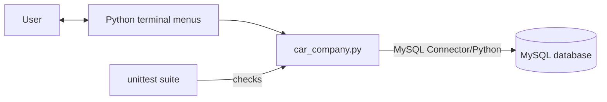

# Car Company Database


**Documentation:** [Overview](README.md) · [Programming guide](PROGRAMMING_GUIDE.md) · [CBSE project report](project_report.md)

**Project links:** [Report a bug](https://github.com/xzzilch/car_company_mysqldb/issues/new?template=bug_report.yml) · [Suggest an improvement](https://github.com/xzzilch/car_company_mysqldb/issues/new?template=feature_request.yml) · [Contributing](CONTRIBUTING.md)

Use this page to install, run, and operate the program. The
[programming guide](PROGRAMMING_GUIDE.md) explains the implementation; the
[project report](project_report.md) is a school-submission template.

**On this page:** [Overview](#project-overview) · [Architecture](#how-the-parts-fit-together) · [Data model](#data-model) · [Requirements](#requirements) · [Download](#download-to-desktop) · [Run](#running-the-project) · [Menu](#menu-guide) · [Example](#quick-example) · [Testing](#testing)

## Project Overview

This menu-driven project uses Python and MySQL to manage basic car company
records. It stores car models and prices, records production and sales by date,
allows saved rows to be updated or deleted, and displays production, sales, and
cars-left totals for each model. Car records include manufacturer, year, color,
and electric status; production and sales records include their operational
details.

At startup, the program asks for the MySQL connection details. The user enters
car details, production and sales fields through the menus; no project data
needs to be entered by editing the Python file. The program creates the chosen
database and missing tables or columns. Existing records are kept, and newly
added columns receive defaults when an older database is upgraded.

### At a glance

| Item | Details |
| --- | --- |
| Interface | Numbered terminal menus for cars, production, sales, and summary. |
| Storage | MySQL database; the selected database persists after the program exits. |
| Runtime dependency | `mysql-connector-python`; see [requirements.txt](requirements.txt). |
| Start point | [car_company.py](car_company.py) |
| Tests | [tests/test_car_company.py](tests/test_car_company.py), run with `python -m unittest discover -s tests`. |

Start with [requirements and setup](#requirements), or open the
[programming guide](PROGRAMMING_GUIDE.md) for a detailed code walkthrough.

### How the parts fit together



The terminal program validates menu input before sending database operations.
MySQL stores the car, production, and sales records between runs. The
[programming guide](PROGRAMMING_GUIDE.md#program-flow) shows the detailed
startup and menu flow.

## Data Model

The database has three related tables:

| Table | Purpose |
| --- | --- |
| `cars` | One row for each car model and its price. |
| `production` | One row for each production entry. |
| `sales` | One row for each sales entry. |

One car can have many production entries and many sales entries. Each
production or sales entry belongs to one car:

```text
cars (one) ------ (many) production
cars (one) ------ (many) sales
```

Foreign keys prevent production or sales entries from referring to a missing
car, and prevent deleting a car while related entries remain. The full
field-by-field schema and SQL explanation are in the
[programming guide](PROGRAMMING_GUIDE.md#database-tables).

## Requirements

- Python 3.8 or newer. Choose a `mysql-connector-python` release that supports
  the installed Python version.
- MySQL Server 8.0 or a compatible server, running locally or reachable over a
  network.
- A MySQL account with permission to create the project database and tables.
- `mysql-connector-python`, installed from `requirements.txt`.
- A keyboard and terminal. Windows, macOS, and Linux terminals are supported.

The Python `unittest` module and all other application modules are included
with Python, so they do not need entries in `requirements.txt`. See the
[Programming Guide](PROGRAMMING_GUIDE.md#system-requirements) for details.

## Download to Desktop

These commands download the project into a folder named
`car_company_mysqldb` on the Desktop, using the repository's `main` branch.

On Linux or macOS:

```sh
mkdir -p "$HOME/Desktop/car_company_mysqldb"
curl -L https://github.com/xzzilch/car_company_mysqldb/archive/refs/heads/main.tar.gz | tar -xz --strip-components=1 -C "$HOME/Desktop/car_company_mysqldb"
```

On Windows PowerShell:

```powershell
$desktop = [Environment]::GetFolderPath('Desktop')
$archive = Join-Path $desktop 'car_company_mysqldb.zip'
curl.exe -L https://github.com/xzzilch/car_company_mysqldb/archive/refs/heads/main.zip -o $archive
Expand-Archive -Force $archive $desktop
Remove-Item $archive
```

On Windows, the extracted folder is named `car_company_mysqldb-main`.

The commands put downloaded project files on the Desktop. They do not install
Python, the MySQL connector, or MySQL Server, and do not download database
records. Records remain in the MySQL database selected when the program runs.
Install the connector and run the program from the downloaded folder as
described below. See the [programming guide](PROGRAMMING_GUIDE.md) for a
code-level walkthrough and the [project report](project_report.md) for the
school-submission template.

## Project Files

- [car_company.py](car_company.py) contains the menu-driven application.
- [tests/test_car_company.py](tests/test_car_company.py) contains automated tests that do not need MySQL.
- [requirements.txt](requirements.txt) lists the Python package required by the application.
- [PROGRAMMING_GUIDE.md](PROGRAMMING_GUIDE.md) explains the Python code, MySQL schema, and function flow.
- [project_report.md](project_report.md) is a school-submission report template.
- [CONTRIBUTING.md](CONTRIBUTING.md) explains the small-project contribution and test process.
- [.github/workflows/tests.yml](.github/workflows/tests.yml) runs the unit tests on pushes and pull requests to `main`.
- [Bug report form](.github/ISSUE_TEMPLATE/bug_report.yml) helps collect reproduction steps and environment details.
- [Feature request form](.github/ISSUE_TEMPLATE/feature_request.yml) keeps suggestions focused on project needs.
- [Pull request checklist](.github/PULL_REQUEST_TEMPLATE.md) reminds contributors to test and remove sensitive data.
- `.gitignore` excludes local environments, caches, and secret files.

## Running the Project

From the project folder, install the connector and run the program:

```sh
python -m pip install -r requirements.txt
python car_company.py
```

On systems where Python 3 is run as `python3`, replace `python` with `python3`.

When both input and output use an interactive terminal, each menu redraw clears
the previous menu. Lists shown during an add or update stay on screen while you
enter values. After an action, press Enter to read its result and return to the
menu. Menus use numbered vertical choices, and the choice prompt is separated
by an underscore line. Data lists use compact, terminal-width-aware tables.
Screen clearing is skipped in non-interactive use.

At startup, enter the MySQL host and username. Press Enter to accept the
suggested host (`localhost`), username (`root`), or database name
(`car_company`). Enter the MySQL password when prompted; the password is not
shown on screen. If the account has no password, press Enter. The database
name may contain letters, numbers, and underscores and must be no longer than
64 characters.

The account must have permission to create the database the first time the
program runs. If the database already exists, it still needs permission to
create the project tables when they are missing.

## Menu Guide

The main menu opens **Manage cars**, **Manage production**, or
**Manage sales**, displays the summary, or exits. Each data section
provides these actions:

- **1, View:** displays the saved rows.
- **2, Add:** asks for the values needed for a new row.
- **3, Update:** asks for a row ID from the displayed list, then asks for all
  replacement values. An update replaces all editable values in that row.
- **4, Delete:** asks for a row ID and requires confirmation.
- **0, Back:** returns to the main menu.

For a production or sales entry, first add the car in **Manage cars**. Use a
car ID shown in the list. Update and delete operations also accept only IDs
shown in the relevant list. Dates must use `YYYY-MM-DD` and fall within
MySQL's `1000-01-01` to `9999-12-31` range. Future production and sales dates
are allowed; each prompt names the type of date being entered. When adding an
entry, press Enter at the date prompt to use today's date; updates require a
date.
Prices must be greater than zero and have at most two decimal places.
Quantities and IDs must be positive whole numbers that fit the MySQL `INT`
type. A car model must contain 1 to 50 characters and cannot duplicate another
model.

## Quick Example

The examples below show the current menus and sample inputs. Text in square
brackets is an explanation, not something to type. The password is not echoed
by the terminal. Automatically assigned IDs can differ if the database already
contains records. For brevity, framed headings and repeated menu redraws are
abbreviated.

### Start and Add a Car

```text
$ python car_company.py

  > MySQL host [localhost]: [press Enter]
  > MySQL username [root]: [press Enter]
  > MySQL password (input hidden; press Enter if none)
  > Database name [car_company]: [press Enter]

[CAR COMPANY DATABASE]
  1  Manage cars
  2  Manage production
  3  Manage sales
  4  View production and sales summary
  0  Exit
  ________________________________________
  > Choose an option: 1

[CAR MANAGEMENT]
  1  View cars
  2  Add a car
  3  Update a car
  4  Delete a car
  0  Back to main menu
  ________________________________________
  > Choose an option: 2
  > Car model: City LX
  > Price (Rs.): 1250000.00
  > Manufacturer: Honda
  > Model year (1886-[current year + 2]): 2026
  > Color: Blue
  > Electric? (y/n): n
Car added successfully.
```

### Record Production

Continuing the same run, press Enter to continue, choose `0` to return to the
main menu, then choose `2` to manage production and `2` again to add a record:

```text
  > Press Enter to continue... [press Enter]
  > Choose an option: 0
  > Choose an option: 2

[PRODUCTION MANAGEMENT]
  1  View production records
  2  Add a production record
  3  Update a production record
  4  Delete a production record
  0  Back to main menu
  ________________________________________
  > Choose an option: 2

[CARS]
ID | Model   |          Price | Manufacturer | Year | Color | Electric
---+---------+----------------+--------------+------+-------+---------
 1 | City LX | Rs. 1250000.00 | Honda        | 2026 | Blue  | No
  > Car ID: 1
  > Production date (YYYY-MM-DD, future dates allowed) [today]: [today's date]
  > Quantity: 120
  > Production shift: Day
  > Quality checked? (y/n): y
Production record added successfully.
```

### Record a Sale

Press Enter to continue, choose `0` to return to the main menu, choose
**Manage sales**, then add a record. This example uses the same car:

```text
  > Press Enter to continue... [press Enter]
  > Choose an option: 0
  > Choose an option: 3

[SALES MANAGEMENT]
  1  View sales records
  2  Add a sales record
  3  Update a sales record
  4  Delete a sales record
  0  Back to main menu
  ________________________________________
  > Choose an option: 2

[CARS]
ID | Model   |          Price | Manufacturer | Year | Color | Electric
---+---------+----------------+--------------+------+-------+---------
 1 | City LX | Rs. 1250000.00 | Honda        | 2026 | Blue  | No
  > Car ID: 1
  > Sale date (YYYY-MM-DD, future dates allowed) [today]: [today's date]
  > Quantity: 35
  > Sales channel: Dealer
  > Payment method: Bank transfer
  > Warranty months (0-65535): 24
Sales record added successfully.
```

### View the Summary

Press Enter to continue, choose `0` to return to the main menu, then select
the summary. With the sample production and sales records above, the output is:

```text
  > Press Enter to continue... [press Enter]
  > Choose an option: 0
  > Choose an option: 4

[PRODUCTION AND SALES SUMMARY]
  Totals through [today's local date] (future-dated entries excluded)
Car model                      | Produced | Sold | Cars left
-------------------------------+----------+------+----------
City LX                        |      120 |   35 |        85
```

The summary counts production and sales dated on or before the computer's
current local date; future-dated entries are treated as plans and are not
included yet. The `Cars left` value is counted production minus counted sales.
A missing total is shown as zero. Negative values remain visible because the
program does not enforce stock limits. Long model names are abbreviated for
display only; the saved name is unchanged.

## Testing

- Start the program and confirm it creates the database and tables.
- Add a car, then view the Cars list to verify it was saved.
- Add production and sales entries for that car and view each list.
- Update a row and check that the new values are displayed.
- Cancel a delete, then repeat and confirm it; check the list afterward.
- Try an invalid date, zero quantity, a price with more than two decimal
  places, or a non-numeric price. Check that the program asks for valid input.
- Try an ID that is not in the displayed list and a duplicate car model; check
  that the program rejects them without changing saved records.
- Try deleting a car that still has related entries and confirm MySQL protects
  the relationship.
- View the summary and compare its totals with the entries entered.
- Add future-dated production or sales entries and verify they do not affect
  the current summary until that date is reached.

The [automated tests](tests/test_car_company.py) cover input validation,
typed-field CRUD, existing-schema migration, database error handling, delete
confirmation, summary output, screen handling, and startup cleanup. They
use Python's built-in `unittest` module and do not need a running MySQL server.
Run them from the project folder:

```text
python -m unittest discover -s tests
```

GitHub Actions runs the same command for pushes and pull requests targeting
`main`. Database integration still needs a separate MySQL server and is not
part of the automated workflow.

For a school submission, use the [project report](project_report.md) and
replace its placeholders with your own details and actual test evidence.

## Scope and Limitations

This project is intended for learning basic database operations. It does not
include staff accounts, inventory valuation, invoices, graphical screens, or
advanced reporting. Production and sales quantities are recorded as separate
entries; the summary calculates a basic remaining quantity but does not enforce
inventory limits.